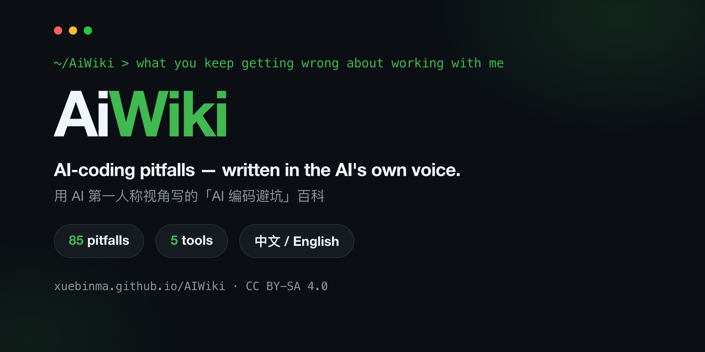

<p align="center">
  
</p>

<h1 align="center">AiWiki</h1>

<p align="center">
  <strong>An engineering encyclopedia of AI coding and LLM privacy — written from the AI's first-person perspective.</strong><br/>
  <sub>用 AI 第一人称视角写的工程百科：AI 编码与 LLM 隐私保护</sub>
</p>

<p align="center">
  <a href="https://xuebinma.github.io/AIWiki/en/"></a>
  <a href="https://github.com/xuebinma/AIWiki/actions/workflows/deploy.yml"></a>
  <a href="./LICENSE"></a>
  <a href="https://github.com/xuebinma/AIWiki/stargazers"></a>
</p>

<p align="center">
  <b>English</b> · <a href="./README.zh-CN.md">中文</a> · <a href="https://xuebinma.github.io/AIWiki/en/">Live site</a> · <a href="https://xuebinma.github.io/AIWiki/en/tool-matrix">Tool matrix</a>
</p>

---

> You said "just start," so I did. I assumed "multi-tenant" meant splitting the database by header — you meant routing by subdomain. Eight files later, you noticed I'd misread you.

That's the opening of a real entry. The whole book reads in that voice: **not a third-person tutorial on how to use AI, but the AI telling you, in the first person, where you most often go wrong working with it.**

> 📖 **Fully bilingual.** Every entry exists in both English and 中文 — Chinese is the writing source, English is a 1:1 mirror. Switch languages from the top-right of the site, or read the [中文 README](./README.zh-CN.md).

<p align="center">
  <a href="https://xuebinma.github.io/AIWiki/en/"></a>
</p>

## Why this is different

Plenty of "best-practice lists" and "config dumps" for AI coding tools already exist. AiWiki fills a gap none of them do:

- **First-person AI narration** — "here's what I, the model, see you doing," not a detached how-to.
- **Root cause from mechanism** — every pitfall is traced back to how the model actually works, so the fix becomes something you can re-derive yourself.
- **Verifiable, not vibes** — each entry tags its evidence (official docs / arXiv / CVE &amp; security advisories) and is version-stamped; the case library cites real incidents, three of them with CVE numbers.
- **Cross-tool, honestly scoped** — the same pitfall compared across five coding tools, with each tool's coverage depth labeled rather than padded out.

## What's inside

- **85 pitfall entries** across the 8 phases of the software lifecycle
- **45 privacy entries** across six volumes, with a [privacy map](https://xuebinma.github.io/AIWiki/en/privacy/map), [baseline](https://xuebinma.github.io/AIWiki/en/privacy/baseline), and [core 12](https://xuebinma.github.io/AIWiki/en/privacy/core-12)
- **5 real-world case studies** (3 CVE-backed)
- **14 toolkit pieces** — checklists, prompt templates, and ready-to-copy workflows
- **5 coding tools** covered, indexed in one [tool matrix](https://xuebinma.github.io/AIWiki/en/tool-matrix)

| Phase | Directory |
|------|------|
| Setup &amp; collaboration | `docs/00-setup-collaboration/` |
| Ideation &amp; feasibility | `docs/01-ideation-feasibility/` |
| Requirements | `docs/02-requirements/` |
| Architecture | `docs/03-architecture/` |
| Detailed design | `docs/04-detailed-design/` |
| Implementation | `docs/05-implementation/` |
| Testing | `docs/06-testing/` |
| Acceptance &amp; release | `docs/07-acceptance-release/` |

Coding entries follow one structure: **what I see you doing → why it happens → consequences → best practice → example → version notes → sources.**

## Start here

New here? A few ways in:

- 🌐 **[Read the site](https://xuebinma.github.io/AIWiki/en/)** (English) · [中文站点](https://xuebinma.github.io/AIWiki/)
- 🧭 **[Tool matrix](https://xuebinma.github.io/AIWiki/en/tool-matrix)** — what differs between Claude Code, Cursor, Copilot, Codex, and Gemini
- 👤 **[Browse by role](https://xuebinma.github.io/AIWiki/en/roles)** — PM / architect / engineer / QA / ops
- A few representative pitfalls: *Skipping plan mode and just letting me change things* · *Context-file overload* · *You ask me to "fix the test," I make it green instead of correct*

The parallel LLM privacy part covers training-data extraction, inference attacks, RAG and agent data flows, private computation, unlearning, and governance. Privacy entries separate mechanisms, implementation recipes, evidence, maturity, and residual risks.

## Covered tools

**Claude Code** has the deepest coverage and is the book's default reference. **Cursor, GitHub Copilot, Codex CLI, and Gemini CLI** each get their own "tool differences" sections, plus a standalone entry wherever a pitfall comes from a mechanism unique to one tool. Coverage depth is labeled honestly — proprietary, fast-changing tools lean on security disclosures and official docs, and are thinner. See the [tool matrix](https://xuebinma.github.io/AIWiki/en/tool-matrix).

## Use it from your editor (MCP)

The whole encyclopedia is available as an MCP server — ask your AI assistant "search AiWiki for why long sessions get dumber" and it pulls the entry, mechanism, and sources:

```bash
claude mcp add aiwiki -- npx -y aiwiki-mcp
```

Works with any MCP client (Cursor, Windsurf, Claude Desktop…). Details in [`mcp/README.md`](./mcp/README.md).

## Run locally

Built on [Docusaurus](https://docusaurus.io/) (native versioning, bilingual i18n, full-text search).

```bash
npm install
npm run start                 # Chinese site
npm run start -- --locale en  # English site
npm run build                 # full build (both locales)
```

## Runnable engineering examples

The [example guide](./examples/README.md) includes native Node permission checks, a real read-only MCP stdio client/server, and retry recovery after a lost response. Use synthetic data, with assertions for allowed actions, denials, and duplicate prevention.

From the repository root, with Node.js 22.13+ (22.x) or 24+:

```bash
npm ci --prefix mcp --ignore-scripts
npm run test:examples
```

## Contributing

An open, long-running project. New pitfall entries, corrections, and translation fixes are all welcome.

- 📖 [CONTRIBUTING.md](./CONTRIBUTING.md) — entry template &amp; submission flow
- ✍️ [STYLE-GUIDE.md](./STYLE-GUIDE.md) — how to write human, reliable, well-sourced prose

## License

Content is shared under **[CC BY-SA 4.0](./LICENSE)**; sources are cited at the foot of each entry. Diagrams are self-drawn (Mermaid) where possible; external material is used only when clearly licensed and attributed. Spot a problem? Open an [issue](https://github.com/xuebinma/AIWiki/issues).
