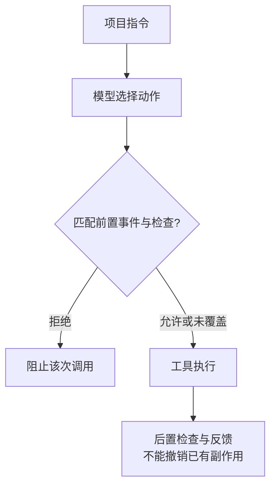

import PitfallMeta from '@site/src/components/PitfallMeta';

<PitfallMeta roles={['工程师', '运维工程师']} phase="准备与协作" severity="高" appliesTo="Claude Code（支持 hooks 的版本）" evidence="官方文档" />

> 一句话摘要：提示词能表达要求，但不能代替执行检查。把格式化等可机械判断的要求接到 hook 或 CI，同时测试事件覆盖、错误处理和绕过路径。

## 现象

我常看到你这样立规矩：在 CLAUDE.md 里写下「每次编辑后运行 `prettier`」「提交前先 `npm test`」「不要修改 `package-lock.json` 和 `.env`」，写得清清楚楚，然后就当这事办妥了。

前几轮我确实照做了。可会话一长，任务一多，你会发现：我改了三个文件却只格式化了一个；我直接提交，跳过了测试；甚至有一次，我「顺手」改了你明令禁止的 `.env`。你以为白纸黑字写下的就是铁律，但从我这边看，它们一直只是「我需要遵守的要求，但未被强制执行」，而不是「必然发生的事」。

## 为什么会这样

CLAUDE.md 提供持续指令，但不是强制执行层。指令可能被遗漏；这不表示它们没有优先级或允许我忽略，也不能推定压缩必然删除它们。

**command hook 的触发由客户端控制；检查正确性仍由实现决定。** 还要满足事件、matcher 和配置条件，并处理命令失败、超时及未覆盖工具。prompt / agent 类型 hook 会调用模型，语义判断不能统称确定性。

退出码的作用依事件不同：`PreToolUse` 的退出码 2 可以阻止该次工具调用；`PostToolUse` 时工具已经执行，不能追回副作用；`PermissionRequest` 的拒绝应按文档返回相应 JSON，不能套用统一的 exit 2 规则。



## 后果

- **该跑的没跑。** format/lint 漏执行，风格漂移悄悄进了仓库；测试被跳过，回归在更晚的阶段才暴露，增加排查成本。
- **该拦的没拦。** 「不要碰 `.env`」是我必须遵守的要求，但它不是访问控制规则；若没有其他控制，违反指令的调用仍可能执行。
- **不可复现的纪律。** 同一条规则，这次遵守、下次忽略，团队里没人能依赖它——若 CI 覆盖了对应问题，可能在更晚阶段才发现，把本可在本地秒级解决的问题，拖成一次失败的流水线。
- **CLAUDE.md 越写越长。** 你不断往里加「请务必……」来补偿我的不可靠，继续叠加指令未必补上执行检查，还可能增加维护负担。

## 最佳实践

1. **编辑后格式化。** 使用 `PostToolUse` 的 `Edit|Write` matcher。例如下面配置调用仓库内可信脚本；脚本须自行实现、审查并测试，不是仅复制配置就完成：

```json
{
  "hooks": {
    "PostToolUse": [{
      "matcher": "Edit|Write",
      "hooks": [{"type": "command", "command": "node \"$CLAUDE_PROJECT_DIR/.claude/hooks/format-file.cjs\""}]
    }]
  }
}
```

脚本从 stdin 解析事件 JSON，校验 `tool_input.file_path` 在允许项目范围内，以独立参数调用已安装的固定 formatter，并处理失败。不要把文件名经 `xargs` 或字符串拼接送进 shell；路径可能带空格或选项字符。

2. **前置拒绝与实际访问隔离配合。** 在 `PreToolUse` 校验目标路径，用文档规定的阻断返回值；测试 shell、其他写工具、符号链接和路径变化。路径正则不覆盖所有写入方式。command / HTTP hook 在多数事件中缺失、崩溃或超时通常会放行动作；Claude Code v2.1.295+ 可设 `onFailure: "block"`，并测试这些故障确实阻断。未配置时 Windows 无 Git Bash 等情况另有例外；旧版不能依赖这一字段，应使用外部访问控制。详见[失败处理](https://code.claude.com/docs/en/hooks#block-the-action-when-a-hook-fails)。
3. **提交与发布使用真正的闸门。** 运行与变更相称的检查，检查返回状态；CI 必须设为必需检查才构成合并闸门。测试超时或失败不能被当成通过。
4. **保留需要判断的项目指令。** 复用策略、风格取舍适合写进 CLAUDE.md；缺少 hook 事件时，也可用外部策略、权限或流程约束，而非只剩提示词。

## 示例

**改之前（写进 CLAUDE.md）：**

```text
# CLAUDE.md
- 每次改完代码后，请务必运行 prettier
- 提交前请务必跑 npm test
- 不要修改 .env

→ 实际发生：
我：改了 a.ts、b.ts、c.ts，只对 a.ts 跑了 prettier（漏了两个）
我：直接 git commit（忘了测试）
我：为了让构建过，顺手改了 .env（你明明说过不要）
```

**改之后（做成 hook）：**

```text
# .claude/settings.json 里：
# PostToolUse(Edit|Write) → 每个被改文件自动 prettier
# PreToolUse → 命中 .env 即 exit 2 否决；v2.1.295+ 配 onFailure: "block" 并测故障

我：改了 a.ts、b.ts、c.ts
harness：（三个文件逐一自动格式化，无需我记得）
我：尝试写入 .env
harness：exit 2，拦截 →「Blocked: .env matches protected pattern」
我：（收到反馈，改走配置注入，不碰 .env）
```

差别不在我变得更自律，而在于「必须发生」的那几件事，被移出了我的自觉范围，交给明确的事件处理器；还需验证它覆盖了实际工具路径并正确处理失败。

## 什么时候例外

「该做成 hook」的前提是「必须每次发生」。当这个前提本身不成立，留在提示词里反而是对的：

- **要求本身就是软的、靠判断的。** 「优先复用已有工具函数」「命名跟着模块走」——这类需要我当场权衡、偶尔可以变通的事，做成 hook 只会把合理的例外也一并拒掉，反而碍事。
- **规则还在快速变动、或只用一次。** 探索期天天改的临时约定、一次性脚本里的检查，hook 的维护成本（写、调、跟着改）高过它买到的那点可靠性，先写进提示词更划算。
- **没有对应事件。** 考虑将要求移到 CI、受控工具或服务端策略；若只能给提示，说明它没有机械强制保证。

判据一句话：**先问「漏一次会不会出事」——会出事且能挂上确定性触发点，做成 hook；不会出事、或根本挂不上钩，才留提示词。**

最后提醒两件写完 hook 之后才会遇到的事。它们不改变上面的结论，但决定你那道 hook 到底管不管用。

**一、它拦的是字符串，还是行为？** 用正则去匹配危险命令，两头都会歪：一段完全无害的文本——比如把某个危险命令的名字写进说明文字再输出到文件——会因为字面命中而被拦；反过来，把同一个标志拆成两截字符串再拼起来，或者把命令挪进一个脚本文件再执行，就绕过去了。字符串匹配挡的是「长得像」，不是「做了什么」。所以这类 hook 该按最坏情况设计（宁可误伤，也别漏），并且**别把它当成能挡住有意规避的边界**——它挡的是手滑。

**二、它读到的状态，未必是命令执行时的状态。** 拦截点跑在命令**之前**，所以它看到的是命令还没运行时的世界。一个典型后果：把暂存和提交写成一行（`git add -A && git commit ...`），检查会拿着**上一次**的暂存快照来评判，于是把你刚修好的那条违规又报一遍。判据：**让 hook 检查的对象，在 hook 运行时就已经处于最终状态**——分成两步跑，别指望它看见同一条命令里后面那一半。

## 版本说明

:::note 适用版本
2026-10-29 核对当前 Hooks reference。事件、退出码、模型 hook 和失败策略随版本变化；先在所用版本验证允许、拒绝与错误路径。不要把 hook 脚本自身的执行权限误当成受 Bash 沙箱保护。
:::

## 延伸阅读与出处

- [Hooks reference (Claude Code)](https://code.claude.com/docs/en/hooks)
- [Configure the sandboxed Bash tool (Claude Code)](https://code.claude.com/docs/en/sandboxing)
