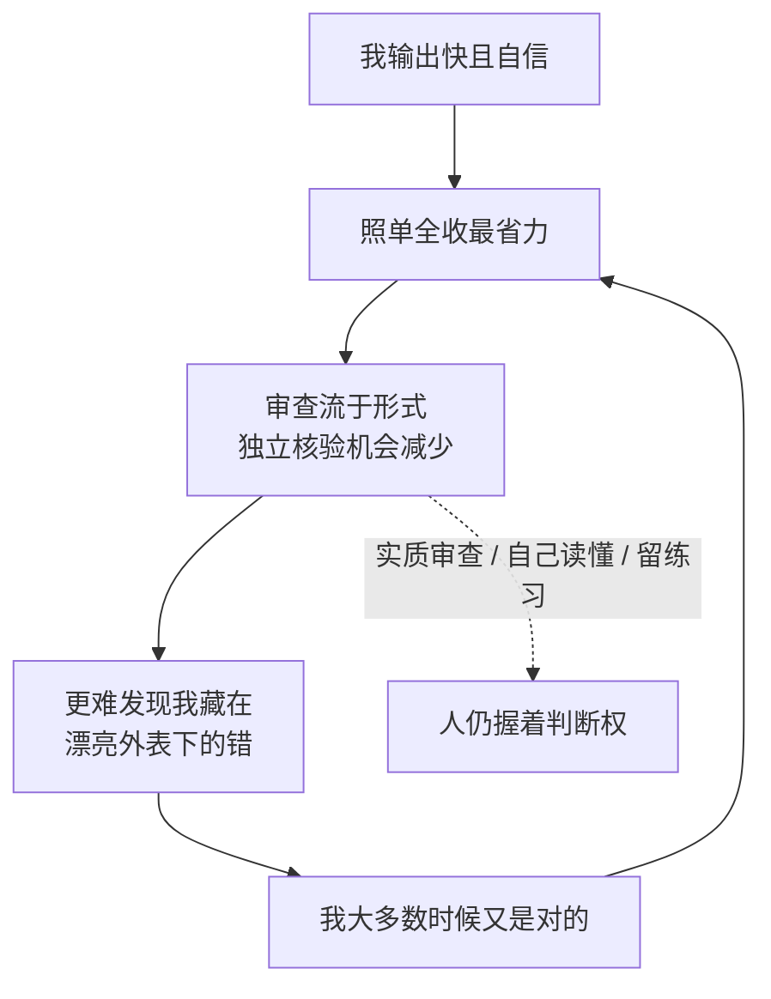

import PitfallMeta from '@site/src/components/PitfallMeta';

<PitfallMeta roles={['项目经理', '工程师', '架构师']} phase="准备与协作" severity="高" appliesTo="Coding Agent 通用" evidence="研究支持" />

> 一句话摘要：流畅的 AI 输出可能让独立核验减少。应按任务风险检查实际证据，并保留团队理解和恢复系统的能力；长期技能影响仍需要具体研究。

## 现象

刚开始你会逐行看我写的东西，时不时质疑一句。慢慢地，我没让你失望太多次，你就松了：我给的 PR 你扫一眼 diff 就合；我说「我已经测过了」，你就信；遇到不熟的模块，你直接把整个目录甩给我「你看着办」。

一种需要留意的情景是：核心代码持续由我修改，团队却没有同步建立理解；发生故障时，只能继续询问我。对新人而言，也应检查是否获得了独立定位和解释错误的练习，而不是假定使用 AI 就一定学不到。

这些是需要监测的工作流风险，不是这几篇研究共同证实的必然长期结果。我应提供可核对的依据，组织也应明确谁负责验收和恢复。

这和两条已有的误区方向不同，别混：

- 《[找我验证想法时，我会偏向支持你](../01-ideation-feasibility/sycophancy-idea-validation.mdx)》讲的是**我这一侧**——我倾向迎合你。本条讲的是**你这一侧**——你过度信任我，方向正好相反。
- 《[信任但不验证](../06-testing/trust-then-verify.mdx)》讲的是「我写的代码看起来对≠真的对」（针对产出本身）。本条讲的是审查流程是否保留独立证据（针对你的审查行为）。

## 为什么会这样

**自动化偏误是人类面对自动化系统时的天然倾向：系统给了个答案，人就倾向于接受它、放松独立核验。** 这不是你不够专业，而是一种被反复研究证实的认知捷径——尤其当系统大多数时候是对的、且答案来得毫不费力时，「再查一遍」的动力会持续走低（见 Springer 那篇自动化偏误综述）。

当我的输出流畅、完整、措辞笃定，却没有清楚标注证据与限制时，可能强化这种误判。一段写得漂亮、结构工整的代码，天然像「对的」；而我的错恰恰藏在这种漂亮里——一个边界没处理、一个安全假设不成立，外表看不出来。你越信「它一向靠谱」，就越不会去翻那层漂亮底下的东西。

证据需要分开看。METR 的 early-2025 随机试验涉及 16 名熟悉各自仓库的资深开发者、246 个任务，测得允许 AI 时完成时间增加 19%，而参与者事后估计提速约 20%。这说明该设置下感受与测量可能不一致，不证明今天所有人都会变慢，更不直接证明技能萎缩。

《Echoes of AI》在 151 人的两阶段实验中，未检出后续维护时间或代码质量的系统性劣化；认知债与长期技能影响被列为后续研究，不能写成既有结论。



## 后果

- **错误漏到下游。** 橡皮图章式审查等于没有审查——我那些「看起来对」的边界与安全问题，本该在你这关被拦，却被放行进了主干。
- **故障时你接不住。** 真出事、而我也卡住时，那个需要深入理解系统才能解的问题，落回你手里，但你对这套代码的心智模型已经空了。
- **团队能力空心化。** 新人用我跳过了基本功，资深的人荒废了手感。短期交付变快，长期可能缺少独立排错的练习机会；是否真的造成技能下降，需要纵向证据。
- **你连「依赖了多少」都估不准。** METR 说明特定设置下主观感受可能失准；依赖程度还需结合任务、缺陷、复查和恢复能力观察。

## 最佳实践

**核心一句：把「人在环上」做实，而不是做样子。我可以是杠杆，但判断权和理解必须留在你手里。**

- **实质审查关键改动，而不是扫一眼 diff 就合。** 对触及核心逻辑、安全、数据的改动，要求自己能讲清「这段为什么这样写、哪里可能出错」再合。读不懂就别合——读不懂正是风险所在。
- **逼我把依据摊开，用它来训练你的判断。** 别只要结论，让我列出简要依据与可核对证据、列假设、标不确定的地方（参见[只给单方案不给权衡](../03-architecture/single-option-no-tradeoffs.mdx)）；复杂任务可先看计划；简单可逆任务无需固定增加计划审批。你审的是论据，不是我的语气。
- **刻意保留「不用 AI」的练习空间。** 关键路径、新人成长期，刻意自己写一遍、自己 debug 一遍。将练习视为培养与评估能力的方法，不把外包必然导致萎缩当成已证实规律。
- **别把整个仓库甩给我让我替你思考。** 「省得自己想」是过度依赖最滑的入口。范围越关键，越要你自己先有判断，再用我去执行、去加速，而不是用我来代替判断。
- **团队层面立规矩。** 比如「AI 生成的代码必须有人能口头解释才算过审」「关键模块禁止纯 AI 改动直接合并」——把「人在环上」从自觉变成机制（同[该用 hooks 却只写提示词](./hooks-not-prompts.mdx)的思路：靠机制，不靠自觉）。

## 示例

**改之前：**

```text
你：（最近几个 PR 我都一次过，你放心了）
我：（提交一个 PR：顺手重构了鉴权中间件，diff 三百行，说"已测试"）
你：（扫一眼，绿的，合了）
两周后：线上鉴权偶发绕过——那段我"顺手重构"时改错了一个边界，没人读出来
```

**改之后：**

```text
你：这个 PR 动了鉴权，属于关键路径。先别给 diff，讲清楚：
    你改了哪些信任边界？哪种输入会让它失效？测试覆盖了哪些反例？
我：（列出改动的边界、假设、反例与覆盖情况）
你：（发现一个反例没覆盖，要求补测试并自己读懂那段后才合）
你：（核心鉴权改动列入"必须人能口头解释才过审"清单）
```

差别不在我这次写得更好，而在于你没有把「它一向靠谱」当成放行理由——你把判断权留在了自己手里。

## 什么时候例外

「人在环上」要做实，但不等于「每一行都得你亲手读懂」。把同样的审查强度铺到所有产出上，会把精力耗在不值得的地方。当代价被环境框死，减少审查强度可以合理，但仍应实际检查对应证据：

- **低风险、可逆、机器可验证的改动。** 可降低审查强度，但要核对检查覆盖和真实回退成本；“一次性脚本”本身不是低风险证明。
- **你不打算长期维护的产物。** 跑完即弃的分析、临时工具可以减少长期维护审查；仍需核对结果与持久副作用。

反过来，只要改动碰到核心逻辑、安全、数据，或会沉淀成你将来要维护的代码，例外立刻失效——回到实质审查、自己读懂再合。判据一句话：**决定要不要细审的，不是「我信不信得过它」，而是「它错了、撞到上限会怎样」——影响大或不可逆，就亲手把关；小且可逆，才可以省。**

## 版本说明

:::note 研究范围
METR 结果限 early-2025 的受测任务与工具。《Echoes of AI》当前 v3（2026-02-26）报告 late-2024 的助手式协作实验，早于当代 agent 形态，未发现其测量范围内系统性可维护性劣化。自动化偏误综述也跨多个领域；保留练习与风险分级是实践建议，不是全模型必然导致失能的证明。
:::

## 延伸阅读与出处

- [METR early-2025 developer productivity study](https://metr.org/blog/2025-07-10-early-2025-ai-experienced-os-dev-study/)
- [Exploring automation bias in human–AI collaboration](https://link.springer.com/article/10.1007/s00146-025-02422-7)
- [Echoes of AI (v3)](https://arxiv.org/html/2507.00788v3)
