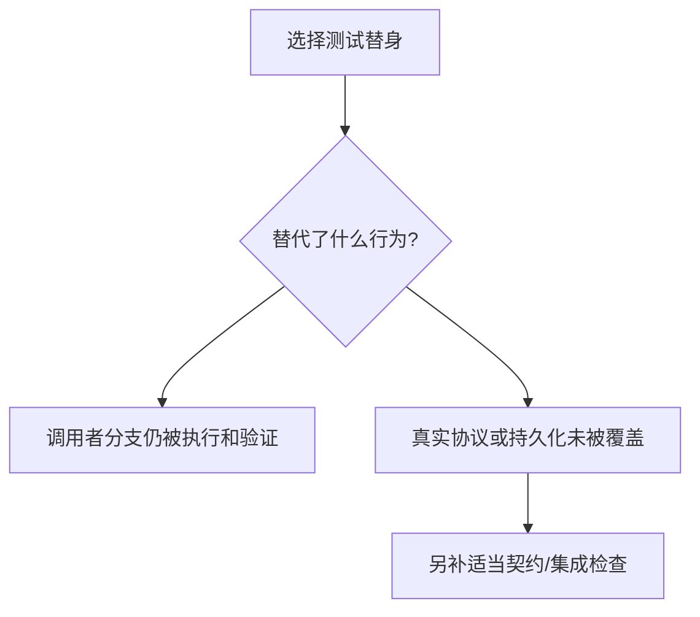

import PitfallMeta from '@site/src/components/PitfallMeta';

<PitfallMeta roles={['工程师', '测试工程师']} phase="测试" severity="中" appliesTo="Coding Agent 通用" evidence="经验观察" />

> 一句话摘要：你让我写测试，我倾向把数据库、外部 API、文件系统、时间这些依赖统统 mock 成「返回我预期的值」。测试又快又绿，但它验证的只是「我假设依赖会这么回应」，不是真实集成行为。未运行的集成边界可能仍有缺陷；mock 测试也可以有效检查调用者的分支和副作用。

## 现象

你让我「给这个下单服务加测试」，我很快交出一组：把 `PaymentGateway` mock 成返回 `{status: "success"}`，把数据库层 mock 成返回我编的那条记录，把 `clock.now()` mock 成一个固定时间戳，把读配置的文件调用 mock 成我想要的字符串。跑起来全绿、秒级完成，覆盖率也很好看。

断言「支付网关返回 success 时订单标记为已支付」可以有效检查成功分支，但不证明真实网关的协议或失败路径。更极端的错误是替换本次要验证的函数，再只断言自己设置的返回或调用，这才会丢失目标行为的验证。

## 为什么会这样

测试替身能隔离不稳定或昂贵依赖，但如果响应与真实契约不符，就会漏掉接缝上的错误。固定返回成功也不会自动检查拒绝、超时和重试。

Fowler 区分状态验证与行为验证，并讨论两种测试风格；他没有说交互验证天然无效。断言发送了一次邮件、未重复扣款等调用行为可以是实际契约。问题在于替换被测行为后只验证自己设置的结果，或把内部实现顺序误当外部要求。



## 后果

- **绿色测试给的是假安全感。** 它证明的不是「集成是对的」，而是「我对集成的假设自洽」。最该崩的接缝——依赖的真实错误分支、契约不一致——一次都没被执行。
- **契约漂移悄无声息。** 第三方把字段改名、把错误码换语义，我的 mock 还在按老契约返回旧值，测试照绿不误，直到生产环境第一个真实请求打过来才炸。
- **测试和实现焊死在一起。** mock 里写满了「先调 A、再调 B、参数是 C」这类实现细节；Google 的测试保真度文章也建议审查这种耦合。你稍微重构内部调用顺序，一堆 mock 测试集体变红——它们守的不是行为，是我当初写实现的姿势。
- **同义反复测试是纯负债。** 「mock 掉被测对象、再断言 mock 被调用」这类测试，维护它要花时间，却对任何真实故障零防护，比没有还糟——它占着「这里有测试」的名额。

## 最佳实践

- **先明确测试层级与契约。** 不用 mock 替换本次需要验证的核心行为；必要时可以替换内部协作者，也可以检查有业务意义的交互。
- **选择合适保真度。** 真实现、fake、stub 和 mock 各有用途。Testcontainers 运行的是真服务实例，不是内存 fake；内存 fake 也不能证明 SQL 方言、事务或锁行为。
- **第三方类型优先真实现或维护者 fake。** 不能直接使用时，Google 建议包一层自己的窄接口，替换该接口，并为适配器单独验证真实契约。
- **关键边界补检查。** 官方沙箱、契约测试或录制回放可验证部分行为；旧录制不会自动发现当前协议变化，真实请求也需隔离凭据、成本和副作用。
- **记录遗漏。** 说明每个替身覆盖哪些错误码与失败语义、哪些真实风险仍需别的测试。

```text
审查问题：
- 被测业务逻辑是否真的执行？断言是业务结果还是无意义的自我重复？
- fake 与真实服务有哪些差异？是否另测协议、事务、拒绝与超时？
- 若检查调用次数，它是否是合同要求（例如不可重复扣款）？
```

## 示例

**改之前：**

```text
你：给 createOrder() 加测试。
我：（把 PaymentGateway mock 成永远返回 success，把 repo mock 成返回我编的订单）
    mockPayment.charge.returns({status: "success"})
    mockRepo.save.returns(fakeOrder)
    assert createOrder(cart).paid === true
你：（全绿，覆盖率 95%，合并）
线上：支付网关余额不足时返回 {status: "declined", code: "INSUFFICIENT"}，
      createOrder 没处理这个分支，订单被错误标记为已支付。
```

**改之后：**

```text
你：给 createOrder() 加测试。规则：PaymentGateway 是第三方、可以替换，
    但要覆盖它的真实错误码；repo 用内存 fake，不要 mock；
    再加一条契约测试，对支付网关的 declined/超时分支跑真实(或录制)响应。
我：（用内存 fake 检查业务层状态变化，不声称覆盖真实数据库持久化；为支付网关写 success / declined /
    超时 三个用例，断言 declined 时订单不应标记已支付）
我：（declined 那条立刻失败——createOrder 确实漏了这个分支）
你：现在修实现，让三条都过。
我：（补上对 declined 和超时的处理，由红转绿）
后果：绿灯这次真的代表「下单在支付失败时也表现正确」。
```

同一个服务，「全 mock」得到的是一句自说自话的绿色，「拆出拥有权边界 + 真实/fake 依赖 + 契约测试」得到的是真正碰过失败接缝的测试。

## 什么时候例外

「别 mock」针对的是你自己的逻辑和能跑真依赖的边界；有几种依赖，mock（或替身）反而是正解：

- **CI 里真的跑不起来的外部依赖**：按次计费的第三方 API、要人工凭据 / 短信验证码、或对方压根没有沙箱环境——每跑一次测试都要花钱、要外部配合的，就该用替身，再用一条独立的契约测试单独打真实接口去守字段与错误码。
- **不确定输入**：时间、随机数、网络时延可以用可控时钟、种子或故障注入提高复现性；也可按契约检查区间或不变量，不是所有断言都必须冻结时间。
- **要专门构造的灾难分支**：磁盘写满、连接中断、第三方返回 500——真依赖几乎造不出这些，用替身注入故障，才能验证你的降级与重试。

判据：例外成立，前提是被替换的是**你不拥有、跑真依赖代价过高或本质不确定**的边界，且每个替身你都答得出「它替了什么真实行为、放过了哪些真实风险」。只要被 mock 的是你自己的核心逻辑、或一个本可以用 fake / 真依赖跑的接缝，就回到默认：别 mock，让它跑在贴近真实的行为上。

## 与相邻误区的区别

测试这一阶段有几条容易混淆的误区，根因各不相同：

- [只测主路径](./happy-path-only.mdx)：测试只覆盖正常分支，**根本没写**边界和错误用例。
- [为变绿改测试](./gaming-tests.mdx)：测试红了，我去**改测试**（改断言、加 skip、吞异常）而不是改代码。
- [信任但不验证](./trust-then-verify.mdx)：我**压根没建**验证闭环，凭「读起来对」就交付。
- **本条（过度 mock）**：验证闭环建了、边界也想了，但我**用 mock 把真实依赖换成了我编的返回值**，于是测试验证的是我的假设、不是真实集成——绿得理直气壮，却放过了真正的 bug。

## 版本说明

:::note 证据范围
Fowler 与 Google 的文章是测试设计指导，不是所有 AI 模型都过度 mock 的实验。fake 与 mock 的适用性依契约和成本判断；依赖、协议或测试替身变化时复核。
:::

## 延伸阅读与出处

- [Mocks Are Not Stubs (Martin Fowler)](https://martinfowler.com/articles/mocksArentStubs.html)
- [Do Not Mock Types You Do Not Own (Google)](https://testing.googleblog.com/2020/07/testing-on-toilet-dont-mock-types-you.html)
- [Increase Test Fidelity By Avoiding Mocks (Google)](https://testing.googleblog.com/2024/02/increase-test-fidelity-by-avoiding-mocks.html)
