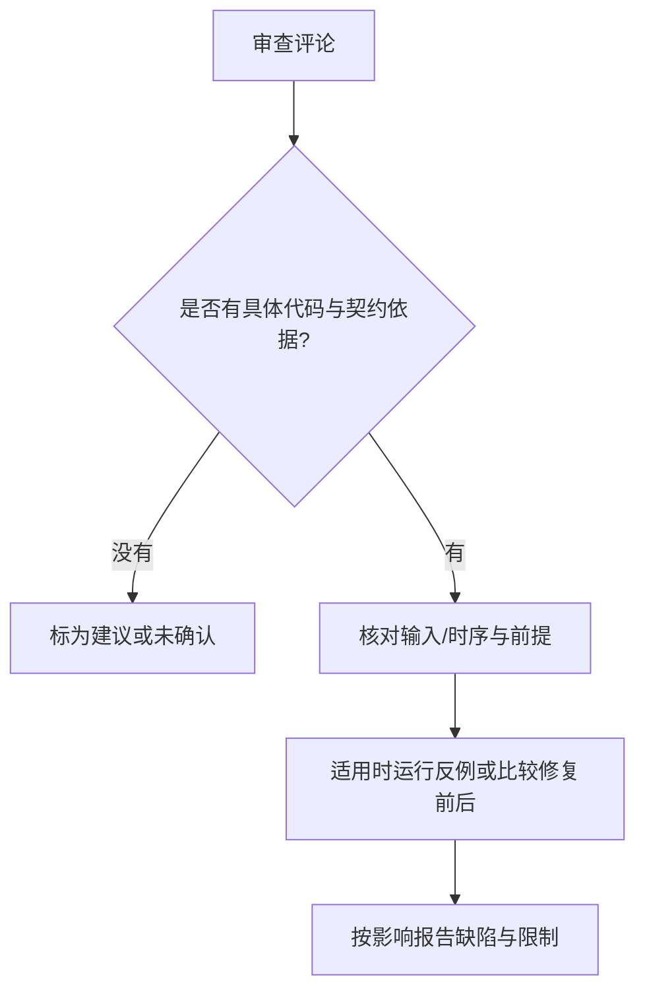

import PitfallMeta from '@site/src/components/PitfallMeta';

<PitfallMeta roles={['工程师', '测试工程师']} phase="测试" severity="高" appliesTo="Coding Agent 通用" evidence="研究支持" />

> 一句话摘要：你让我审 PR，我刷一屏「命名可以更好」「建议加注释」「这函数有点长」，看着很尽责。但那个并发下会丢数据的竞态、那个 off-by-one、那个没处理的错误码，我只字没提——我挑的全是表面，真正会出事的逻辑被我放过了。

## 现象

你把一个改动交给我审查。我很快回一长串评论：这里变量名不够语义化、那里缺一行注释、这个函数建议拆短、那段缩进风格不统一、这里可以用更「现代」的写法。条数很多，看起来我审得很认真。

但你真正担心的东西——这段并发代码在两个请求同时进来时会不会丢更新、这个分页逻辑在最后一页是不是会少一条、这个外部调用失败时有没有兜底、这个边界值会不会让数组越界——我一个都没碰。我审出了一堆**不疼不痒**的，恰好漏掉了**会让你半夜被叫起来**的那几个。

## 为什么会这样

容易看到的风格意见可能挤占审查注意力，而逻辑问题往往需要状态追踪、调用契约或并发反例。不能从输出风格直接推断我的训练动机，也不能说所有模型天生更会写而不会审。

SWR-Bench 当前论文评估真实 PR 上的审查评论，报告所测系统仍有不足，并观察到 ACR 工具更擅长检出功能错误。它没有建立所有生成模型的永久能力排序。

《Are LLMs Reliable Code Reviewers?》在所测需求符合性任务中发现正确实现可能被误判，要求解释和修复的更详细提示有时反而增加误判。因此“能讲出失败故事”仍是待核线索，应检查前提与可执行证据。



## 后果

- **「已严格审查」是假象。** 一份满是风格评论的报告，给团队的信号是「这段代码被仔细看过了」，而真正的高危缺陷一个没拦——比没审更危险，因为它让你放下了戒心。
- **作者的注意力被噪声占用。** 我刷的那些风格 nits 会把作者的精力引去改命名、加注释，反而冲淡了「这里逻辑对不对」这个真问题。
- **风险与产出倒挂。** 我评论最多的地方往往是最无关紧要的地方；最该被拦下的改动，恰恰是逻辑最绕、我最容易放过的那种。

## 最佳实践

**把审查的注意力按风险排序：正确性、安全、边界优先；风格交给确定性工具，别浪费我的深推理预算在它上面。**

- **风格让 formatter / linter 去管。** 缩进、格式、未用变量可由明确规则检查；命名语义和可读性仍可能需要判断——交给 Prettier、gofmt、ESLint、Ruff 这类工具，让它们在 CI 里把关。别把我的审查算力花在机器能秒判的事上，腾出来对付机器判不了的逻辑。
- **用清单逼我覆盖逻辑维度。** 给我一份审查清单，强制逐条回答：边界值（空、零、最大、负数）处理了吗？错误 / 失败分支兜底了吗？并发 / 重入安全吗？跨文件的调用契约还成立吗？——把开放式的「有问题吗」换成必须逐项过的硬骨头。
- **要求我给可复现的失败路径，而不是泛泛意见。** 对每个我声称的缺陷，让我写出「什么输入 / 什么时序会触发它」。无法给出触发路径时标为未确认；即使能给出，也要核对其前提、真实代码路径和可能的测试证据，避免虚构反例。
- **让我对最坏情况负责。** 对关键改动，逼我回答一句「这段代码在最坏情况下会怎么坏」——这把我从「找几个表面毛病」推向「主动设想它如何失效」，正是审查该干的事。

```text
可放进 CLAUDE.md 或审查提示里的优先级：
- 风格 / 格式 / 命名 → 交给 formatter + linter，AI 审查不重复劳动。
- AI 审查只盯：正确性、边界、错误处理、并发、安全、跨文件契约。
- 每条缺陷必须附「可触发它的输入 / 时序」，否则视为未确认。
- 关键改动追问一句：最坏情况下它怎么坏？
```

## 示例

**改之前：**

```text
你：review 这个 PR（给账户扣款加并发处理）。
我：1) balance 命名建议改 currentBalance；2) 这个函数有点长，建议拆分；
   3) 建议给 deduct() 加文档注释；4) 第 12 行缩进风格不统一。
你：（照着改了命名和注释，合并）
线上：两笔扣款并发到达，读到同一个旧余额、各自扣减、后写覆盖先写 → 钱少扣了一次。
      而这个竞态，我一个字都没提。
```

**改之后：**

```text
你：review 这个 PR。风格交给 linter，你只看：并发安全、边界、错误分支；
   每条问题给出能触发它的具体场景。
我：⚠ deduct() 是 read-modify-write，无锁 / 无乐观并发控制：
   两个请求同时读到 balance=100、各扣 30、后写覆盖先写 → 最终 70 而非 40。
   触发场景：同一账户两笔并发扣款。建议加行级锁或 CAS 重试。
   ⚠ 余额恰好等于扣款额时走的是 <= 还是 <？若拒绝条件写成 `if balance <= amount: reject`，会拒绝合法的全额扣款；在允许余额归零的契约下应核对是否改为 `<`。
你：（这两条才是真会出事的，先修它们）
```

同一个 PR，「开放式让我审」刷来一堆风格噪声、漏掉竞态；「按风险排序 + 要求可复现路径」把我逼到真正的逻辑缺陷上。

## 什么时候例外

纯格式或文案改动，可读性本身就是审查目标。已有测试可以调整审查重点，但测试和类型检查不自动覆盖全部逻辑；高风险变更仍需核对新假设与未覆盖路径。没有 linter 时，人工或 AI 指出明显格式问题也有价值，报告时应与缺陷分开。

## 与相邻误区的区别

- [只看 diff 的上下文饥饿审查](./context-starved-review.mdx)：那条是我**没拿到**仓库上下文，巧妇难为无米之炊；本条是我**拿到了**也不往深里挖，专挑表面省事——一个是缺料，一个是缺力。
- [只测主路径不测边界](./happy-path-only.mdx)：那是我**写测试**时只覆盖正常分支；本条是我**审代码**时只挑表面问题。同源的「避重就轻」，发生在不同工序。
- [信任但不验证](./trust-then-verify.mdx)：那是压根没建审查 / 验证；本条是审查建了、却审在了无关紧要的地方。

## 版本说明

:::note 研究范围
2026-10-29 核对两篇论文当前题名与摘要。基准结果限受测模型、任务、上下文和判定方法；不能用它们证明跨版本永久短板。模型、基准或审查流程变化时复核。
:::

## 延伸阅读与出处

- [SWR-Bench: Assessing LLM Performance in Real-World Code Review Comment Generation](https://arxiv.org/abs/2509.01494)
- [Are LLMs Reliable Code Reviewers? Systematic Overcorrection in Requirement Conformance Judgement](https://arxiv.org/abs/2603.00539)
