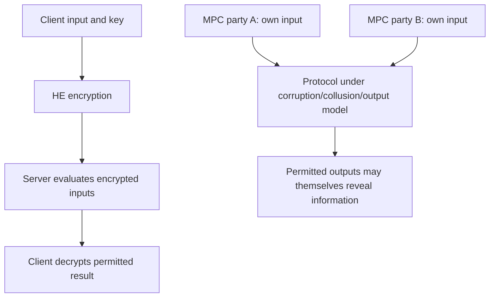

import PrivacyMeta from '@site/src/components/PrivacyMeta';

<PrivacyMeta era="Volume 1 · Privacy foundations" technique="Privacy-preserving computation" audience={['Privacy Engineer', 'Security Engineer', 'ML Engineer']} severity="Medium" maturity="Experimental" evidence="Research" />

> In one sentence: homomorphic encryption lets a key-holding client outsource computation on encrypted inputs; MPC lets parties compute jointly under a protocol. Confidentiality depends on cryptographic assumptions, parameters, and corruption models, with endpoints, keys, and implementations still trusted. Permitted outputs can reveal inputs. Performance depends on scheme, circuit, and communication rather than one overhead multiplier without a matched benchmark.

## Mechanism: what happens on my side

An HE server evaluates encrypted inputs and returns encrypted results for client decryption. Gentry’s 2009 first fully homomorphic scheme uses bootstrapping to manage noise and support deeper circuits; encoding, approximation, and correctness require scheme-specific analysis. MPC participants already know their own inputs. Secret sharing, garbled circuits, and related techniques constrain their views under a specified model beyond their own inputs and permitted outputs. Red line: functional correctness tests do not prove cryptographic security, and HE input confidentiality does not automatically establish correct results from a malicious server.



## Threat surface

HE input confidentiality does not cover compromised key-holding endpoints, metadata not covered by the analysis, or output use. Semi-honest MPC does not automatically provide malicious security; check collusion, dropout, fairness, and guaranteed output delivery for the protocol. Even correct secure computation can produce a function output that determines another input with auxiliary knowledge, without violating a definition permitting that output.

## How the defense works

HE/MPC do not use remote execution hardware as the sole confidentiality root, while still relying on local hardware, randomness, libraries, and key management. If the objective also bounds a record’s contribution to statistical output, separately design a DP mechanism with units, adjacency, budget, and composition. Arbitrary functions cannot simply receive a little noise, and DP does not promise zero disclosure.

## Buildable recipe

```text
1. Define input holders, permitted outputs, and adversary; choose HE outsourcing or an MPC protocol
   with explicit corruption/collusion/dropout assumptions.
2. Fix scheme, parameters, security estimator, library, keys/randomness, and endpoint responsibilities.
3. Check approximate-arithmetic error; verify integrity separately for malicious HE servers and
   fairness/output delivery for MPC.
4. Benchmark latency/throughput/bandwidth for actual circuit, scale, communication, and bootstrapping.
5. Assess permitted outputs and auxiliary knowledge; independently check DP units/budgets if selected.
```

**Minimal testable assertion**: results match plaintext computation within declared error, parameters/protocol models receive independent review, and output recipients are authorized. Tests support those implementation checks, not a security proof. Failed tested attacks do not establish absence of leakage.

## Real cases / engineering feasibility

Gentry provides the FHE foundation and Evans et al. a systematic MPC introduction. Neither certifies latency or security for a 2026 LLM deployment. Private-inference feasibility requires measurements for model, precision, communication, and key responsibilities, rather than extrapolating full-scale production from early prototypes.

## Residual risk and trade-offs

Party views, permitted output, correctness, and availability are distinct goals. Communication rounds, ciphertext expansion, deep circuits, and approximation may become bottlenecks; measure their actual magnitude. Encryption does not automatically remove contractual or personal-data obligations, and this entry does not certify a jurisdiction-specific outcome.

## How this differs from neighboring techniques

[TEE](./trusted-execution-environment.mdx) relies on hardware isolation, attestation, and approved software; HE/MPC rely on cryptographic protocols with endpoint trust. [DP](../03-conversational-llms/dp-fine-tuning.mdx) bounds a defined unit’s distinguishability in releases, distinct from hiding intermediate computation views. Combine them when the objectives require it.

## Version notes

:::note Applicable versions
Checked the FHE foundation and author-maintained MPC book repository on 2026-10-29. The direct book PDF timed out; protocols were not re-proved and concrete deployments were not certified. No universal multiplier is given without a matched primary benchmark. Review by 2027-04-29, earlier for schemes/estimators, corruption models, implementations, or workload benchmarks.
:::

## Further reading and sources

- [Gentry: Fully Homomorphic Encryption Using Ideal Lattices (STOC 2009)](https://research.ibm.com/publications/fully-homomorphic-encryption-using-ideal-lattices)
- [A Pragmatic Introduction to Secure Multi-Party Computation: author repository](https://github.com/evansuva/pragmaticmpc)
