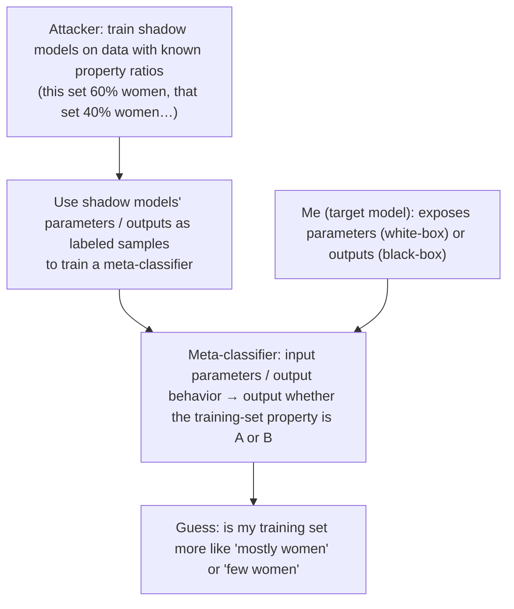

import PrivacyMeta from '@site/src/components/PrivacyMeta';

<PrivacyMeta era="Volume 1 · Privacy foundations" technique="Inference attacks (MIA / inversion / attribute)" audience={['Privacy Engineer', 'ML Engineer', 'Security Engineer']} severity="Medium" maturity="Research" evidence="Research" />

> In one sentence: this entry isn't about deciding whether someone is in (membership inference) or rebuilding a specific sample (inversion) — it's about extracting a **statistical property** of my whole training **set**: "what fraction of women / a given ethnicity was this model trained on." Ganju et al. (CCS 2018) did exactly this with a **meta-classifier**: on US Census Income data, it distinguishes training sets that are **38% vs 65% women** and **0% vs 87% white**. Suri & Evans (PoPETs 2022) then **formalized** it as "distribution inference" and gave the `n_leaked` metric to quantify the risk. Conclusion first: **the population makeup of a training set can itself be sensitive** (trade secret / group privacy) — don't focus only on protecting a single individual; sometimes the attacker doesn't want any one record at all.

## Mechanism: what happens on my side

My **parameters** and **output statistics** mathematically carry traces of the training set's **overall distribution** — not any one record, but "what this batch of data looks like." An attacker exploits this by training a **meta-classifier**: its input is my parameters (white-box) or my output behavior (black-box), and its output is "is this model's training set more like A or B" (e.g. "women a majority or a minority").

Concretely, Ganju et al.'s (CCS 2018) white-box approach: a fully connected network's (FCNN) neurons have **permutation invariance** — reorder the neurons within a layer and the function is unchanged, yet the **arrangement of the raw weight vector** changes. Feeding the weights directly to a meta-classifier drowns it in this meaningless permutation noise; they instead feed a **representation that is invariant to neuron permutation** (map each neuron's parameters to features, then aggregate within a layer in a permutation-invariant way), so the meta-classifier learns to read a training-set property out of "a layer's overall parameter distribution." The attacker first trains a batch of "shadow models" on data with **known property ratios** (this set 60% women, that set 40% women…), uses their parameters as labeled samples to train the meta-classifier, and once it's trained, runs it once against my parameters to get a guess at my training set's ratio.

To be clear about the red line: it's not "I know what fraction of women is in my training set / I remember this batch's makeup" — I can't introspect my training set's ratio. What's externally recomputable is that **my parameter / output statistics vary with the training set's population makeup — enough for an attacker to train a meta-classifier that tells different makeups apart**.



## Threat surface: what can be inferred, and what the attacker needs

**Can be inferred**: the training set's **aggregate / population property** — the **ratio / makeup** of some sensitive feature (what fraction women, the share of an ethnicity, the share of a region's samples, the positive/negative class ratio), not any specific record. What Ganju et al. distinguished on Census Income data is **overall-makeup** differences like 38% vs 65% women, 0% vs 87% white.

**Attacker model / prerequisites** (these decide feasibility — spell them out per BACKLOG-privacy.md "classification checklist"):

- **White-box vs black-box**: Ganju et al. study parameter access; later attacks query outputs. Empirical strength depends on the method and adversary knowledge, so black-box is not always weaker than a tested white-box attack.
- **Can train shadow models**: the attacker needs to train same-architecture shadow models on data with **known property ratios** (knowing or approximating my training pipeline and architecture).
- **Binary / distinguishing**: the classic setting is **distinguishing two makeups** (A vs B), not reading out a continuous ratio directly; estimating "exactly what percent" is harder and depends heavily on the ratio range the shadow models cover.
- **Success criterion**: the meta-classifier's **distinguishing accuracy** on held-out target models — and (see below) the `n_leaked` Suri & Evans convert it into.

## How the defense works

Distribution-inference risk arises when a model observably depends on training-set composition, but a particular sensitive property need not be encoded or leaked. Measure the relevant task and evaluate resampling, training, and release controls; learning useful patterns does not imply that every group property is inferable.

Given that, what you *can* do is **raise the attack cost and shrink the leakage**:

- **DP helps somewhat, but it's aimed at the wrong target**: DP bounds a **single sample's** influence on parameters, which is directly effective against attacks "targeting an individual in training" (membership inference / individual inversion); but distribution inference wants the **overall makeup**, an aggregate that DP's individual-level guarantee **doesn't directly cover** — don't treat DP as a silver bullet for distribution inference. (DP mechanism: [DP fine-tuning](../03-conversational-llms/dp-fine-tuning.mdx).)
- **Control parameter exposure**: release weights or host an API as needed, and test white-box / black-box attacks separately. Distillation and quotas may change risk; secure aggregation protects individual updates in transit, not group information in the final model.
- **Quantify with `n_leaked`, not gut feel**: Suri & Evans (PoPETs 2022) convert "the meta-classifier's distinguishing accuracy" into an intuitive quantity — **how many records the adversary would need to sample directly from the population distribution to match that distinguishing power**. This turns an abstract "attack success rate" into "equivalent to leaking N samples," easy to align with your asset sensitivity.

## Buildable recipe

```text
1. First identify the exposure surface: is your model open weights / federated
   parameter exchange (white-box), or API-only (black-box)? Distribution-inference
   test both white-box and black-box signals — treat "must we publish weights?" as a privacy
   decision, not an engineering default.

2. Put "training-set population makeup" on the asset list: it may be a trade secret
   (data-source composition) or group privacy (a sensitive attribute's ratio). Don't let
   your threat model only say "protect a single record."

3. Run a distribution-inference red team (distinguishing): train shadow models with
   known ratios + a meta-classifier, and assess "under your exposure surface (white-box /
   black-box), can it distinguish the two makeups you care about (e.g. 30% vs 70% of some
   attribute)." For white-box, reference Ganju et al.'s permutation-invariant approach.

4. Report risk with n_leaked, not just an accuracy: convert the meta-classifier's
   distinguishing power into "equivalent to the attacker sampling how many records"
   (Suri & Evans). For a fixed property-ratio pair and attack conditions, higher distinguishing accuracy means larger n_leaked and more equivalent information leakage.

5. Tighten the exposure surface: distill / expose only an API / add secure aggregation
   where you can, pushing white-box back to black-box. Stacking DP weakens individual-
   level attacks, but state honestly in privacy evals that "DP doesn't directly cover
   distribution inference" — don't promise zero.
```

Every conclusion is tied to **your model architecture, exposure surface, and the property you care about** — a paper's distinguishability on Census data **doesn't transfer** to your setup.

**Minimal testable assertions** (turn distribution-inference risk into a regression check):

- How to test: train a batch of shadow models with known property ratios + a meta-classifier, and under your real exposure surface (white-box parameters / black-box outputs) measure the meta-classifier's distinguishing accuracy for "the two population makeups you care about," then convert to `n_leaked`.
- Pass: with the property-ratio pair, prior, model, and access mode held fixed, distinguishing accuracy and its confidence interval meet the threshold and equivalent `n_leaked` is low. This measures distributional information, not a count of recovered records; do not rank different ratio pairs solely by this value.
- Fail: the two compositions are distinguishable under the stated conditions and equivalent `n_leaked` exceeds the tolerance → record the group leakage, evaluate resampling / release controls, and retest. Secure aggregation hides individual updates; it does not automatically remove group-property signals from the final model.

## Research status (engineering feasibility)

(This entry's maturity is "Research": below is **empirical-attack / formalization** evidence, tightly bound to the experimental datasets and settings — not an endorsement that "any model can be casually read for its training-set ratio.")

- **Reading a training set's population makeup out of a fully connected network (white-box)**: Ganju et al. (ACM CCS 2018) proposed property inference via a meta-classifier exploiting FCNN **permutation invariance**; on US **Census Income** data it distinguishes training sets that are "**38% vs 65% women**" and "**0% vs 87% white**" — revealing that "sharing the weights of a model trained on a sensitive population leaks that training data's population makeup." (This entry does not cite a single top-line accuracy figure: that number was not verifiable; we describe only the setup and the makeup conditions it distinguishes.)
- **The correct direction of `n_leaked`**: Suri & Evans (PoPETs 2022) use the equivalent number of direct samples from the candidate distributions needed to match the attack’s distinguishing power. For fixed candidate distributions, higher values mean more distributional information leaked by the model. This is neither an extra sampling cost the attacker must pay nor a count of recovered records. Their 95%-accuracy examples give approximately 3 for ratios 0.5 vs 1.0 and 42 for 0.5 vs 0.52; differing ratio separations prevent a simple cross-task ranking.
- (Founding thread: meta-classifier property inference traces back to Ateniese et al., "Hacking Smart Machines with Smarter Ones," Int. J. Security and Networks 2015; the two papers above advanced it to neural networks and to formal quantification. Verify the latest literature before citing specific enhancements.)

## Residual risk and trade-offs

Breaking the false security item by item:

- **Statistical intuition is not an impossibility proof.** Leakage of a property depends on the task, data, and mechanism. Measure explicit property pairs without promising absolute safety or claiming mitigation impossible.
- **DP is not the silver bullet here.** DP gives an **individual-level** guarantee; distribution inference wants the **aggregate makeup** — the targets don't coincide. Stacking DP weakens individual attacks, but don't treat it as the cure for distribution inference.
- **Access mode alone is not a risk ranking.** Parameter access adds information, but a particular white-box attack can be weaker than a better black-box method. Compare with model, knowledge, and budget held fixed.
- **"Population makeup" is also an asset to protect.** It may be a trade secret (data sources) or group privacy (a sensitive attribute's ratio). Defending only "a single record" misses this whole class of risk.
- **Numbers depend on the setting.** Ganju’s ratios come from a particular Census task; the 3 / 42 examples for `n_leaked` come from specified candidate ratios and 95% accuracy. They are not record-leak counts for arbitrary models.

## How this differs from neighboring techniques

Make the "**individual vs population**" axis explicit — it's the fundamental boundary between this entry and its two neighbors:

- **vs [Membership inference](./membership-inference.mdx) (this volume)**: membership inference asks "is **one specific individual in or out** of the training set" (a yes/no bit); this entry asks "what is the **whole set's** population makeup" (an aggregate property). The former is individual-level, the latter population-level — both on the "inference attacks" board, but the unit of leakage differs.
- **vs [Model inversion & attribute inference](./model-inversion-attribute-inference.mdx) (this volume)**: there, "attribute inference" infers **one individual's** undisclosed sensitive attribute (this person's genotype), or rebuilds a **class's representative sample**; this entry infers the **whole training set's** population property (what fraction women). One lands on the **individual**, the other on the **population** distribution — both names carry "attribute," but the unit they act on is the opposite, so don't conflate them.

## Version notes

:::note Applicable versions
Corrected the direction of `n_leaked` and the acceptance criteria against the original paper on 2026-10-29. Also checked Dissecting Distribution Inference (SaTML 2023): its black-box attack outperforms the earlier white-box attack in most evaluated settings, and resampling can help. Thus “white-box is always stronger” and “every property must leak” are not universal conclusions. Review by 2027-04-29, earlier for changed adversary knowledge, property ratios, or release modes.
:::

## Further reading and sources

- [Property Inference Attacks on Fully Connected Neural Networks using Permutation Invariant Representations (Ganju et al., ACM CCS 2018)](https://dl.acm.org/doi/10.1145/3243734.3243834) — white-box property inference: a meta-classifier exploiting FCNN permutation invariance distinguishes a training set's population makeup on Census Income data (38% vs 65% women, 0% vs 87% white). This entry's primary source.
- [Formalizing and Estimating Distribution Inference Risks (Suri & Evans, PoPETs 2022)](https://arxiv.org/abs/2109.06024) — defines distribution inference and equivalent `n_leaked`; larger values mean more equivalent information leakage.
- (Foundational, optional) Ateniese et al., "Hacking Smart Machines with Smarter Ones" (Int. J. Security and Networks 2015) — the origin of meta-classifier property inference.

- [Dissecting Distribution Inference (SaTML 2023)](https://arxiv.org/abs/2212.07591)
