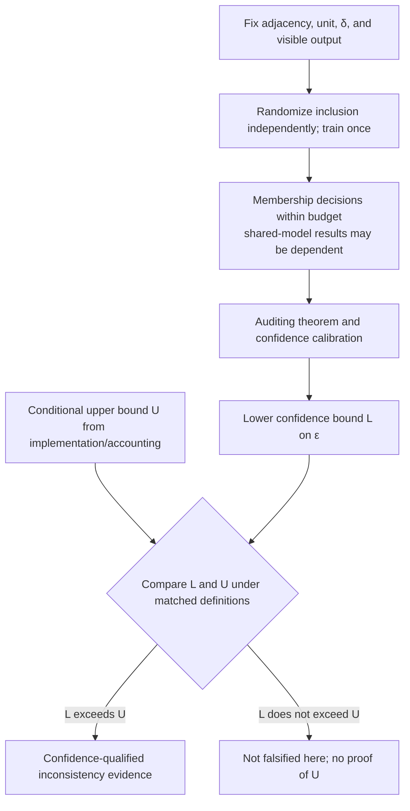

import PrivacyMeta from '@site/src/components/PrivacyMeta';

<PrivacyMeta era="Volume 2 · Memorization and extraction" technique="Privacy evaluation & auditing" audience={['Privacy Engineer', 'ML Engineer', 'Security Engineer']} severity="Medium" maturity="Research" evidence="Research" />

> In one sentence: DP auditing uses controlled attacks such as membership inference to construct a **statistical lower confidence bound** on ε for specified adjacency and δ, looking for counterexamples to a claimed upper bound. It neither supplies a formal upper bound nor certifies the implementation. One-run audits independently randomize canary inclusion, but **privacy losses / decisions from a shared trained model are not thereby independent**; use the appropriate calibrated theorem.

## Mechanism: what happens on my side

Post-training membership distinguishability is externally testable, unlike my self-report of “who I remember.” Fix privacy unit, dataset adjacency, δ, observable output, and confidence level, then translate attack results into an ε lower bound L. Statistical audit error and δ in the DP definition are distinct quantities, not one generic failure probability.

Steinke, Nasr, and Jagielski (NeurIPS 2023) independently include / exclude canaries within one run and analyze results using the connection between DP and statistical generalization. Each canary is not an independent training run. Scores can be correlated through the shared model; naive independent-Bernoulli formulas do not replace the method’s calibration.



## Threat surface: capabilities and blind spots

- **L above the claimed bound**: with calibrated confidence and matched adjacency / δ / visible output, this is evidence to investigate. Check audit code, selection, and multiple comparisons too; it does not identify a particular clipping bug.
- **L far below U**: a loose theoretical bound, weak attack, limited observation, or lower actual leakage could explain the gap. The gap alone cannot establish implementation correctness or error. **It is not additional bug evidence**.
- **L close to U**: the tested attack approaches the analyzed bound; this is not a security proof or implementation certification.
- **Access and canaries**: intermediate gradients, final parameters, and API-only outputs expose different views. An audit with a stronger view than the release covered by a DP claim cannot directly refute that release’s claim.

## How the defense works

Implementation review and complete privacy accounting supply a conditional formal upper bound; auditing seeks behavioral counterexamples. Statistical tests can err, and adaptive threshold selection, repeated audits, or choosing the best result affect confidence calibration. Record selection rules; do not select attacks and report unadjusted significance on the same observations.

## Buildable recipe

```text
1. Pin mechanism, adjacency, unit, δ, visible output, analyzed upper bound U, and audit confidence.
2. Use synthetic traceable canaries without real PII, independently randomizing inclusion as required;
   retain the actual training implementation being audited.
3. Fix scorer, threshold selection/abstentions, attack budget, and statistical procedure;
   separately record adaptive selection.
4. Compute lower confidence bound L with the matching theorem; report canary count,
   inclusion randomization, δ, and confidence level.
5. Compare L and U; investigate training, accounting, and audit if inconsistent.
   Otherwise record no counterexample found.
```

**Minimal testable assertion**: the audit procedure has its claimed coverage on known mechanisms / controls, and L and U use matching adjacency, δ, and views; no bound violation appears under the predefined multiple-comparison policy. Passing is an empirical gate, while formal guarantees require full mechanism analysis. L need not always approach U, and a stronger attack increasing L is not automatically failure.

## Research and engineering feasibility

- **NeurIPS 2020 DP-SGD auditing**: poisoning constructs high-impact samples and repeated mechanism runs estimate privacy lower bounds, providing an attack-based checking approach.
Selecting attack parameters, thresholds, or repeated audits by the best result requires corresponding selection/multiple-testing calibration. Per-trial confidence does not automatically apply to the final selected claim.

- **One-run auditing (NeurIPS 2023)**: in the white-box CIFAR10 / WideResNet experiment allowing arbitrary injected gradients with 5,000 canaries, theoretical ε=1/2/4/8 corresponds to empirical lower bounds 0.7/1.2/1.8/3.5, with δ=10⁻⁵. The old entry mixed ε8 with lower bound1.8 and upper bound4 in one setting; corrected here. These illustrate the paper’s configuration, not thresholds or universal power for a new deployment.

## Residual risk and trade-offs

Audit data modifications affect utility and cost; canaries do not cover every actual individual, and their privacy losses are not independent. Upper bounds require analysis of implementation, sampling, and all releases in composition; audits require separate statistical calibration. A well-known library replaces neither.

## How this differs from neighboring techniques

[Memorization measurement](./quantifying-memorization.mdx) uses exposure as a candidate-ranking metric; this entry constructs a statistical lower bound on ε. [DP fine-tuning](../03-conversational-llms/dp-fine-tuning.mdx) describes mechanisms and accounting; audits attempt to falsify their conditional claims, not replace proofs.

## Version notes

:::note Applicable versions
Read §6/§7 of the one-run paper and the predecessor study on 2026-10-29, checking numerical settings and dependence limits. The original training was not rerun, nor were all audit variants proved. Review by 2027-04-29, earlier for auditing theorems, confidence calibration, adjacency/δ, sampling, or visible-output changes.
:::

## Further reading and sources

- [Privacy Auditing with One (1) Training Run (full text)](https://arxiv.org/html/2305.08846)
- [Privacy Auditing with One (1) Training Run (paper page)](https://arxiv.org/abs/2305.08846)
- [Auditing Differentially Private Machine Learning (NeurIPS 2020 manuscript)](https://arxiv.org/abs/2006.07709)
