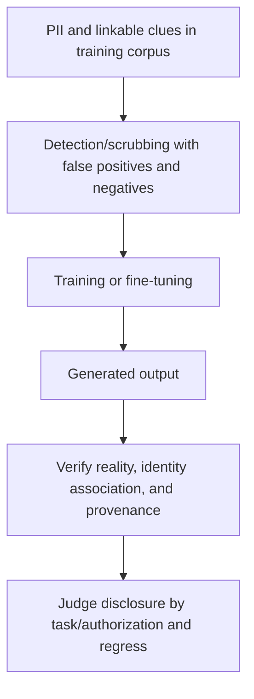

import PrivacyMeta from '@site/src/components/PrivacyMeta';

<PrivacyMeta era="Volume 3 · Conversational LLMs" technique="PII detection, redaction & synthetic data" audience={['Privacy Engineer', 'ML Engineer', 'Compliance Engineer']} severity="High" maturity="Research" evidence="Official docs" />

> In one sentence: genuine personal information in training data can be reproduced during generation. Scrubbing can reduce exposure while missing entities or cross-field associations. Presidio **originated at Microsoft and is now maintained by the Data Privacy Stack community**, rather than being a current official Microsoft product. Google/AWS/Azure offer separate hosted services. Validate tools, thresholds, languages, and entity types for the task; scanning does not establish absence of personal information.

## Mechanism: what happens on my side

I may generate names, addresses, or linked fragments matching training text, but PII-shaped outputs can also come from current context, public knowledge, inference, coincidence, or fabrication. A match alone does not establish private-training provenance. Lukas et al. distinguish extraction, inference, and reconstruction in their models/corpora, finding scrubbing can reduce without eliminating risk. Red line: attribution requires data and controls, not my claim that I remember.



## Threat surface

Pattern detectors can miss semantic sensitivity, while fields and auxiliary knowledge can reconstruct associations. Removing direct identifiers does not automatically anonymize; hashing or reversible placeholders do not complete de-identification. Sentence-level DP is not automatically user-level protection for a person represented by multiple fragments.

## How the defense works

Minimize unnecessary data and combine NER, rules, dictionaries, and checksums by language/entity type, followed by controlled extraction/reconstruction audits. A DP claim needs adjacency, units, complete accounting, and trusted boundaries; detector miss rates are not formal privacy budgets.

## Buildable recipe

```text
1. Define protected people/fields, legitimate tasks, and recipients; remove unnecessary corpus content.
2. Self-host Presidio or choose a hosted detector; pin version/language/entity/threshold and measure precision/recall.
3. Test extraction, inference, and field linkage with synthetic canaries or authorized data, without new real-PII logs.
4. Verify identity association and provenance; score authorized and unauthorized disclosures separately.
5. Add output filtering; independently check DP units/accounting if claimed, and retest new corpora/attacks.
```

**Minimal testable assertion**: independent labeled data meet precision, recall, and reconstruction thresholds by language/PII type, with intervals and missed cases. No detected PII does not prove anonymity; a phone-number-shaped string does not directly prove disclosure.

## Real cases / tool status

- **Presidio project docs**: the community FAQ disclaims complete sensitive-information detection and recommends additional protections. There is no vendor SLA; self-hosting teams must check models, entities, and maintained versions.
- **Google Sensitive Data Protection**: choose infoTypes and transformations for the data; detection is imperfect and does not automatically establish compliance.
- **AWS Comprehend**: current docs cover English/Spanish PII detection with entity scores and offsets. Do not import another service/language’s coverage.
- **Azure Language PII transparency note**: integrate capabilities and limitations with the whole process and people; the cloud-service name does not certify sufficient cleaning.
- **Lukas et al. (2023)**: specific text-model/domain experiments require separate measurement of scrubbing and DP’s residual PII, not a universal product miss rate.

## Residual risk and trade-offs

Recall and false positives, utility and minimization trade off. Replacement maps, human review, and audit logs can create sensitive copies needing access/retention controls. Legal anonymity requires jurisdiction-specific identifiability assessment, not a tool toggle.

## How this differs from neighboring techniques

[Training-data extraction](../02-memorization-extraction/training-data-extraction.mdx) studies content recovery; this entry focuses on genuine personal information and associations. [Synthetic data](../06-governance-compliance/synthetic-data-privacy.mdx) and de-identification do not automatically establish anonymity.

## Version notes

:::note Applicable versions
Read the maintained Presidio FAQ, Google/AWS/Azure limitations, and Lukas paper on 2026-10-29; replaced the failed old FAQ and removed long quotations and unnecessary entity counts. All tools were not rerun. Review by 2026-12-29, earlier for maintainers, models/languages/entities, corpus provenance, or PII attacks.
:::

## Further reading and sources

- [Presidio community FAQ](https://raw.githubusercontent.com/data-privacy-stack/presidio/main/docs/faq.md)
- [Google infoTypes and limitations](https://docs.cloud.google.com/sensitive-data-protection/docs/concepts-infotypes)
- [AWS Comprehend PII](https://docs.aws.amazon.com/comprehend/latest/dg/how-pii.html)
- [Azure PII transparency note](https://learn.microsoft.com/en-us/azure/foundry/responsible-ai/language-service/transparency-note-personally-identifiable-information)
- [Lukas et al. PII study](https://arxiv.org/abs/2302.00539)
