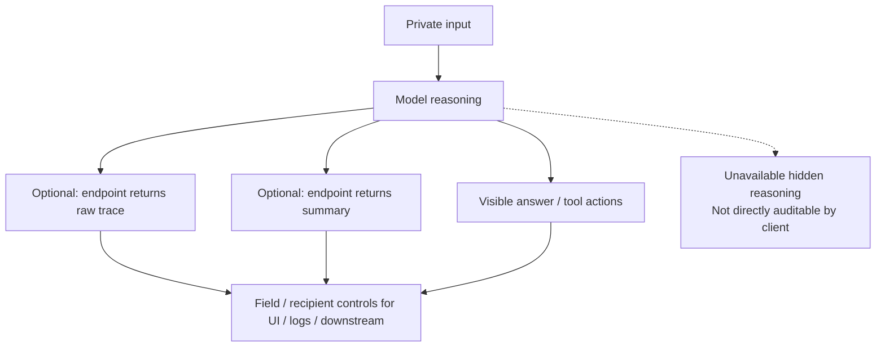

import PrivacyMeta from '@site/src/components/PrivacyMeta';

<PrivacyMeta era="Volume 3 · Conversational LLMs" technique="Context-surface privacy" audience={['Security Engineer', 'Privacy Engineer']} severity="High" maturity="Research" evidence="Research" />

> In one sentence: **reasoning text that is displayed, logged, or passed downstream may expose sensitive data absent from the final answer.** But a raw trace, a reasoning summary, and unavailable hidden reasoning are different objects. Check what the endpoint actually returns before controlling each reachable path. “More reasoning always leaks more” is not a universal law established by one study.

## The mechanism: what happens on my side

Intermediate text may repeat an account number, medical detail, or other private input. Displaying, logging, or forwarding that text creates another readable copy; final-answer filtering can miss it. **Readability depends on the endpoint, response format, and application flow, not simply on both being generated tokens.**

Distinguish the audit objects:

| Object | Example and boundary | Audit approach |
|---|---|---|
| Raw reasoning trace | `analysis` / `<think>` text returned by some open-weight or self-hosted deployments; OpenAI’s gpt-oss docs distinguish raw CoT from displayable content | Control actual returned fields across access, streaming, and logs; do not display raw text by default |
| Reasoning summary | OpenAI’s hosted reasoning guide offers explicitly requested summaries and says raw reasoning tokens are not exposed | Audit the summary as output against content and recipient permissions; it is not the complete internal trace |
| Hidden reasoning | Reasoning unavailable to the client | Record “not directly observable,” not “captured, redacted, or zero leakage”; test visible answers and actions separately |

I cannot reliably self-certify that my thinking contains no secrets. Evidence is the fields actually received, saved, or forwarded and their permissions. **Unavailable fields must not become a fabricated zero-hit audit score.**



## The threat surface: who can see which reasoning text

An observer could be an end user, unauthorized trace reader, downstream agent, or observability vendor. Specify **which text is reachable by that observer**. Where raw traces are explicitly returned, test them directly; where only summaries exist, test summaries, answers, and actions. A generated self-report responding to “repeat your thinking” is not evidence of a raw trace.

Leaky Thoughts (EMNLP 2025 main) studies visible reasoning in AirGapAgent-R probes and the AgentDAM agentic setting. It observes sensitive-field repetition, some content entering answers, and budget-dependent leakage. This supports **separate governance of visible traces**, not a claim that every hosted API exposes complete reasoning or that budget–leakage relationships are universally monotonic.

## Why the defense works

- **Control fields separately:** raw trace, summary, answer, and arguments, including their readers, logs, and downstream destinations.
- **Enforce at serialization and forwarding boundaries:** do not display raw traces or retain unnecessary originals by default. Apply recipient permissions and redaction where sharing is needed. Hiding `<think>` tags in the UI leaves underlying response bodies and logs untouched.
- **Unavailable raw traces do not secure every path:** summaries, answers, and actions still need testing. Provider processing is covered in [Inference-service data boundary](../06-governance-compliance/inference-service-data-boundary.mdx).
- **Evaluate budgets per endpoint:** measure utility and privacy on visible paths. Raising a budget is not a privacy control, nor is disabling reasoning a universal solution.

## Implementation (recipe)

```text
1. Capture a controlled response from the actual endpoint / model version. Inventory
   raw trace, summary, answer, and arguments. Mark unavailable fields as not applicable
   or not directly observable.
2. Map permissions for UI, streaming, logs, trace vendors, and downstream agents.
   Do not display raw traces by default; retain only when necessary and authorized.
3. Use synthetic profiles and artificial canaries without real PII to test disclosure
   and elicitation on each reachable field. Judge candidate matches by purpose / recipient.
4. Compare supported reasoning budgets with other conditions fixed; report task success,
   privacy, sample size, and uncertainty.
5. Regress after endpoint, model, summary-setting, logging, or downstream changes.
```

**Minimal testable assertions**:

- How to test: inspect actual responses and what UI / logs / downstream recipients receive. Run canary and injection cases separately for reachable raw traces, summaries, answers, and actions. If raw traces are unavailable, report visible paths and the coverage gap.
- Pass: unauthorized disclosures meet preset limits for every reachable path; access / retention policies work, utility meets its threshold, and budget effects are recorded. Unobservable content is not described as proven leak-free.
- Fail: raw traces reach unauthorized readers, summaries / answers / actions reveal forbidden data, logs bypass controls, or model self-reports masquerade as internal-trace evidence. Fix and re-test the relevant path.

## Real cases / research progress (engineering feasibility)

Maturity remains **Research**: papers establish risks and methods, while official docs distinguish interfaces; neither proves universal defenses.

- **Leaky Thoughts (EMNLP 2025)** uses AirGapAgent-R probes with **20 synthetic profiles × 26 fields × eight scenarios**, plus AgentDAM. In tested visible traces, cautious answers can coexist with sensitive-field repetition, and larger budgets can increase exposure. Keep its model, task, and prompt conditions; these are not current leakage rates for arbitrary endpoints.
- **OpenAI interface documentation (checked 2026-10-29)** distinguishes raw tokens from opt-in summaries in the hosted reasoning guide, while the gpt-oss raw-CoT article describes interfaces returning original analysis text. “Reasoning model” alone does not define exposure.
- **Trend Micro’s DeepSeek-R1 analysis (2025-03-04)** is a historical example of explicit `<think>` exposure. It remains supplementary, not a current all-model description or the quantitative primary source.

## Residual risk and trade-offs

- **A clean answer does not cancel leakage on another readable path.** Check raw traces, summaries, tools, and logs separately.
- **Summaries may contain sensitive content.** They still are not complete raw traces, so their results cannot establish exhaustive auditing of hidden content.
- **Detectors and attacks have blind spots.** A canary miss only means these cases found no more, not that semantic leakage is impossible.
- **Limited trace retention affects debugging.** Keep necessary evidence with restricted readers and retention, and report utility costs.

## How this differs from adjacent techniques

[Context-surface privacy](./context-surface-privacy.mdx) concerns secrets in input context; this entry covers additional reasoning-related text paths. The two can overlap, but differ from training-weight memorization in [PII regurgitation](./pii-regurgitation.mdx). A self-report about hidden reasoning is not reliable introspective evidence.

## Version notes

:::note Applicable versions
Checked **2026-10-29** for the raw-trace / summary / hidden-reasoning interface boundaries and acceptance tests. Leaky Thoughts retains its **EMNLP 2025** experimental conditions; Trend Micro remains a **March 2025** historical example. Visibility and streaming fields change by endpoint: inspect its documentation and actual response. This entry does not claim access to raw reasoning unavailable from hosted endpoints.
:::

## Further reading and sources

Primary: Research (Leaky Thoughts); supplementary: official interface docs and historical security analysis.

- [Leaky Thoughts (EMNLP 2025 main)](https://aclanthology.org/2025.emnlp-main.1347/) · [arXiv paper](https://arxiv.org/abs/2506.15674) — visible-trace privacy measurement and conditions.
- [OpenAI — Reasoning models](https://developers.openai.com/api/docs/guides/reasoning) — hidden hosted reasoning tokens and optional summaries.
- [OpenAI — How to handle the raw chain of thought in gpt-oss](https://developers.openai.com/cookbook/articles/gpt-oss/handle-raw-cot) — raw reasoning versus displayable content in gpt-oss.
- [Trend Micro — Exploiting DeepSeek-R1 (2025-03-04)](https://www.trendmicro.com/en_us/research/25/c/exploiting-deepseek-r1.html) — historical supplement, not a current general leakage rate.
