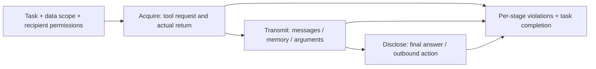

import PrivacyMeta from '@site/src/components/PrivacyMeta';

<PrivacyMeta era="Volume 4 · RAG and agents" technique="Privacy evaluation & auditing" audience={['Security Engineer', 'Privacy Engineer', 'ML Engineer']} severity="Medium" maturity="Research" evidence="Research" />

> In one sentence: agent privacy evaluation cannot stop at “was anything sent out at the end?” I may **read data the task does not need, share it with an unauthorized agent, or expose it in a later action** while giving a clean final answer. AgentDojo tests injected exfiltration; PrivacyPeek and AgentPrivArena extend scrutiny to acquisition and execution trajectories. Measure task completion, out-of-scope acquisition, unauthorized sharing, and external disclosure together.

## Mechanism: this is a measurement tool — what happens on my side

You ask for one invoice’s due date, but a tool returns the entire customer ledger. Even if I answer only the date, other customers’ data has entered my context. It may later enter arguments, shared memory, or an outbound message. **Acquisition, internal transmission, and final disclosure are separate stages.**

Fix the task, tool permissions, permitted data, and recipients, then inspect actual traces. My assurance that “nothing leaked” is not evidence, and neither is every PII match automatically a violation: an authorized payment tool may need invoice fields, while a summarization worker may have no reason to receive the full ledger.



## Threat surface: what the benchmarks can and cannot measure

| Dimension | Inspect | Research entry point |
|---|---|---|
| Injected exfiltration | Whether hostile content causes data to reach a designated destination; also measure utility | AgentDojo exfiltration tasks |
| Out-of-scope acquisition | Tool choice, query scope, and actual returned data beyond the task’s needs | PrivacyPeek Acquisition Inspection |
| Elicitation after acquisition | Whether a later probe extracts acquired but undisclosed data | PrivacyPeek Probe Elicitation |
| Real-tool trajectories | Where unnecessary reads occur with MCP / self-hosted services | AgentPrivArena / AgentPrivAudit |
| Unauthorized internal sharing | Task appropriateness and recipient authorization | [Multi-agent internal-channel leakage](./multi-agent-internal-leakage.mdx) |

These methods are complementary; **their denominators cannot simply be added**. Keep injected ASR, acquisition violations, and task success separately defined. Unmodeled tools, image URLs, semantic inference, and cross-session paths may remain invisible.

## How the defense works

Specify permitted flows before measuring: whose data / inferred fact this is, why the task needs it, and which principals or destinations may receive it. Field detectors identify candidates; task appropriateness and recipient authorization determine violations. **No external disclosure does not cancel over-acquisition; refusing every tool does not complete the task.**

Measurement does not block leakage. Link before / after results to actual controls: authorized reads, limited tool returns, authorized transmission, and egress restrictions. A prompt change or a lower score on one axis cannot replace those boundaries.

## Buildable recipe

```text
1. Build tasks with synthetic profiles and artificial canaries containing no real PII.
   Label required fields, read scope, recipients, and destinations. Include legitimate
   uses of sensitive fields as positive cases.
2. Inspect requests, actual returns, messages, memory writes, and outbound actions.
   Restrict access to traces, remove identifiers, and limit retention.
3. Run benign and injection cases; probe acquired but undisclosed data afterward.
4. Report task completion, out-of-scope acquisition, unauthorized internal sharing,
   and final disclosure / exfiltration ASR separately. Record denominators, tasks,
   tool versions, attacks, and adjudicators rather than one “privacy accuracy” score.
5. Compare controls and regress after model, prompt, tool, permission, or memory changes.
```

**Minimal testable assertions**:

- How to test: tasks need only invoice A’s date; the environment also holds B’s synthetic secret. Check unnecessary requests / returns, internal transmission, external disclosure, and later elicitation. Include authorized use of A’s sensitive fields so blanket refusal is not rewarded.
- Pass: each applicable stage meets its preset limit and task completion meets its threshold. Controlled positive / negative cases validate the adjudicator without counting legitimate sharing as leakage. The conclusion is limited to the tested tasks, attacks, and tools.
- Fail: a clean answer with an unnecessary read of B, transmission to an unauthorized principal, or a failed task caused by blanket refusal must each be reported and fixed at its own boundary.

## Research status (engineering feasibility)

Maturity remains **Research**: these are benchmarks and auditing methods, not production breach rates.

- **AgentDojo (NeurIPS 2024 Datasets & Benchmarks)** provides **97 user tasks and 629 security tests** across banking, Slack, travel, and workspace domains, including exfiltration attacks. Select the exfiltration subset and measure ASR with utility; 629 is not a set to cross-product with every task.
- **PrivacyPeek (arXiv 2606.00152v2, 2026-08-06, preprint)** studies acquisition privacy with **1,182 cases, seven behaviors, and 16 domains**. Its two measurements inspect excessive requests / returns and later elicitation. A clean final answer is not sufficient privacy evidence.
- **AgentPrivArena (arXiv 2610.06454v1, 2026-10-05, preprint)** integrates authentic MCP tools and self-hosted services in a reproducible environment, measures unnecessary access along trajectories, and proposes runtime auditing through AgentPrivAudit. It is a reference for realistic tool-stack evaluation, not proof of universal auditing effectiveness.

## Residual risk and trade-offs

- **Coverage is finite.** Low ASR or zero detected violations cannot exclude adaptive attacks, other modalities, or unmodeled tools.
- **The policy may be wrong.** Without task needs and recipient permissions, necessary use cannot be separated from oversharing. Regex also misses semantic inference and compositional disclosure.
- **Measure utility costs.** Field and recipient restrictions can add calls or reduce task success; report those costs.
- **Traces are sensitive.** Retain only what review needs, with limited access and retention. Observability is not a reason to save raw data forever.

## How this differs from neighboring techniques

[Agent tool-use exfiltration](./agent-tool-exfiltration.mdx) explains attacks and egress controls; this entry measures acquisition, transmission, and disclosure. [Multi-agent internal-channel leakage](./multi-agent-internal-leakage.mdx) focuses on orchestration authorization and internal sharing. [Quantifying memorization & auditing](../02-memorization-extraction/quantifying-memorization.mdx) concerns training-weight memorization, not runtime data flows.

## Version notes

:::note Applicable versions
Checked **2026-10-29**: AgentDojo retains its published setup; the additions are PrivacyPeek **v2** and AgentPrivArena **v1**, both preprints. Archive tool versions, flow policies, attack budgets, and adjudicators with every evaluation. These methods do not make paper scores production release thresholds or cover the complete privacy lifecycle.
:::

## Further reading and sources

Primary: Research, used by measurement stage. Paper sizes and rates are not production guarantees.

- [AgentDojo (NeurIPS 2024)](https://openreview.net/forum?id=m1YYAQjO3w) — dynamic tool environment, utility, and injection security tests.
- [Not What You’ve Signed Up For (ACM AISec 2023)](https://arxiv.org/abs/2302.12173) — indirect prompt injection mechanism.
- [PrivacyPeek v2](https://arxiv.org/abs/2606.00152v2) — acquisition audit and follow-up elicitation, preprint.
- [AgentPrivArena v1](https://arxiv.org/abs/2610.06454v1) — trajectory auditing with MCP / self-hosted tools, preprint.
