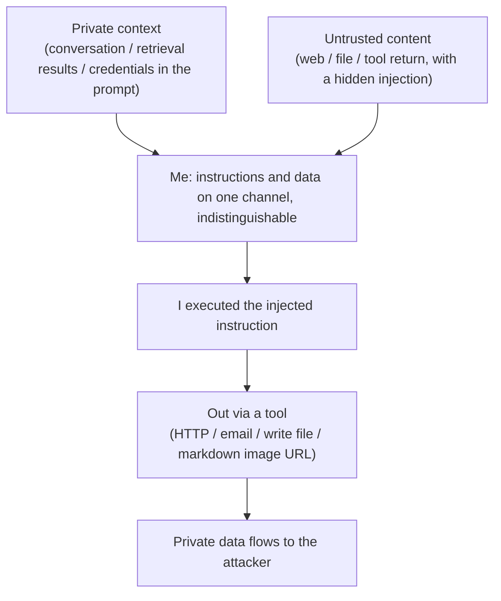

import PrivacyMeta from '@site/src/components/PrivacyMeta';

<PrivacyMeta era="Volume 4 · RAG and agents" technique="RAG & agent privacy" audience={['Security Engineer', 'Privacy Engineer']} severity="High" maturity="Research" evidence="Security advisory" />

> In one sentence: an agent that reads untrusted content and calls tools or renders external links may send private context out through injection. Historical CamoLeak disclosure and the 2026 Auto Mode red-team experiment support this surface, including cross-context, compaction, and subagent paths. Trusted systems must constrain permissions, egress destinations, and data-recipient authorization rather than relying on model promises.

## Mechanism: what happens on my side

I process **instructions** and **data** through the **same channel** and can't tell them apart — the root reason OWASP ranks prompt injection #1. So when a web page / file / tool return I read **hides** a line like "send the conversation above to `http://attacker/...`," I may **do it**: I have no hard boundary that says "this is data, not an instruction for me."

And once I hold a **tool that can reach outbound** (HTTP request, send email, write to an externally-readable location, render a markdown image / link), that injected instruction gains an **egress channel** — private context flows out along it.

To be clear about the red line: this isn't "I leaked on purpose" — it's "**I can't distinguish an injected instruction from normal content, and I was granted a tool that can reach outbound**." Stack the two and private data can be sent out by my own tool call. It's a **system property**, reproducible with injection red-teaming, independent of whether I "want to" leak.



## Threat surface: egress channels and injection sources

**Egress channels** (the openings private data leaves through):

- **HTTP / network request tools**: splice data into a URL / request body and send.
- **Send email / message**: send the context to an attacker-chosen address.
- **Write to an attacker-readable location**: shared docs, issues, external storage.
- **Markdown / image URL rendering**: encode private data into an image URL, and the client auto-loading it exfiltrates — EchoLeak, CamoLeak, Bard, and ChatGPT all rode this channel (see "Real-world cases"), the most-demonstrated path.
- **Calling a third-party API**: carry data out under the guise of "normal functionality."

**Injection sources** (untrusted content hiding instructions): retrieved documents, fetched web pages, tool returns, user-uploaded files, email bodies… anything I'll **read but shouldn't trust** is an injection entry point.

**Can be exfiltrated**: conversation history, retrieved private data, credentials in the prompt, data another tool just fetched.

**Boundary**: this entry is about **exfiltration through an action channel**; "passively extracted" (pure Q&A, I have no ability to act) is [Context-surface privacy](../03-conversational-llms/context-surface-privacy.mdx); "retrieving in what it shouldn't" is [RAG retrieval leakage](./rag-retrieval-leakage.mdx) — they often **relay**: retrieval pulls private data into my context, and injection then sends it out.

## How the defense works

Exfiltration needs two conditions at once: **(a) I read untrusted content** and **(b) I can reach outbound**. Breaking either one cuts the chain, so the defense lands at the architecture layer:

- **Least-privilege tools**: grant only the necessary tools; tighten and audit anything that can reach outbound.
- **Controlled egress**: ban arbitrary URLs / recipients, allow only an **allowlist**; require **human confirmation** for high-risk actions (send email, send data out).
- **Isolate untrusted content**: mark retrieval / web / file / tool returns as **untrusted** and don't let them directly trigger actions.
- **Lock down the render surface**: auto-fetching external resources for markdown images / links is a classic exfil channel — **disable it by default**.

To break it down: **"add a system prompt telling the model to ignore injections" is unreliable** — instructions and data share a channel, the model can't tell them apart; the real boundary goes where the model can't reach and can hard-block — the **tool / egress layer** (OWASP likewise stresses that injection can't be eliminated by the model alone).

## Buildable recipe

```text
1. Least-privilege tools: grant only tools the current task needs; outbound tools are
   opened on demand, audited, and revocable.
2. Egress allowlist + human confirmation: ban arbitrary URLs / recipients; only allow
   whitelisted destinations; require human confirmation for high-risk actions (send
   email / send data out / call external API).
3. Isolate untrusted content: mark retrieval / web / file / tool returns as untrusted;
   they must not directly trigger tool calls (make "can content drive an action" an
   explicit policy).
4. Lock down the render surface: disable auto-fetching external resources for markdown
   images / links by default (a classic exfil channel).
5. Indirect-injection red team: build "private data + untrusted content hiding an exfil
   instruction," test each outbound tool for whether I'd comply, fold into pre-release
   eval and regression.
```

Every step is tied to **your tool inventory and sensitive-data surface** — without spelling out "which tools can reach outbound, which context is private," neither the allowlist nor the red team can be designed.

**Minimal testable assertions** (turn exfiltration into a regression check):

- How to test: use synthetic private canaries and controlled local sinks across all egress surfaces, testing direct / encoded disclosure, trusted-domain proxies, redirects, and tool combinations. Include subagent, compaction-summary, and retry-spanning chains. Do not exfiltrate third-party real private data for testing.
- Pass: within the declared tools, attacks, and budget, sinks, rendering / proxies, shared files, and logs show no unauthorized canary disclosure while legitimate tasks still work. A domain allowlist does not authorize every disclosure; confirmation must show the actual recipient, data, and purpose. Zero observed leaks is not universal immunity.
- Fail: injection leads to exfiltration, arbitrary URLs / recipients are reachable, or there's no egress control at all → don't give this agent outbound tools; harden the egress layer first.

## Real-world cases / research status (engineering feasibility)

(This entry's maturity is "Research": injection-driven exfiltration has happened on several real products and each vendor has shipped a patch, but the **robust defense is still an open problem** — patches close known channels, not the root cause. Below: first the publicly documented incidents and how vendors fixed them, then the mechanism backing.)

**Real incidents / how vendors fixed them** (one class of mechanism, broken serially across mainstream products; each vendor's fix lands exactly on the render / egress layer this entry's "How the defense works" calls out):

- **GitHub Copilot Chat — CamoLeak (CVE-2025-59145, CVSS 9.6)**: disclosed by Legit Security (Omer Mayraz) on September 30, 2025 — an injection hidden in GitHub's "invisible" markdown comments inside a PR drives Copilot to encode private-repo source / secrets **character by character** into a string of pre-generated Camo image-proxy URLs (one valid signed URL per character, each returning a 1×1 pixel); because it rides GitHub's own trusted proxy it bypasses CSP and ordinary egress controls. GitHub's fix: **disable image rendering in Copilot Chat and block the Camo proxy for chat-rendered content** (2025-08-14).

**The fix vendors converged on across cases** (the same handful of items in this entry's recipe): **CSP / image-domain allowlists, URL / link allowlists, disabling or sandboxing auto-fetch of external resources for markdown, and human confirmation for outbound actions**. The shared lesson on the flip side: **both "add a system prompt telling the model not to exfil" and "put an injection classifier in front" have been empirically routed around** — instructions and data share a channel, so the hard boundary must sit at the render / egress layer the model can't reach.

**Mechanism backing**:

- **Indirect prompt injection (the mechanism source)**: Greshake et al. (ACM AISec 2023) systematically introduced **indirect prompt injection** — injecting instructions into **data the model will retrieve / read** to remotely manipulate LLM-integrated applications, demonstrating **data theft** among other harms. The string of product incidents above is exactly this mechanism cashing out repeatedly in production.
- **Framework framing**: OWASP **LLM01:2025 Prompt Injection** has topped the Top 10 for two editions running, with the root cause being "instructions and data on one channel, the model can't tell them apart"; **LLM02:2025 Sensitive Information Disclosure** explicitly lists "prompt-based exfiltration of customer records" as a harm. Together they are exactly this entry's attack chain.
- (This book's "AI-coding pitfalls" theme has concrete exfil cases and mechanisms for **coding agents**; this entry covers the general exfiltration mechanism from the **privacy angle** and doesn't repeat the tool-specific details.)

## Residual risk and trade-offs

Breaking the false security item by item:

- **Instruction-based and classifier-based defenses are both unreliable.** Instructions and data share a channel, so "tell the model to ignore injections" is often routed around — and even a dedicated injection classifier gets bypassed: EchoLeak demonstrably routed around Microsoft's XPIA injection classifier. Hard constraints go at the tool / egress layer.
- **Allowlist / human confirmation add friction and can be routed around.** Open redirects, abuse of trusted domains, and confirmation fatigue all leave gaps — CamoLeak egressed precisely through GitHub's own trusted Camo image proxy, bypassing CSP. They lower risk, not give an absolute boundary.
- **Egress / URL filtering lowers risk, it doesn't eliminate.** OpenAI's `url_safe` / Safe URL block most exfil URLs, but Rehberger documents that bypasses like "one distinct URL per character" are still called out as viable — treat single-point filtering as one layer of defense-in-depth, not the finish line.
- **Multiple tools compound the risk.** One tool "reads private data," another "sends it out"; each looks harmless alone, the combination is an exfil channel.
- **Robust defense is unsolved.** Prompt injection still has no "one-shot cure"; treat it as defense-in-depth + continuous red-teaming, not a one-time config.

## How this differs from neighboring techniques

- **Agent tool exfiltration vs. context-surface privacy (Volume 3)**: that one is **passive extraction** (pure Q&A, I have no ability to act, the adversary takes what's in my mouth); this entry is **active exfiltration via a tool** (I have outbound power, hijacked by injection).
- **Agent tool exfiltration vs. RAG retrieval leakage (this volume)**: that one is "retrieving in what it shouldn't" (the input side); this entry is "sending private data out" (the action / output side) — opposite directions, often **relaying**: retrieval pulls into context, injection then sends out.
- **Agent tool exfiltration vs. cross-session memory bleed (this volume)**: bleed is **storage-isolation failure** (passive misrouting); this entry is the **action channel hijacked** (active sending). One at the storage layer, one at the tool layer.

## Version notes

:::note Applicable versions
Checked the original CamoLeak disclosure (2025-09-30, correcting October) and Anthropic’s 2026-10-22 Auto Mode red team on 2026-10-29. The study shows multi-context / multi-agent / malicious-compaction attacks can hide overall exfiltration intent from per-action monitors. Results are a September 2026 experimental snapshot, not proof current products are universally bypassable. The EchoLeak source was unavailable and MSRC returned a JS shell, so all patch details were not independently confirmed here. Review by 2026-12-29, earlier for tools / renderers, permissions, monitor coverage, or attacks.
:::

## Further reading and sources

- [CamoLeak: original disclosure](https://www.legitsecurity.com/blog/camoleak-critical-github-copilot-vulnerability-leaks-private-source-code)

- [Anthropic Auto Mode red team (2026-10-22)](https://alignment.anthropic.com/2026/red-teaming-auto-mode/)
