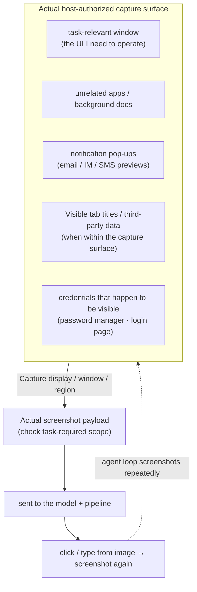

import PrivacyMeta from '@site/src/components/PrivacyMeta';

<PrivacyMeta era="Volume 4 · RAG and agents" technique="RAG & agent privacy" audience={['Security Engineer', 'Privacy Engineer']} severity="High" maturity="Production" evidence="Official docs" />

> In one sentence: GUI agents send captured interface content to the model; **clicking a task button does not mean the image contains only task-required data**. The host determines the surface: a display, dedicated VM, browser viewport, window, or region. Do not equate them all with the user’s entire host desktop. Check actual payloads and authorized surfaces, then isolate, clear, or mask unrelated sensitive content before sending it.

## Mechanism: what happens on my side

In a screenshot-based agent loop, I request an observation; the application captures an image and returns it, then executes clicks / typing from tool calls. **I receive the surface supplied by the host.** Anthropic’s current `computer_toolset_20260801` docs define `screenshot` as the full display and `zoom` as a specified region; your application executes the tools in its environment. This does not make every browser-use or window-use implementation able to see every app on the user’s host computer.

The key is that **capture scope can exceed task scope**. A full display can contain notifications and other visible windows; one window or browser viewport can still contain unrelated sidebars, tab titles, or personal data on the same page. Hidden text in inactive tabs and covered windows is not automatically in a screenshot merely because those surfaces are open. DOM / accessibility text sent separately by the host is another data flow to audit.

Externally testable evidence is the screenshot payload, selected display / window / tab / region, and any accompanying text. The model may request a region, but the host must authorize and crop before capture / transmission. “I will ignore unrelated areas” is not minimization. **Redacting the final answer cannot recall an image already sent to a model provider.**



## Threat surface: what actually gets captured in one screenshot

No attacker required — **the act of capturing itself** pulls ambient private data far beyond the task's need into the model's context:

- **Unrelated apps / background documents.** I only need to operate a browser window, but the screenshot sweeps in the mail client on the same screen, the source code open in an IDE, that unclosed contract / medical-record PDF in the background. They're unrelated to the task but share the frame with the task window.
- **Notification pop-ups.** In the instant of capture, the email preview / IM message / SMS one-time code / calendar reminder popping up in the corner or at the top gets frozen into the screenshot — sender, snippet, and all — and sent out.
- **Other people's data on a shared / projected screen.** Running computer-use during a meeting projection, a screen share, or on a shared monitor means the screenshot also grabs **someone else's** windows, chats, and documents — what leaks isn't the operator's own privacy but a third party's who merely shares the frame.
- **Credentials that happen to be visible.** An open password manager, an autofill dropdown, a plaintext token, a `.env` in an editor, a login page with the password field already filled — if it's visible at capture time, it's in the screenshot. Anthropic's official security guidance is aimed squarely at this: **don't give the model access to sensitive data (such as account login information), to prevent information theft.**
- **Screen content is still an injection vector — but injection is counted separately.** Instructions hidden on screen (in a webpage or an image) may be executed as commands, which is why Anthropic added an injection classifier **on the screenshot side**. But the "injected → driven to exfiltrate" chain belongs to [Agent tool exfiltration](./agent-tool-exfiltration.mdx); this entry only covers the **over-capture** surface, not injection.

**Attacker model / unit of leakage**: the main line here is **attacker-free routine over-capture** — the unit of leakage is "the screen regions captured in one screenshot that exceed the task's need," auditable by grabbing the payload at the host↔model boundary and checking it region by region. It doesn't require the adversary to know your screen layout; once projection / shared displays enter the picture, the victim can be a **third party in the frame**, not the operator.

**Boundaries** (drawing lines against the two nearest entries):

- **This entry vs [Agent tool exfiltration](./agent-tool-exfiltration.mdx)**: that one is **attacker-driven** injection → sending private data **out** through a tool (action / output side); this one is **attacker-free input-surface over-capture** — to operate the UI, taking unrelated / sensitive data from the captured surface **in** (input side). Opposite directions.
- **This entry vs [MCP data flow & least collection](./mcp-data-flow-privacy.mdx)**: that one is about the host handing **context-field slices** to each MCP server per protocol and consent (structured data flow); this one is about the **screen-pixel** input path — the unit of collection is "visible screen region," not "context field," and the minimization moves differ too (clear the desktop / isolate a VM, rather than narrowing fields per server).

## What protects it

Over-capture only works if unrelated / sensitive content **happens to be visible** and thus gets screenshotted in. So protection lands on the **capture surface** — narrow "what's on screen at capture time," rather than hoping the model looks at less on its own:

- **Minimal screen surface (dedicated profile / clean desktop / isolated VM).** Run computer-use in a **dedicated, clean** environment: a separate VM / container, a separate user profile, only the task's windows on the desktop — don't keep personal mail, medical records, and source code open on the same screen. Anthropic's first security precaution is exactly to **use a dedicated VM / container with minimal privileges**, and OpenAI's CUA runs in a controlled virtual browser / environment too. That way, even if the whole screen is captured, there's no extra privacy on it to capture.
- **Hand sensitive input to a human (takeover).** When a step needs a password / payment details / a CAPTCHA, **let a human type it** — don't route it through the model. OpenAI's Operator productized this as **takeover mode**: on steps that require login or payment, Operator asks the user to take over, and **during takeover it does not collect or screenshot what the user enters** — so the sensitive data never reaches the model.
- **Hide notifications and background.** Before you take a screenshot, switch to a "do not disturb / presentation" mode, turn off pop-up previews, collapse or minimize unrelated windows — don't let a fleeting notification get frozen into the image.
- **Keep credentials off the capture surface.** Password managers, plaintext tokens, `.env` files, an already-filled login form — anything you don't want screenshotted shouldn't be open on that screen during a computer-use session (matching Anthropic's "don't give the model access to account login information").
- **Supervise on sensitive sites (watch mode).** On high-sensitivity sites like email or finance, have a human **watching** every step and able to stop it. OpenAI requires **watch mode** on sensitive sites — auto-pausing when the user leaves or goes inactive — which is exactly this precaution in product form.

The boundary made explicit: **these are "narrow the capture surface + hand sensitive things to a human" access controls, not encryption, and not making the model "learn to look only at what's relevant."** Once extra privacy is on the screen and gets captured into the image, it's already in this request; what protection can do is **make sure it isn't on the screen in the first place** (clear the stage / isolate / human takeover), not hope after the fact that the model won't look.

## Implementation (recipe)

```text
1. Record which display / VM / window / tab / region the host captures and any extra
   text it sends. Then run computer-use in a separate VM / container +
   separate user profile, minimal privileges; keep only the task window on the desktop,
   not sharing the screen with personal mail / medical records / source code.
   (Matches Anthropic security precaution #1)
2. Hand sensitive input to a human: switch login / payment / CAPTCHA steps to "human
   takeover" — a human types it, not the model; during takeover, no screenshots, no
   collection of the user's input. (Matches Operator takeover mode)
3. Clear the stage before you capture: enter "do not disturb / presentation" mode
   before the session, turn off notification previews, collapse unrelated windows, exit
   password managers / plaintext-credential views.
4. Human supervision on sensitive sites: enable "someone watching + can stop" on email /
   finance and other sensitive sites; auto-pause when the person goes inactive.
   (Matches Operator watch mode)
5. Domain allowlist + human confirmation for high-impact actions: restrict reachable sites
   to an allowlist to reduce exposure to malicious content; require human confirmation for
   actions with real-world consequences — accept cookies / transactions / agreeing to
   terms. (Matches Anthropic security precautions #3, #4)
6. Capture-surface audit (see "minimal testable assertion" below): periodically check
   "which screen regions / sensitive surfaces a single screenshot actually contains,"
   turning over-capture into a regression check.
```

Bind every step to **your own inventory of sensitive surfaces** — without spelling out "which windows / sites / fields count as sensitive, which must go through human takeover," neither stage-clearing nor the allowlist can be designed.

**Minimal testable assertion** (turn "how much gets captured in" into a regression audit, don't stop at "we isolated the environment"):

- How to test: in a controlled environment, place synthetic canaries inside the authorized region, in an unrelated visible window, and outside the captured surface. Inspect actual frames, selected scope, and accompanying text. Test human takeover for sensitive input and verify whether this implementation pauses screenshots and other input collection. Restrict and promptly delete audit samples.
- Passes: the visible content in every screenshot ⊆ the windows / regions the task requires (no out-of-bounds apps, no notifications, no credentials, no third-party data); the sensitive-input step goes through human takeover with zero screenshots during takeover. Both assertions green.
- Fails: screenshots show apps / notifications / credentials / other people's windows outside the task, or the sensitive input got screenshotted directly → narrow the desktop (clear the stage / isolated profile / dedicated VM), change that step to human takeover, downgrade that site to watch mode.

## Real-world state / vendor reality (Production: shipped computer-use / Operator + their official privacy & safety guidance)

This section gives vendor capability and control examples, **not a list of confirmed over-capture incidents**. `maturity=Production` reflects shipped capabilities and official documentation, not verification of every host’s capture scope or privacy controls:

- **Anthropic — Computer use tool (current docs, checked 2026-10-29).** In `computer_toolset_20260801`, `screenshot` captures the full display and `zoom` a specified region. The application executes tools, produces images, and returns them to the API. Verify how that display relates to the user’s host desktop, along with image history, logs, and backend terms. **Local screenshot generation does not mean the provider neither processes nor retains it.**
- **Anthropic Privacy Center — What personal data Computer use processes (official).** A dedicated page explains that computer use captures / processes **screenshots and mouse, keyboard input**, and describes its processing and backend retention — turning "what this input surface collects" into a user-facing privacy statement.
- **OpenAI — Operator / CUA (Operator System Card, 2025-01-23; research preview).** CUA operates GUIs by **reading screenshots**; OpenAI wraps the sensitive surface in several mechanisms: **takeover mode** — for sensitive input like login / payment, it asks the user to take over, and **during takeover it doesn't collect or screenshot the user's input**; **watch mode** — sensitive sites like email / finance require user supervision and pause when the user leaves; plus a **monitor model**, **proactive refusal** of high-risk tasks, and an **injection classifier** for screen content. These are precisely the productized form of this entry's "hand sensitive input to a human, supervise on sensitive sites, clear the capture surface."

These examples show that environment and product design can narrow capture. **The images and accompanying data actually sent** are the audit evidence. Operator remains a January 2025 historical example, not a claim that today’s computer-use products all share its takeover or supervision mechanisms.

## Residual risk and trade-offs

Puncturing false security, point by point:

- **Operating only task controls is not collecting only task data.** Inspect actual surfaces and payloads; one window can still contain unrelated sidebars or notifications. Conversely, do not count an uncaptured host desktop or hidden tab text as data collected by a screenshot.
- **Isolated VMs / stage-clearing have a cost, and it isn't zero.** A dedicated VM / clean profile adds setup and ops friction; many real tasks **need** access to the user's own logged-in state, files, and mailbox, and clearing those off the screen entirely makes the task impossible — so you trade off "usable" against "captures less," using takeover / watch mode to backstop the most sensitive parts rather than wiping everything wholesale.
- **Human takeover / supervision fatigues and can be bypassed.** takeover / watch mode rely on a human stepping in at the critical moment; approval fatigue, wandering attention, or a task engineered to pop takeover frequently all lead to careless approval. They reduce risk; they don't give an absolute boundary.
- **Notifications are a fleeting high-risk surface.** A pop-up visible only for the instant of capture is enough to be frozen in; without "do not disturb" mode, a one-time code / DM / email preview can land in the frame at any moment — and this kind of leak is the hardest to notice after the fact.
- **Projection / shared screens leak a third party.** Running computer-use on a meeting projection or shared monitor captures **someone else's** windows / data; the victim isn't the operator, which makes after-the-fact attribution and notification harder.
- **The injection surface is counted separately, and unsolved.** Screen content is still an injection vector (which is why Anthropic added a screenshot-side classifier), but "injected → exfiltrate" belongs to [Agent tool exfiltration](./agent-tool-exfiltration.mdx); doing the capture-surface narrowing in full does **not** mean injection is defended — that needs injection red-teaming + egress control as separate backstops.
- **Vendor retention / processing still depends on the terms.** Who captures the screenshots, how long they're kept, and whether they're used for anything else depend on that vendor's specific terms and your configuration (e.g., Anthropic states screenshots are stored by your environment, with backend retention / ZDR arrangements) — "local isolation" narrows what's on screen but doesn't govern what happens to the image after it leaves.

## Compliance mapping

- **GDPR data minimization (Art. 5(1)(c)) and minimal capture surface.** "Take in only what the task requires" is data minimization projected onto the screen input surface; taking a screenshot of the whole screen (including unrelated / sensitive content) into the model runs against it. If a screenshot contains **other people's** personal data (projection / shared-screen scenarios), it also raises questions about a lawful basis for third-party data subjects.
- **OWASP LLM02:2025 (Sensitive Information Disclosure) and LLM01:2025 (Prompt Injection).** Over-capture brings sensitive information into context through the screen input surface — one form of LLM02; screen content as an injection vector maps to LLM01 (but the injection chain itself is in [Agent tool exfiltration](./agent-tool-exfiltration.mdx)).

(Compliance evolves with statute / framework versions; this section is timestamped 2026-06 — check the latest text in force before citing.)

## Version notes

:::note Applicable versions
This revision checks Anthropic’s current capture actions and application execution boundary as of **2026-10-29**, distinguishes display / window / tab / region, and revises payload tests. The OpenAI Operator System Card (**2025-01-23**), launch announcement, and earlier vendor privacy examples retain their original timestamps as historical controls. **Current defaults, retention, and availability across all products were not re-verified.** Audit actual tool versions and captured surfaces rather than inferring host-desktop visibility from “computer use.”
:::

## Further reading and sources

> Primary: official docs (Anthropic computer use's screenshot definition and security precautions, OpenAI Operator's takeover / watch mode); supplementary: vendor privacy statement (Anthropic Privacy Center) and a framework (OWASP LLM01/LLM02). **This entry is a "capture-surface over-capture" governance / vendor-reality angle, not a postmortem of a confirmed over-capture breach** (see the honest note in "Real-world state / vendor reality").

- [Anthropic — Computer use tool (official docs)](https://platform.claude.com/docs/en/agents-and-tools/tool-use/computer-use-tool) — the agent loop where a screenshot "sees what's currently displayed on screen"; four security precautions (dedicated VM / minimal privileges, don't give it sensitive data, domain allowlist, human confirmation for high-impact actions) and a screenshot-side injection classifier. Primary source for this entry's "mechanism," "what protects it," and "vendor reality."
- [Anthropic Privacy Center — What personal data will be processed by Computer use (beta)](https://privacy.anthropic.com/en/articles/10030352-what-personal-data-will-be-processed-by-computer-use-beta) — computer use captures / processes screenshots and mouse, keyboard input, and their retention arrangements. The vendor privacy statement of "what this input surface collects."
- [OpenAI — Operator System Card (2025-01-23)](https://openai.com/index/operator-system-card/) — CUA operates GUIs by reading screenshots; takeover mode (hands sensitive input to the user, no collection / screenshots during it), watch mode (human supervision on sensitive sites), monitor model, screenshot injection classifier. Primary backing for this entry's "hand sensitive input to a human / supervise on sensitive sites." (⚠️ WebFetch returned 403; content cross-verified against OpenAI's official pages and multiple third-party accounts.)
- [OpenAI — Introducing Operator](https://openai.com/index/introducing-operator/) — research-preview note: in takeover mode Operator doesn't collect / screenshot the user's entered sensitive info; sensitive sites require watch-mode supervision. Supplementary primary source for the takeover / watch-mode descriptions. (⚠️ Same as above — 403, cross-verified.)
- [OWASP Top 10 for LLM Applications 2025 — LLM02 Sensitive Information Disclosure + LLM01 Prompt Injection](https://owasp.org/www-project-top-10-for-large-language-model-applications/assets/PDF/OWASP-Top-10-for-LLMs-v2025.pdf) — over-capture brings sensitive info into context through the input surface (LLM02); screen content as an injection vector (LLM01). The framework basis for this entry's compliance mapping.
