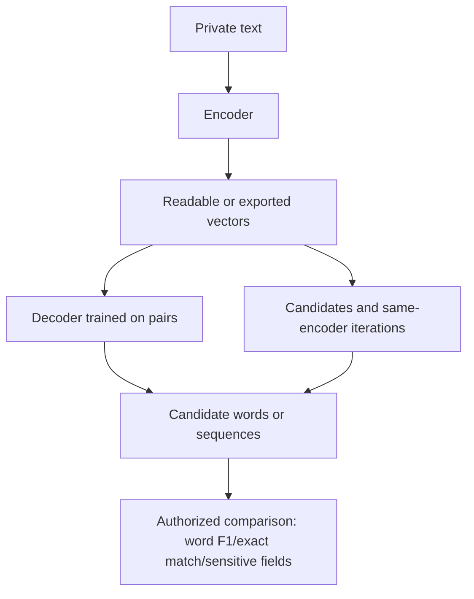

import PrivacyMeta from '@site/src/components/PrivacyMeta';

<PrivacyMeta era="Volume 4 · RAG and agents" technique="RAG & agent privacy" audience={['Privacy Engineer', 'Security Engineer', 'ML Engineer']} severity="High" maturity="Research" evidence="Research" />

> In one sentence: text vectors are not automatically anonymous. Song and Raghunathan report word-set recovery F1 around 0.5–0.7 for evaluated sentence embeddings; vec2text reaches 92% exact recovery for specified GTR-base, 32-token inputs and iterative attacks. Different metrics, encoders, lengths, and adversary capabilities do not form one leakage rate for all vectors.

## Mechanism: what happens on my side

An encoder maps text to vectors that may preserve information useful for recovering words or sequences. An attacker can train a decoder on text–embedding pairs, or generate candidates, re-embed them with the same encoder, and iteratively correct them. Red line: a vector match or optimization convergence does not prove a unique original. Verify success against authorized originals, sensitive fields, or explicit metrics rather than my claim that I did not store text.



## Threat surface

The adversary needs target vectors; paired training, encoder knowledge, and query access affect inversion. Exposed indexes, backups, logs, or API responses can supply them. Strong 32-token results do not directly transfer to long documents, other encoders, or lower-precision vectors. Word F1 is neither recall nor name-recovery rate.

## How the defense works

Include embeddings linked to sensitive text in access, export, retention, and deletion controls; numeric representation is not a reason to downgrade them. At-rest encryption/CMK protects specified storage/key boundaries, not against authorized runtime services processing plaintext vectors. Noise, quantization, and dimensionality reduction can change inversion and retrieval utility. Without a specified DP mechanism/accounting, their evidence remains empirical.

## Buildable recipe

```text
1. Record encoder/version, text length/domain, vector precision, and same-encoder query access.
2. Restrict reads/exports for indexes, backups, logs, and APIs; trusted services bind caller/tenant identity.
3. Minimize embedded content and handle PII; audit residual detection failures and inference.
4. Run decoder and iterative attacks on synthetic or authorized texts; separately report word F1,
   exact match, sensitive fields, and intervals.
5. Report retrieval quality when changing noise/quantization/dimensions; propagate deletion to copies.
```

**Minimal testable assertion**: with fixed attack budget and conditions, recovery metrics and utility meet declared thresholds, while read/export and deletion controls pass separately. One failed attack does not establish anonymity; cosine convergence is not a text-match test.

## Real cases / research

Song and Raghunathan (CCS 2020) report word-set inversion F1 around 0.5–0.7 without ordering; vec2text (EMNLP 2023) reports 92% exact 32-token recovery in its specified setup. Pinecone and Azure document at-rest encryption, keys, and access controls; these do not certify isolation from every runtime accessor. EDPB Opinion 28/2024 addresses case-specific AI-model anonymity, not a direct ruling on all vector stores.

## Residual risk and trade-offs

Revoking access cannot recall copies already obtained. Longer texts or new encoders can change results without establishing safety; strong short-text results are not a universal inversion theorem. Text scrubbing, vector transformations, and encryption have distinct boundaries and are not interchangeable.

## How this differs from neighboring techniques

[RAG retrieval leakage](./rag-retrieval-leakage.mdx) returns original chunks after authorization failure; this entry attempts text recovery from vectors. [Model inversion](../01-foundations/model-inversion-attribute-inference.mdx) may recover only class representatives. [Deletion propagation](../06-governance-compliance/data-lifecycle-deletion.mdx) must include residual vectors.

## Version notes

:::note Applicable versions
Checked Song’s manuscript, vec2text, and provider documentation on 2026-10-29, correcting F1-as-recall and convergence-as-unique-original claims. Attacks were not reproduced and account configurations were not inspected. Review by 2027-01-29, earlier for encoder/precision, attacks, export permissions, or runtime encryption boundaries.
:::

## Further reading and sources

- [Information Leakage in Embedding Models (CCS 2020 manuscript)](https://arxiv.org/abs/2004.00053)
- [Text Embeddings Reveal (Almost) As Much As Text (EMNLP 2023)](https://aclanthology.org/2023.emnlp-main.765/)
- [Pinecone security overview](https://docs.pinecone.io/admin/security/security-overview)
- [Azure customer-managed keys](https://learn.microsoft.com/en-us/azure/search/search-security-manage-encryption-keys)
- [EDPB Opinion 28/2024](https://www.edpb.europa.eu/system/files/2024-12/edpb_opinion_202428_ai-models_en.pdf)
