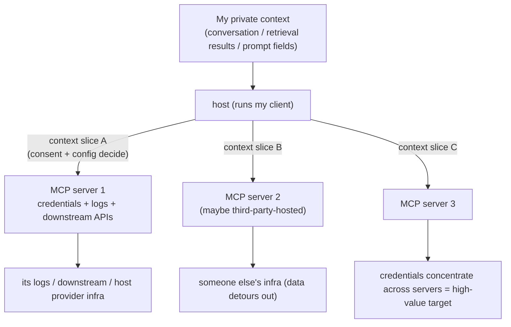

import PrivacyMeta from '@site/src/components/PrivacyMeta';

<PrivacyMeta era="Volume 4 · RAG and agents" technique="RAG & agent privacy" audience={['Security Engineer', 'Privacy Engineer', 'Compliance Engineer']} severity="Medium" maturity="Production" evidence="Official docs" />

> In one sentence: connecting an MCP server requires checking **which arguments, resources, and follow-up inputs actually reach which party**. An ordinary `tools/call` does not automatically include the conversation by protocol requirement; excess sharing comes from arguments, host behavior, additional capabilities, or downstream access. Inventory the flows, credential scopes, and retention parties, then minimize by task. **The 2026-07-28 stateless protocol core does not mean the application stores no data**: handles, retry inputs, and caches still have privacy boundaries.

## Mechanism: what happens on my side

MCP separates the **host** (the application running a client) from the **server** (a local or remote process exposing tools / resources). An ordinary `tools/call` sends a tool name, `arguments`, and protocol metadata; it **does not require a full transcript, retrieval results, or system prompt by default**. The model can place private fields in arguments, the host can add fields, and the server can read downstream data using its own credentials. Audit these separately. Additional capabilities such as sampling or elicitation change the direction and contents of flows; “connected over MCP” alone does not establish what a server saw.

What can be checked externally is the host’s outgoing payload, resources actually accessed by the server, and subsequent log / API flows. **Model-generated arguments are not an authorization boundary**: before execution, the host and server must check caller permissions, task-required fields, and destinations rather than treating “the model says it needs this” as authorization.

One host commonly connects several servers at once. So the same private context may be distributed to many parties, and each server holds its own credentials (OAuth tokens, API keys, database passwords). The CoSAI/OASIS MCP security doc names the structural risk here: concentrating multiple services' credentials into a single protocol layer **violates the principle of segregation**, turning these servers into "high-value targets" — one compromised or over-scoped server has a blast radius covering every service it can reach.



### How protocol changes affect this data flow

| Baseline | Change | Privacy audit consequence |
|---|---|---|
| 2025-06-18 | This entry’s original authorization baseline | Check HTTP OAuth audience binding and token-passthrough rules by version; audit local stdio environment credentials separately |
| 2025-11-25 | A later generation retaining initialization / protocol sessions | Record the actual version, capabilities, and extensions used by both peers |
| 2026-07-28 | Stateless core; MRTR retries with `inputResponses`; catalog / resource cache hints | Authorize handles per call and limit retention; minimize follow-up inputs; partition caches by authorization; minimize method / tool names in routing logs |

The new release also adds authorization-response issuer validation, binds credentials to their issuing authorization server, and moves from DCR toward CIMD. **This does not constrain a server’s downstream credentials or retention.** Compatibility is separate: Roots / Sampling / Logging and legacy HTTP+SSE have at least a twelve-month deprecation window; existing stdio servers are not thereby immediately invalid. (Protocol / SDK docs checked 2026-10-29.)

## Threat surface: over-collection, credential concentration, third-party detour, shadow servers

No attacker required — this data flow itself has four **governance-level** leak / expansion points:

- **Server over-collection.** The context slice a server receives exceeds what it needs to do the job — the most typical form is **over-broad scope**: a filesystem server, to serve one folder, is granted read access to the entire home directory; or a server quietly rakes a whole conversation transcript into its logs. This is exactly what Anthropic's software directory policy red-lines: "only collect what's necessary, and don't collect extraneous conversation data even for logging." Over-collection turns "one-off, for this task" data into long-lived retention on the server side.
- **Credential / token concentration.** The more servers you connect, the more credentials concentrate across them; one compromised or over-scoped server is a broad exposure point. CoSAI/OASIS lists this among the top MCP risk categories (credentials may pile up server-side "without cryptographic protection, secure storage standards, or credential rotation policies") and warns this enables **cross-service correlation** to build a comprehensive user profile.
- **Third-party-hosted server detour.** A remote server hosted by a third party routes your context slice through **someone else's infra** — what you trust is "I connected this capability," but the data actually lands with its host provider. NSA/CISA's MCP security CSI therefore advises **preferring servers hosted directly by the service provider** rather than third-party intermediaries, to shrink exposure.
- **Shadow / ungoverned servers.** Servers connected without approval, not on any inventory, with no security review — OWASP lists these separately as **MCP09:2025 Shadow MCP Servers**. You don't even know who you handed context to, so least collection and deletion become moot.

**Boundaries** (draw a clear line against the two nearest entries, don't conflate):

- **This entry vs [Agent tool-use exfiltration](./agent-tool-exfiltration.mdx)**: that one covers the **attacker-present** injection→exfil chain (an attacker hides an instruction in content I'll read, and private data is sent out through a tool); this one covers the **attacker-absent** normal data flow — which context slices the host hands to each server per protocol and per your consent, and who over-collects. (MCP-specific **tool poisoning / prompt injection via a tool description** belongs to the "attacker-present" class and goes in [Agent tool-use exfiltration]; this entry does not cover it.)
- **This entry vs [Inference-service data boundary](../06-governance-compliance/inference-service-data-boundary.mdx)**: that one covers the **inference provider's** data boundary (how long your API input is retained, whether it's used for training); this one covers the **client host↔server consent-and-collection-scope boundary defined by the MCP protocol itself** — which of my context slices go to which server and how much, not what the provider retains.

## What protects it

Four governance-level risks map to four protocol / engineering hard constraints — all landing at the **architecture and config layer**, not on "I'll hand over less voluntarily":

- **Explicit consent, per server and per capability.** The MCP spec lists it as a top principle: **hosts must obtain explicit user consent before exposing user data to servers, and must not transmit resource data elsewhere without user consent.** Consent isn't "one prompt, full authorization" — it should spell out "what data this server can read / write, and for how long."
- **Least context.** What's handed to each server should be only the fields it needs to do the job — matching Anthropic's policy of "only necessary, and no extraneous conversation data even for logging." Model "which fields does this server need" explicitly, rather than shipping the whole context over by default.
- **Per-server, audience-bound tokens (RFC 8707).** For applicable HTTP OAuth deployments, bind tokens to the target MCP audience, prohibit passing received tokens through upstream, and apply the version’s issuer / credential-binding checks. **Audience binding limits where one token is accepted; it does not revoke other service permissions already held by the server.** Downstream tokens still need minimal scopes, separate storage, and rotation. Local stdio uses environment credentials; do not apply the HTTP OAuth recipe blindly.
- **Server allowlist + inventory.** Only allow approved, registered servers to connect; maintain an auditable inventory of "which servers exist, what scope each holds, which credentials each carries," closing off shadow servers.

Where the boundary sits: **these are access control and data-flow governance, not encryption** — consent prompts, scope narrowing, and token binding all reduce "who can get which slice of my context," but once a server legitimately obtains some field, what it does with it inside its own process / logs / downstream comes back to "do you trust this server and its host provider," which its terms, your inventory, and audits have to keep covering.

## Implementation (recipe)

```text
1. Map the data flow before connecting a server: for each candidate MCP server, list
   "which inputs / resource scope it declares it wants" -> "which context fields the host
   will actually hand it" -> "are those fields what its task needs." Treat over-broad
   scope (the whole home dir to serve one folder) as a red flag; narrow it or don't connect.
2. Consent per server / per capability, not blanket: the authorization UI should spell out
   what the server can read / write and for how long; high-sensitivity fields (credentials,
   a whole transcript) don't enter server input by default — release them explicitly if needed.
3. For HTTP OAuth deployments, isolate tokens per server (RFC 8707): send resource in
   authorization / token requests to bind the token to the target server; the server does
   not pass through the received token to call upstream (confused-deputy defense). Store
   downstream credentials separately and rotate them. For local stdio, audit environment
   credential scopes separately instead of applying HTTP OAuth.
4. Server allowlist + inventory: only connect registered, approved servers; maintain a
   "server -> scope -> credentials -> host provider" inventory and review it periodically;
   alert on any unregistered connection (shadow-server defense).
5. Stricter on remote / third-party hosting: prefer servers self-hosted by the service
   provider; assess third-party-hosted ones as "data will pass through its infra," sign a
   data agreement, and limit fields.
6. Check protocol versions and extensions: inventory MRTR inputs, state handles, caches,
   and routing logs. Authorize every call, partition caches by authorization, and limit
   state / log retention.
```

Bind every step to **your own context sensitivity surface and server inventory** — without mapping "which fields count as private, which server should get which," neither least collection nor the allowlist can land.

**Minimum testable assertion** (turn "who over-collects" into a repeatable, regression-tested audit, don't stop at "we minimized"):

- How to test: capture representative actual requests and examine arguments, protocol metadata, MRTR inputs, and downstream reads separately against task requirements and caller permissions. Check audiences / issuers for HTTP OAuth, environment credential scopes for stdio, and cross-identity negative cases for state handles and caches.
- Pass: fields and downstream reads stay within task needs and caller authorization; HTTP OAuth audience / issuer checks and stdio environment-credential checks meet their respective requirements; cross-identity handle / cache cases cannot bypass permissions; every connection is inventoried. Each applicable check must pass.
- Fail: a server receives fields beyond what it needs (e.g. a whole conversation lands in its logs), a token is reusable across servers, or an unregistered server appears → narrow that server's input / scope, reissue tokens per server, and bring the shadow server under governance or disconnect it.

## Real-world state / production reality (governance practice, not a confirmed over-collection breach)

This section lists **protocol requirements, vendor policies, and governance guidance**, not confirmed over-collection incidents. `maturity=Production` means deployed protocols and engineering controls have formal documentation; **it does not mean every implementation has passed a privacy audit**:

- **The protocol writes the boundary in plain text (official spec, 2025-06-18).** In the MCP spec's security-and-trust principles, "hosts must obtain explicit user consent before exposing user data to servers" and "must not transmit resource data elsewhere without user consent" are stated as **musts**; the authorization spec further makes "clients MUST implement RFC 8707" and "servers MUST NOT pass through the token" mandatory. This shows "which context goes to whom, and how tokens are bound" is treated by the protocol's designers as a first-class boundary — a production-grade governance requirement, not an optional suggestion.
- **Data minimization is written into vendor policy (Anthropic software directory policy).** "Software must only collect data from the user's context necessary to perform their function, and must not collect extraneous conversation data even for logging" is one of the hard gates for joining the ecosystem — over-collection is explicitly prohibited and reviewable behavior, not a gray area.
- **Over-permissioning is a repeatedly named deployment reality (CoSAI/OASIS, community practice).** "A server granted far more scope than it needs" and "credentials concentrating across servers into a high-value target enabling cross-service correlation" are deployment anti-patterns governance docs warn about repeatedly — CoSAI/OASIS explicitly advises token exchange rather than passthrough, and short-lived tokens, to dissolve this concentration.
- **Government-side governance guidance (NSA/CISA MCP security CSI, May 2026 v1.0).** The CSI advises aligning tools and models with data classification (sensitive tools must be explicitly controlled and segregated) and **preferring servers self-hosted by the service provider** over third-party intermediaries — exactly the official backing for this entry's "third-party-hosted detour" and "least collection / classification" points.
- **Shadow servers are already a named risk category (OWASP MCP Top 10, beta 2026).** MCP09:2025 "Shadow MCP Servers" formally lists "unregistered / ungoverned servers" as a risk class — you don't even know who you handed context to, so least collection is moot.

The common landing point: **MCP's privacy boundary doesn't stop at "the model won't leak on its own" — it's about "which slice of context the host hands to which server per protocol and consent, who over-collects, and how credentials concentrate." That data flow is auditable field by field and decided by governance.**

## Residual risk and trade-offs

Puncturing false security, point by point:

- **"Only connect official / well-known servers and you're safe" is wrong.** Official-or-not only lowers the "the server itself is malicious" dimension; over-collection, over-broad scope, credential concentration, and data passing through its host provider's infra can hit official servers too — what actually matters is "which fields it receives from me and whether they're necessary."
- **"One consent prompt is enough" is wrong.** A one-off blanket authorization degrades "least, per-server, per-capability consent" into "one big grant"; consent should spell out scope and duration and be split by capability, not permanent after a single click.
- **Least collection ≠ no retention server-side.** Even if only necessary fields are handed over, what happens to them once inside the server's process / logs / downstream still depends on that server and its host provider's terms — least collection shrinks the volume handed out, but can't govern what happens after.
- **The blast radius of token concentration.** Audience binding limits which resource server accepts a token. A compromised MCP server holding separate downstream credentials may still reach multiple services. Continue auditing downstream permissions, credential isolation, and rotation; RFC 8707 is not system-wide permission isolation.
- **Inventories go stale, shadow servers grow.** A static inventory can't keep up with servers connected at runtime; without continuous discovery / governance, the allowlist is just a one-time snapshot.
- **This entry does not cover poisoning / injection.** "An attacker injects via a tool description and drives exfiltration" is a different boundary ([Agent tool-use exfiltration](./agent-tool-exfiltration.mdx)) — doing all of this entry's governance measures still doesn't equal blocking injection, which needs injection red-teaming + egress control to cover separately.

## Compliance mapping

- **GDPR data minimization (Art. 5(1)(c)) and least collection.** "Only collect what's necessary" is precisely the engineering projection of the data-minimization principle; handing a whole transcript to a server that needs a single field runs against it. A third-party-hosted server that processes personal data may constitute a **processor / sub-processor**, requiring a DPA, sub-processor disclosure, and cross-border transfer arrangements (same lineage as [Inference-service data boundary](../06-governance-compliance/inference-service-data-boundary.mdx)).
- **OWASP LLM02:2025 (Sensitive Information Disclosure) and MCP Top 10 (beta).** Over-collection / shadow servers are forms of sensitive information expanding through the tool surface; OWASP already lists MCP09 shadow servers separately in the MCP Top 10 (beta 2026).

(Compliance evolves with statute / framework versions; this section is timestamped 2026-06 — verify the latest in-force text before citing.)

## Version notes

:::note Applicable versions
This revision checks ordinary tool-call data flows, the MCP **2026-07-28** release, the scope of HTTP authorization, and official SDK compatibility documentation as of **2026-10-29**. Requirements cited from 2025-06-18 retain that version’s scope and cannot be applied unconditionally to stdio or every historical implementation. Vendor-policy, CoSAI, NSA/CISA, and OWASP examples keep their original timestamps; host defaults and incident counts were not re-audited. Deployment decisions must use actual payloads, versions, extensions, contracts, and permissions.
:::

## Further reading and sources

Primary: official docs (the MCP spec's consent / authorization mandatory items, Anthropic's software directory policy collection red line); supplementary: governance docs (CoSAI/OASIS on credential concentration, NSA/CISA CSI) and a framework (OWASP MCP Top 10 beta). **This entry is a governance / deployment-practice angle, not a postmortem of a confirmed over-collection breach** (see the honest note in "Real-world state / production reality").

- [Model Context Protocol — Security Best Practices (official spec)](https://modelcontextprotocol.io/docs/tutorials/security/security_best_practices) — confused deputy, token passthrough prohibited, RFC 8707 resource indicators; the spec basis for this entry's "explicit consent" and "per-server token binding."
- [Model Context Protocol — Authorization (official spec 2025-06-18)](https://modelcontextprotocol.io/specification/2025-06-18/basic/authorization) — clients MUST implement RFC 8707 and send the `resource` parameter to bind tokens to the target server; servers MUST NOT pass through the received token. The primary source for this entry's RFC 8707 and confused-deputy parts.
- [Anthropic — Software Directory Policy (official policy)](https://support.claude.com/en/articles/13145358-anthropic-software-directory-policy) — "software must only collect data from the user's context necessary to perform their function, and must not collect extraneous conversation data even for logging"; the primary source for this entry's least-collection red line.
- [CoSAI / OASIS WS4 — Model Context Protocol Security](https://github.com/cosai-oasis/ws4-secure-design-agentic-systems/blob/main/model-context-protocol-security.md) — credential concentration makes servers high-value targets, and cross-service correlation violates segregation; advises token exchange rather than passthrough, and short-lived tokens. The governance backing for this entry's "credential concentration."
- [NSA / CISA — Model Context Protocol (MCP): Security Design Considerations (CSI, May 2026 v1.0)](https://media.defense.gov/2026/Jun/02/2003943289/-1/-1/0/CSI_MCP_SECURITY.PDF) — align tools / models with data classification; prefer servers self-hosted by the service provider. The government-side backing for this entry's "third-party-hosted detour" and "classified least collection."
- [OWASP MCP Top 10 — MCP09:2025 Shadow MCP Servers (beta 2026)](https://owasp.org/www-project-mcp-top-10/2025/MCP09-2025%E2%80%93Shadow-MCP-Servers) — unregistered / ungoverned shadow MCP servers as a risk class. The framework basis for this entry's "shadow servers."

- [MCP 2026-07-28 release](https://blog.modelcontextprotocol.io/posts/2026-07-28/) · [Tools](https://modelcontextprotocol.io/specification/2026-07-28/server/tools) · [Authorization](https://modelcontextprotocol.io/specification/2026-07-28/basic/authorization) · [Official SDK protocol compatibility](https://ts.sdk.modelcontextprotocol.io/v2/protocol-versions) — primary sources for this revision’s version and data-flow changes.
