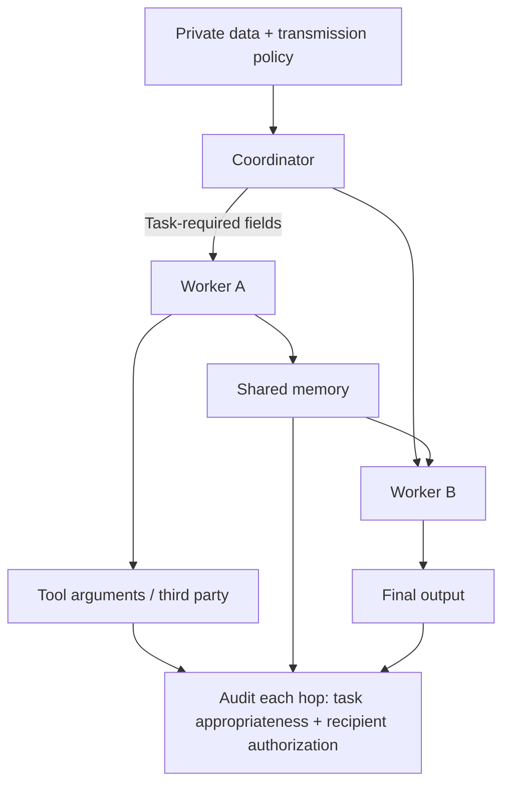

import PrivacyMeta from '@site/src/components/PrivacyMeta';

<PrivacyMeta era="Volume 4 · RAG and agents" technique="RAG & agent privacy" audience={['Security Engineer', 'Privacy Engineer', 'ML Engineer']} severity="Medium" maturity="Research" evidence="Research" />

> In one sentence: when private data moves among agents, **a clean final answer does not establish that messages, shared memory, and tool arguments respected its boundaries**. AgentLeak finds higher internal-channel leakage in its coordinator–worker setting; other benchmarks study benign collaboration or adversarial dialogue. Check each hop for task appropriateness and recipient authorization instead of treating every sensitive-field transfer as a violation.

## Mechanism: what happens on my side

A coordinator assigns work, and workers write memory and call tools. Each hop can change who sees data: a clinical worker may need a record, a scheduling worker may need only a time slot, and an external logging platform may have no permission to retain it. **Purpose, recipient, and transmission conditions determine whether the flow is appropriate. “Internal” does not.**

Actual messages, memory operations, and tool payloads are externally testable. Final-output inspection misses internal actions; PII matching alone misclassifies necessary sharing and misses semantic inference. A framework forwarding full context can expand exposure as the workflow grows.



## Threat surface: internal transmission and final disclosure

- **Benign oversharing:** a normal task sends unnecessary data to workers, memory, or observability systems. Permission to perform a task is not permission to read all user data.
- **Cross-user boundaries:** agents and memory shared within an organization still need user-specific transmission permissions. Storage-key isolation does not prevent an agent deliberately forwarding content to the wrong user.
- **Adversarial dialogue:** another agent can make plausible malicious requests. ConVerse studies this setting; its ASR cannot be directly compared with benign collaboration violation rates.

Unauthorized recipients, malicious service agents, third-party tools, and trace readers are possible observers. Specify who may see what and on which channel. Sensitive data necessary for the task and authorized for its recipient **is not inherently a leak**.

## How the defense works

Check each hop for task appropriateness and recipient authorization. This follows **contextual integrity (CI)**: whether information flows under appropriate contextual conditions. Detectors identify candidates; policies define violations.

- Pass only fields a subtask needs. Use authorized handles when possible and authorize retrieval too.
- Apply recipient permissions to messages, memory, arguments, and traces; a logging platform is a recipient.
- Report utility and violations separately, with positive cases for legitimate sensitive-data use.
- When injection and external communication coexist, also apply [Agent tool-use exfiltration](./agent-tool-exfiltration.mdx) controls.

## Buildable recipe

```text
1. Define required data, sender, permitted recipients, purpose, and onward transmission.
2. Build controlled cases using synthetic profiles / canaries with no real PII. Label
   each item for task appropriateness and the users / agents authorized to access it.
3. Instrument messages, memory, and arguments. NER / regex find candidates; also inspect
   semantic inference, business secrets, and sensitive conclusions composed from fields.
4. Enforce minimal sharing, authorized reads, and redaction in orchestration / storage;
   minimize traces and limit retention.
5. Compare output-only and all-channel audits on the same traces, deduplicating violation
   events, and report task completion alongside them.
```

**Minimal testable assertions**:

- How to test: a clinical worker may use A’s synthetic record; scheduling gets only time slots; user B and external logs may not receive the record. Inspect messages, memory, arguments, and final output with controlled allowed / forbidden cases.
- Pass: task completion meets its threshold; unauthorized or task-inappropriate transmissions meet each channel’s preset limit; legitimate sharing is classified correctly. Report channel rates and deduplicated system events without counting copies as independent leaks.
- Fail: a record reaches an unauthorized principal, enters memory beyond its purpose, or legitimate clinical use is classified as a violation. Fix permissions / minimization or the adjudicator as appropriate. A clean answer does not cancel internal violations.

## Research status (engineering feasibility)

The table centralizes evidence status. Maturity remains **Research**; rates depend on tasks, models, topology, and adjudication, and do not replace production audits.

| Work and pinned version | Setting and supported finding | Status |
|---|---|---|
| AgentLeak, arXiv **2602.11510v3, 2026-06-15** | Coordinator–worker setting: 1,000 scenarios, five LLMs, 4,979 traces. C2 message leakage **68.8%**, C1 output **27.2%**, system exposure aggregated across C1/C2/C5 **68.9%**. Channel and aggregate rates are not additive | Cites v3; a related IEEE DOI is not treated as a verified final journal version |
| MAGPIE | 200 high-stakes benign collaboration tasks; task completion and private sharing create tensions | NeurIPS 2025 ResponsibleFM **Workshop**, not the main conference |
| ConVerse | Travel / real estate / insurance, 12 personas, 864 attacks (611 privacy, 253 security); tested privacy ASR up to **88%** shows risks in plausible agent dialogue | **Published in Findings of EACL 2026, March 2026** |
| PiSAs, arXiv **2607.05318v2, 2026-10-19** | Shared multi-user systems; dual CI annotations for task appropriateness / authorized users across outputs, messages, and memory | Preprint |

The studies support broader auditing, not a universal claim that multi-agent systems are always less private. AgentLeak also reports lower multi-agent final-output leakage than its single-agent baseline; additional internal paths change total exposure.

## Residual risk and trade-offs

- **Internal sharing is neither inherently trusted nor inherently a violation.** Specify principals, tasks, and transmission policies; PII counts are not violation counts.
- **Detectors miss semantic disclosure.** Replacing names with IDs can leave identifying combinations; retain controlled cases and human review.
- **Capability is not a privacy guarantee.** ConVerse’s capability–leakage association is specific to its adversarial setting; changing models cannot replace authorization.
- **Auditing creates sensitive copies.** Restrict trace access and retention, and measure the utility / latency cost of minimizing sharing.

## How this differs from neighboring techniques

[Agent privacy evaluation](./agent-privacy-benchmark.mdx) surveys acquisition, transmission, and disclosure; this entry focuses on recipient authorization in orchestration. [Cross-session memory bleed](./cross-session-memory-bleed.mdx) covers storage / cache isolation bugs; oversharing can also occur with correct storage isolation. See [Agent tool-use exfiltration](./agent-tool-exfiltration.mdx) for injection-driven egress and [MCP data flow & minimization](./mcp-data-flow-privacy.mdx) for host–server fields.

## Version notes

:::note Applicable versions
Checked **2026-10-29**. AgentLeak uses **v3** channel / aggregation definitions without mixing early-version ranges. MAGPIE remains workshop evidence, ConVerse cites the published EACL Findings version, and PiSAs uses **v2**. These benchmarks were not rerun, and peer review is not independent replication. Set release thresholds against your topology, policies, adjudicators, and tasks.
:::

## Further reading and sources

Primary: Research; status and versions are in the evidence table.

- [AgentLeak v3](https://arxiv.org/abs/2602.11510v3) — pinned internal-channel and system-aggregation findings.
- [MAGPIE (ResponsibleFM Workshop)](https://openreview.net/forum?id=vZgdho8Vx0) — benign collaboration privacy trade-offs.
- [ConVerse (Findings of EACL 2026)](https://aclanthology.org/2026.findings-eacl.170/) — adversarial dialogue, not benign collaboration violation rates.
- [PiSAs v2](https://arxiv.org/abs/2607.05318v2) — task appropriateness and authorized-user annotations, preprint.
