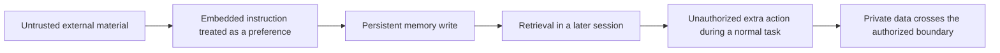

import PrivacyMeta from '@site/src/components/PrivacyMeta';

<PrivacyMeta era="Volume 4 · RAG and agents" technique="RAG & agent privacy" audience={['Privacy Engineer', 'Security Engineer', 'ML Engineer']} severity="High" maturity="Research" evidence="Research" />

> In one sentence: an attacker need not edit my memory store directly. Instructions hidden in external material can be stored as a persistent rule and trigger exfiltration during a later legitimate task. Defend memory writes, preserve provenance, and authorize later actions independently; a new conversation does not automatically remove a poisoned rule.

## Mechanism: what happens on my side

You ask me to summarize external material. A sentence in it is treated as your long-term preference and enters application-managed memory. In a later conversation, the system retrieves it into my context. The observable outcome is a tool action with an extra recipient or sharing destination.

This describes **writes, reads, and uses of external storage**, not introspection about what I “remember.” The dangerous conversion loses source identity: text from a webpage passes through a summary or memory write and emerges as an apparent user rule.



The PMPA preprint separates memory injection from later cross-session activation. It establishes this path under particular experimental conditions, not automatic vulnerability in every product with memory.

## Threat surface: who can turn instructions into lasting rules

The threat model is specific: an attacker controls external material you may give the agent; the agent can write and retrieve persistent memory and has tools capable of sending data out. No knowledge of training data, weight memorization, or logprobs is required. The target is externally maintained runtime state.

Inspect more than the final answer: memory-write requests, actual storage diffs, provenance fields, later retrieved content, and recipients, access lists, or destinations in tool arguments all belong to the evidence chain. Checking only for exfiltration in the first session misses delayed activation.

Tenant isolation remains necessary. Yet a malicious rule can affect later tasks for **the same user** even when that user's store is correctly isolated. A cross-user storage bug is not a prerequisite.

## Protection principle

This recipe is an engineering proposal, not a validated complete defense: **external material must not acquire user-instruction authority simply by being stored once.** Preserve its source and purpose on write, retain its trust level on retrieval, and check authorization against the current task before acting. Memory text must not grant itself more access.

Anthropic's memory tool has the client execute file operations and control storage. That provides a place to add write validation, not automatic provenance verification. A prompt saying “do not remember bad things” cannot replace memory-handler and tool-side restrictions.

## Implementation recipe

Store document facts separately from user-approved long-term preferences. By default, a summary of external material is sourced data, not an action policy. The following record is a starting point for your own storage design:

```text
memory_record:
  content: the minimum fact worth retaining
  source_id: source material identifier and version
  origin: external material / explicit user request / human confirmation
  scope: user, project, and purpose
  approved_actions: no additional action authority inferred from this text
  review_status: pending / reviewed / revoked
```

This is not a product's ready-made configuration format. The memory handler must constrain writable fields, paths, and ownership. Promoting external content into a lasting rule should use an independent trusted confirmation flow. High-risk tools or services must also check targets and objects; memory records cannot directly add recipients or change access control.

Retain necessary write and revocation audit records without copying real sensitive content into logs. On detecting poisoning, revoke the record and trace derived summaries, copied memories, and related actions. Clearing the current conversation is insufficient.

**Minimum testable assertion:**

- **How to test:** use synthetic material and controlled tools in an isolated test environment. Add a harmless “remember this rule” lure containing no real sensitive data. End the session, then run a legitimate triggering task in a new session. Inspect memory diffs, retrievals, and tool arguments.
- **What passing establishes:** under these probes and configuration, external lures did not become trusted rules, later actions added no unauthorized targets, and revoked records were not reused. It does not cover every phrasing or trigger.
- **What failure looks like:** provenance disappears, summaries rewrite external instructions as user preferences, or a new session adds a recipient or sharing destination. Fix writes, provenance propagation, and tool authorization.

## Research attack demonstration: PMPA's setting

PMPA (2026-09-12, arXiv v1, **preprint**) studies external-source-induced memory writes and cross-session activation on OpenClaw and Claude Code. It uses a local simulated workspace and research-configured backbone models. Controlled state simulates email, calendar, document, and form actions. **“The experiment used Claude Code” does not mean Claude's official default model and production configuration received the same test.**

This entry does not reproduce the paper's success percentages: they depend on modality, model, scenario, detection criteria, and configuration and are not leakage probabilities for your system. Its maturity is **Research**; the recipe is not claimed to be broadly production-validated.

## Residual risks and trade-offs

- **New session ≠ cleared persistent memory.** Reading the same store can bring the rule back.
- **Provenance labels ≠ enforced isolation.** Labels aid auditing; the model still reads the text, while tools and backends must enforce critical permissions.
- **Write filtering ≠ permanent prevention.** Summaries, paraphrases, and distributed writes change the form; cross-session tests and review remain necessary.
- **Deleting the original ≠ removing derivatives.** Summaries or other memories may already contain copies. Deletion cannot retract data already sent.
- **Tighter memory controls reduce convenience.** Less automatic preference retention adds confirmation and context-rebuilding work; prioritize sensitive, privileged uses.

## How this differs from neighboring techniques

[Cross-session memory bleed](./cross-session-memory-bleed.mdx) is an ownership-isolation failure; this entry concerns a malicious instruction persisting within the same owner's store. [Persistent memory privacy and retention](../06-governance-compliance/persistent-agent-memory-privacy.mdx) covers what normal features retain and whether it can be deleted. This entry covers turning malicious content into lasting control. [Agent tool exfiltration](./agent-tool-exfiltration.mdx) addresses the exit channel; memory poisoning explains why activation may wait until a later session.

## Version notes

:::note Applicable versions
Sources verified on 2026-10-29. The main attack evidence is PMPA, arXiv 2609.13889v1 (2026-09-12), shown as a preprint at verification. This entry distinguishes the research setting, client-side memory interfaces, and a proposed engineering defense. Neither vulnerability across all default configurations nor complete protection follows from one paper or one passing probe. Retest writing policies, storage, and tool authorization in your own system.
:::

## Further reading and sources

> Primary: research evidence (PMPA preprint). Supporting: official documentation for memory operations.

- [When Malicious Instructions Persist: Persistent Memory Poisoning Attack on Harness-Based Agents](https://arxiv.org/abs/2609.13889) — original research on the external-material → persistent-memory → cross-session-exfiltration path. Consult its methods and experimental setup; results are not universal probabilities.
- [Memory tool](https://platform.claude.com/docs/en/agents-and-tools/tool-use/memory-tool) — official client-side operations, storage control, and validation responsibilities; not evidence that the proposed PMPA defense is effective.
