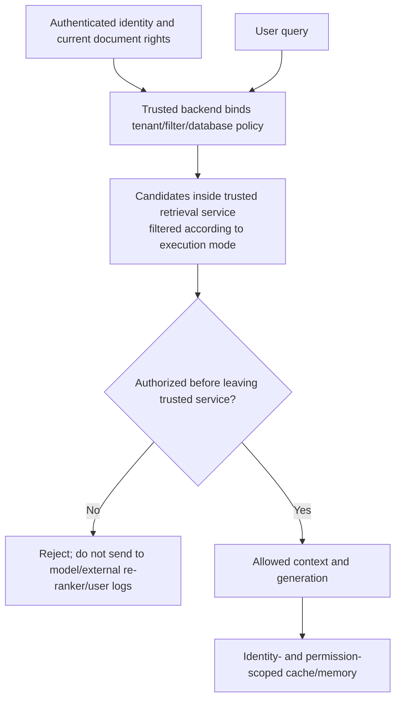

import PrivacyMeta from '@site/src/components/PrivacyMeta';

<PrivacyMeta era="Volume 4 · RAG and agents" technique="RAG & agent privacy" audience={['Privacy Engineer', 'Security Engineer', 'ML Engineer']} severity="High" maturity="Experimental" evidence="Official docs" />

> In one sentence: multi-tenant RAG privacy depends on authenticated identity, document authorization, retrieval / re-ranking / context, and caches together. Vectors are not anonymization, and namespaces do not authorize callers. Filter before unauthorized content leaves the trusted boundary; **post-filtering inside a trusted retrieval service is not inherently a disclosure**, and Azure security trimming is not invariably application-side post-filtering.

## Mechanism: what happens on my side

I answer from supplied retrieval results; I cannot replace system decisions about each chunk’s authorization. A trusted backend derives tenant scope from authenticated identity and current permissions, supplying allowed documents to retrieval, re-ranking, and generation. Unauthorized content sent to an external model, re-ranker, user-visible response, or log is a separate disclosure point.

Embedding inversion is a related representation risk: with raw vectors, an attacker can attempt reconstruction under particular encoders / priors. Not every vector is inevitably recoverable verbatim; see [embedding inversion](./embedding-inversion.mdx).



## Threat surface: where authorization can be lost

- A caller forges tenant / namespace / group_ids and the backend trusts them.
- Retrieval is correct but re-ranking, context, traces, caches, exports, or backups use broader rights.
- Permissions are revoked but stale caches or persistent memory still return content.
- Source text is restricted while raw vectors are downloadable, enabling inversion attempts; at-rest encryption does not stop a credentialed query service reading them.

## How the defense works

Separate authentication, authorization, and partitioning: namespaces / shards control where data lives; permissions control who can select it. A trusted backend binds identity and checks authorization before retrieval results leave its boundary. ANN pre-filtering / post-filtering are execution and recall choices, not binary safety labels. Filtering after content already reached a model or external log is too late.

## Buildable recipe

| System | Checked primitive | Additional authorization condition |
|---|---|---|
| Pinecone | Namespace-level partitioning; shared-index metadata approaches also documented | Select namespaces from identity; do not permit arbitrary caller switching |
| Azure AI Search | OData security filters; separate native ACL support | A string principal is not authentication; bind filters in a trusted backend. Check vector pre/post modes separately |
| Weaviate | Separate shard per tenant | Restrict tenant selection, collection rights, and credentials |
| Qdrant | Payload tenant fields / indexes and tiered multitenancy | Partition optimization is not automatic authorization; check JWT/server filters and read/write endpoints |
| PostgreSQL / pgvector | RLS and FORCE ROW LEVEL SECURITY | Superusers/BYPASSRLS still bypass; owners normally bypass. Use low-privilege app roles, trusted tenant variables, and pool resets |

```text
1. Derive identity and current ACL from authenticated sessions; reject arbitrary caller-selected tenants/groups.
2. Scope queries, re-ranking, generation, raw-vector exports, traces, and caches consistently.
3. Minimize sensitive indexed fields; retain lineage for document/vector/cache erasure and revocation.
4. Insert synthetic tenant canaries; test reads/search/exports/updates/post-revocation using distinct real identities.
5. Keep positive controls for legitimate same-tenant and authorized-shared access; blanket denial is not isolation success.
```

**Minimal testable assertion**: under A/B identities, B cannot retrieve A’s unauthorized canary through responses, model / external-re-ranker context, returned vectors, user-visible traces, or caches, while A’s allowed read succeeds. Repeat after revocation and cache updates. All assertions must hold together; finite success does not prove every path safe.

## Real cases and product scope

Official docs describe deployable primitives; this entry does not certify individual account configurations. Azure’s security-filter pattern is string-based query filtering without authenticating the principal; native ACL and data-source / API eligibility require separate checks. PostgreSQL’s current stable documentation is 18 while 19 remains RC; a “current” URL does not identify your deployment version.

OpenAI’s 2023 cache incident is an adjacent state-isolation failure, **not a vector-RAG disclosure demonstration**. The provider reports possible exposure affecting about 1.2% of Plus subscribers active in a particular nine-hour window, not confirmed viewing of all affected records. It illustrates the need for shared-state authorization and ownership checks.

## Residual risk and trade-offs

Strict authorization can change recall and cost; measure the effect rather than assume a shared large index always improves recall over correct partitioning. Filters do not recover already-exported vectors or old logs; propagate permission changes and erasure. [Cross-session bleed](./cross-session-memory-bleed.mdx) and [data lifecycle](../06-governance-compliance/data-lifecycle-deletion.mdx) expand these state concerns.

## Version notes

:::note Applicable versions
Checked Pinecone / Weaviate / Qdrant, Azure security/vector filters, PostgreSQL RLS, and embedding research on 2026-10-29. Actual account permissions were not inspected; native ACL source/API eligibility and preview status need deployment-time checks. Review by 2026-12-29, earlier for identities, ACL/tenant APIs, RLS roles, re-ranking/logging/caching, or product eligibility.
:::

## Further reading and sources

- [Pinecone multitenancy](https://docs.pinecone.io/guides/index-data/implement-multitenancy)
- [Azure security-filter pattern](https://learn.microsoft.com/en-us/azure/search/search-security-trimming-for-azure-search)
- [Azure vector-filter modes](https://learn.microsoft.com/en-us/azure/search/vector-search-filters)
- [Weaviate multitenancy](https://docs.weaviate.io/weaviate/manage-collections/multi-tenancy)
- [Qdrant multitenancy](https://qdrant.tech/documentation/manage-data/multitenancy/)
- [PostgreSQL row security](https://www.postgresql.org/docs/current/ddl-rowsecurity.html)
- [Text Embeddings Reveal (Almost) As Much As Text](https://arxiv.org/abs/2310.06816)
- [OpenAI 2023 outage](https://openai.com/index/march-20-chatgpt-outage/)
