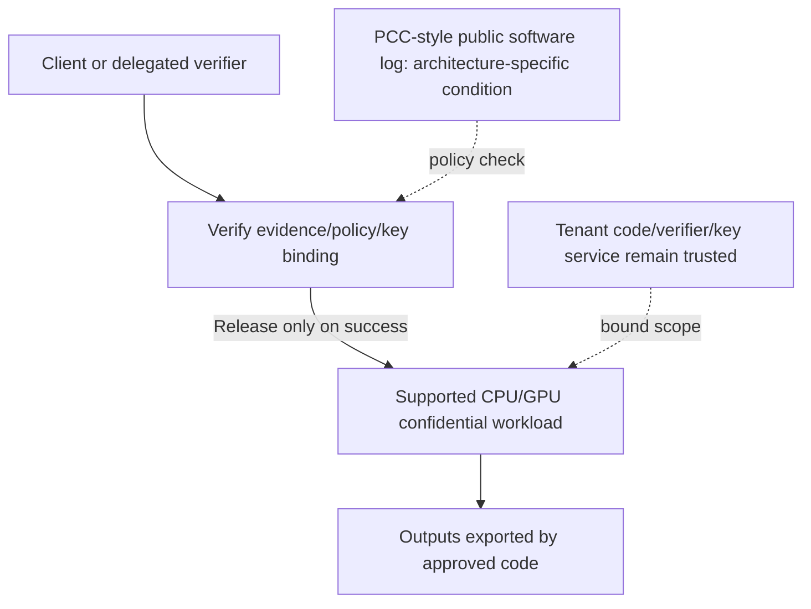

import PrivacyMeta from '@site/src/components/PrivacyMeta';

<PrivacyMeta era="Volume 5 · Frontier and deployment" technique="Privacy-preserving computation" audience={['Privacy Engineer', 'Security Engineer', 'ML Engineer']} severity="Medium" maturity="Production" evidence="Official docs" />

> In one sentence: confidential inference combines supported hardware isolation, attestation, and key-release policy to reduce host-operator access to inputs/weights. **Tenant software inside a CVM still processes plaintext**; a confidential VM alone does not establish confidentiality from the application provider. Apple PCC combines software transparency with device verification; other deployments do not automatically have the same transparency-log architecture.

## Mechanism: what happens on my side

I process inputs inside an approved CPU/GPU environment. A verifier checks hardware certificates, firmware/software measurements, freshness, revocation, and security mode, binding keys to the approved recipient before release. Software identity does not prove absence of malicious code; enumerate tenant, image authority, verifier, and key-service trust.



## Threat surface

Protection covers only memory/links in the platform threat model. Logs, external tools, permitted outputs, and unprotected interconnects can leak. NVIDIA’s current Dev model distinguishes encrypted NVLink in Blackwell multi-GPU CC from unencrypted GPU-to-GPU NVLink in Hopper Protected PCIe. CPU-GPU encryption alone does not certify the whole cluster.

## How the defense works

Separate host operator, tenant application, chip vendor, and end user. Confidentiality from the application provider additionally requires approving workload behavior and export policy. PCC’s public software/device checks limit silent image substitution, while open to inspection does not mean inspected and attested does not mean bug-free.

## Buildable recipe

```text
1. Pin hardware generation/mode, CPU/GPU firmware, drivers, runtime, and model workload.
2. Enumerate trust and inspect client, CPU-GPU, and GPU-GPU paths.
3. Gate sensitive data on fresh evidence, revocation, measurement policy, and key binding.
4. Inventory logs, traces, tools, storage, and outputs; claim confidentiality only for protected paths.
5. Negatively test changed images, stale evidence, revoked certificates, and wrong keys;
   retain positive controls for approved operation.
```

**Minimal testable assertion**: failed policy checks prevent sensitive-key release with no unprotected bypass; measure utility/latency on the complete workload. Finite negative tests do not exclude side channels, and unverified evidence does not mean hardware provided no isolation at all.

## Real cases / deployments

- **Apple PCC**: its 2024 design ties device checks to approved software releases and public transparency, within that architecture.
- **NVIDIA 2026-09-22**: production-inference guidance describes TensorRT-LLM adaptations for movement, tuning, and multiple GPUs, not just one added signature check.
- **Google 2026-10-21**: Confidential G4 (RTX PRO 6000 Blackwell Server) is GA; Confidential Space support in the same post is rolling out in coming weeks, not all GA that day.
- **HE/MPC**: different trust and computational costs; evaluate LLM feasibility by scheme/workload benchmarks rather than declare all fully private inference impossible.

## Residual risk and trade-offs

Availability, side channels, tenant bugs, output inference, and supply-chain updates need governance. Applicable legal obligations can affect retention/processing arrangements, but a legal order alone does not establish an existing hardware-readable plaintext copy. Assess technical visibility and legal responsibility separately.

## How this differs from neighboring techniques

[TEE](../01-foundations/trusted-execution-environment.mdx) is a mechanism, [local inference](./on-device-inference-privacy.mdx) reduces cloud inputs, and [service boundaries](../06-governance-compliance/inference-service-data-boundary.mdx) govern endpoints/contracts/retention. This entry concerns integration and verification of confidential inference.

## Version notes

:::note Applicable versions
Checked PCC, NVIDIA Dev threat model/production integration, and the G4 GA announcement on 2026-10-29. Dev docs are not guarantees for every release; actual regional supply was not checked. Review by 2026-12-29, earlier for hardware/drivers, attestation/key policy, product eligibility, or security advisories.
:::

## Further reading and sources

- [Apple PCC design](https://security.apple.com/blog/private-cloud-compute/)
- [NVIDIA Dev threat model](https://docs.nvidia.com/confidential-computing/virtual-machines/threat-model)
- [NVIDIA production confidential-inference integration](https://developer.nvidia.com/blog/enabling-private-high-performance-production-ai-inference-with-nvidia-confidential-computing/)
- [Google Confidential G4 GA](https://cloud.google.com/blog/topics/ai-infrastructure/confidential-g4-gpus-are-ga/)
