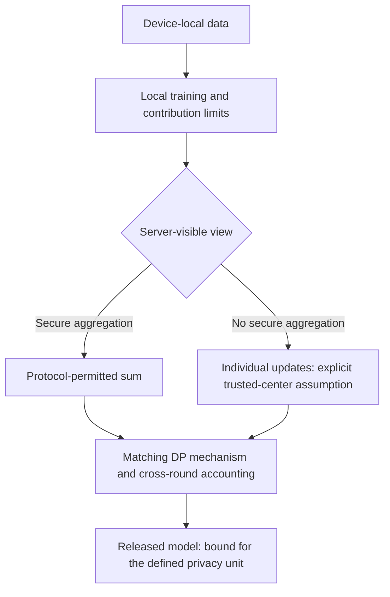

import PrivacyMeta from '@site/src/components/PrivacyMeta';

<PrivacyMeta era="Volume 5 · Frontier and deployment" technique="Federated learning & secure aggregation" audience={['Privacy Engineer', 'ML Engineer']} severity="Medium" maturity="Production" evidence="Research" />

> In one sentence: FL reduces centralization of raw records without automatically protecting updates or the final model. DP bounds a defined unit’s contribution to released results; secure aggregation restricts server visibility of individual updates. Their combination depends on the threat model. Gboard’s 2023 paper deploys over 20 DP models, **two additionally using secure aggregation**, rather than one universal production configuration.

## Mechanism: what happens on my side

My parameters are updated through device-side training and server aggregation. Gboard uses the DP-FTRL mechanism with contribution limits and noise assumptions, avoiding a uniform-client-sampling requirement. This does not remove participation constraints, randomness, or accounting. Noise may come from a trusted center or a distributed protocol; not every FL system independently adds sufficient noise on each device.

Red line: a client is an engineering unit, while a user is a protection target. Multiple devices per person, shared devices, and repeated participation require explicit mapping and accounting; my self-report cannot certify them.



## Threat surface

Central DP without secure aggregation can bound contributions in the released model while leaving pre-noise updates visible to the trusted server. Secure aggregation does not bound individual information in the sum. Analyze repeated participation, availability-dependent selection, small cohorts, and malicious servers under the concrete protocol.

## How the defense works

First declare whether the adversary is the server or only release recipients, then choose central DP, distributed DP / secure aggregation, or local DP. Apple’s 2017 telemetry uses **event-level local DP** with transmission limits, not one ε for a user’s entire lifetime. De-identification supports minimization but does not replace units and composition.

## Buildable recipe

```text
1. Define record/device/user adjacency, cross-device mapping, clipping, and participation limits.
2. Record server/client views, collusion, and dropout assumptions; choose matching DP/aggregation.
3. Recompute accounting using actual sampling, noise, and repeated participation; compose private
   tuning, evaluation, and extra releases.
4. Test inversion/MIA with controlled canaries and report utility; attacks do not replace formal analysis.
```

**Minimal testable assertion**: independent accounting agrees within numerical tolerance under the same configuration, with enforced protocol/participation limits and explicit center visibility. Failed inversion or an “FL” label does not establish user-level protection.

## Real cases / production deployments

Gboard 2023 v2 reports over 20 language models using DP-FTRL and ρ-zCDP; conversion to (ε,δ) requires δ and composition. Only two models additionally used secure aggregation during training. Apple 2017 reports production event-level local-DP telemetry. These named historical deployments do not establish every 2026 feature or future default.

## Residual risk and trade-offs

Protection depends on budget, unit, and trusted boundary. Local-device security, population statistics in the model, and malicious-update integrity are not one DP claim. Noise and contribution limits affect utility; measure your task rather than copying provider settings.

## How this differs from neighboring techniques

[DP fine-tuning](../03-conversational-llms/dp-fine-tuning.mdx) explains training mechanisms; [secure aggregation](./secure-aggregation.mdx) explains server views. This entry covers federated participation and deployment conditions.

## Version notes

:::note Applicable versions
Rechecked Gboard v2 and Apple deployment sources on 2026-10-29, correcting universal SecAgg and client-equals-user claims. Not all current product settings were checked. Review by 2027-01-29, earlier for participation/units, accounting, production models, or aggregation configuration.
:::

## Further reading and sources

- [Gboard DP-FL (ACL 2023 Industry)](https://arxiv.org/abs/2305.18465)
- [Apple Learning with Privacy at Scale (2017)](https://machinelearning.apple.com/research/learning-with-privacy-at-scale)
