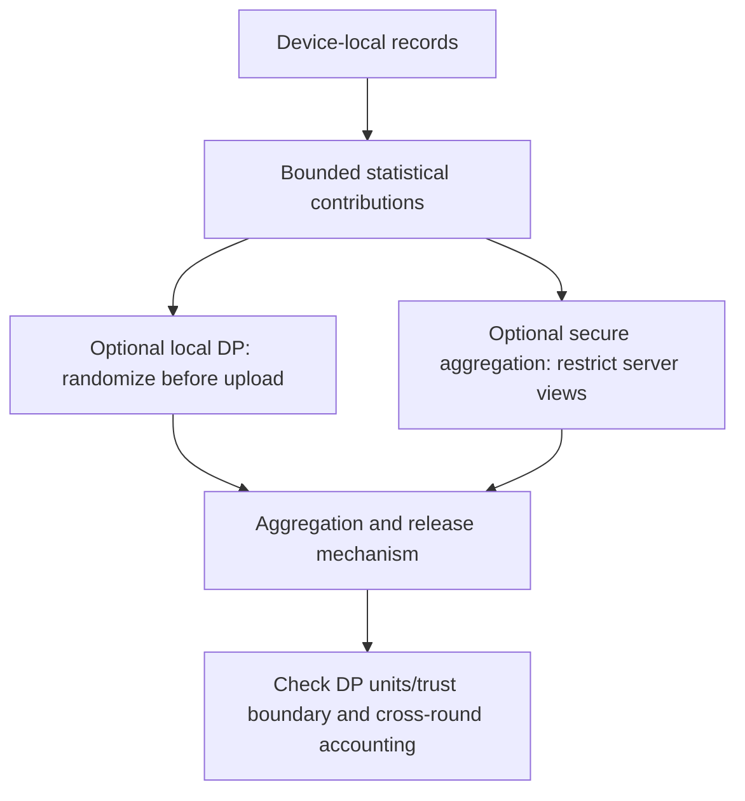

import PrivacyMeta from '@site/src/components/PrivacyMeta';

<PrivacyMeta era="Volume 5 · Frontier and deployment" technique="Federated learning & secure aggregation" audience={['Privacy Engineer', 'ML Engineer', 'Compliance Engineer']} severity="Medium" maturity="Production" evidence="Research" />

> In one sentence: federated analytics computes local statistical contributions and reduces raw-data centralization. Secure aggregation restricts server views of individuals; DP bounds a defined unit’s influence on released statistics. Central, local, and distributed DP have different trusted boundaries, rather than one mandatory combination for all private statistics.

## Mechanism: what happens on my side

Devices compute counts, histograms, or candidate frequent items from local records; the system combines them into released statistics. No model training is required. If the statistics later train me, analyze training leakage separately. Red line: keeping raw data on devices describes data flow, not the privacy of uploaded contributions or releases.



## Threat surface

The server may observe device contributions; recipients may examine small cohorts or cross-round differences. A secure sum can disclose individuals with auxiliary knowledge; DP does not hide information already seen by a trusted center before noise. Local DP can protect uploaded reports directly, but event-level protection is not automatically lifetime user-level protection.

## How the defense works

Define the adversary before choosing mechanisms. To hide individual inputs and bound influence in released statistics, combine secure aggregation with matching DP. Zhu et al.’s sampling/threshold guarantee depends on their specific heavy-hitters algorithm and assumptions; arbitrary top-K, de-identification, or low-frequency thresholds are not automatically DP.

## Buildable recipe

```text
1. Define the statistic, privacy unit, adjacency, contribution limits, and cross-device/round participation.
2. Record device, server, and recipient views; choose central/local/distributed DP and aggregation.
3. Check corruption, collusion, dropout, and permitted output; finite tests are not a cryptographic proof.
4. Independently recompute epsilon/delta and composition of all queries/releases; match thresholds and
   sampling to the specific algorithm.
5. Test small-cohort/difference attacks with authorized or synthetic groups; report error and minority utility.
```

**Minimal testable assertion**: participation/releases conform to protocol and DP analysis, with independent accounting agreement; attacks and utility meet declared thresholds. Failed inversion does not prove individual inputs unrecoverable, and aggregation alone is not DP.

## Real cases / production deployments

Google’s 2020 account describes secure aggregation for song-popularity statistics in Pixel Now Playing. It supports that named deployment, not DP for every statistic. Apple’s 2017 report describes event-level local-DP telemetry. The AISTATS 2020 federated heavy-hitters paper supplies a specific DP algorithm. Deployment evidence and algorithm guarantees cannot fill each other’s undocumented configuration gaps.

## Residual risk and trade-offs

Query selection, private tuning, and repeated releases may consume budget. Include small cohorts and auxiliary knowledge in the threat model. Noise, contribution bounds, and thresholds affect error and coverage, so averages alone are insufficient. Local-device security and malicious-client integrity are not the same DP guarantee.

## How this differs from neighboring techniques

[Secure aggregation](./secure-aggregation.mdx) restricts input views; [DP-FL](./dp-federated-learning.mdx) releases models; this entry releases statistics. [Gradient leakage](./gradient-leakage.mdx) concerns visible updates and does not replace analysis of arbitrary statistical queries.

## Version notes

:::note Applicable versions
Rechecked Google 2020, Apple 2017, and AISTATS 2020 primary sources on 2026-10-29, retaining named historical deployments and removing a universal mandatory combination. Current product query configurations were not comprehensively inspected. Review by 2027-04-29, earlier for query purpose, participation, contribution limits, DP algorithms, or repeated releases.
:::

## Further reading and sources

- [Google Federated Analytics (2020)](https://research.google/blog/federated-analytics-collaborative-data-science-without-data-collection/)
- [Federated Heavy Hitters Discovery with Differential Privacy (AISTATS 2020)](https://proceedings.mlr.press/v108/zhu20a.html)
- [Apple Learning with Privacy at Scale (2017)](https://machinelearning.apple.com/research/learning-with-privacy-at-scale)
