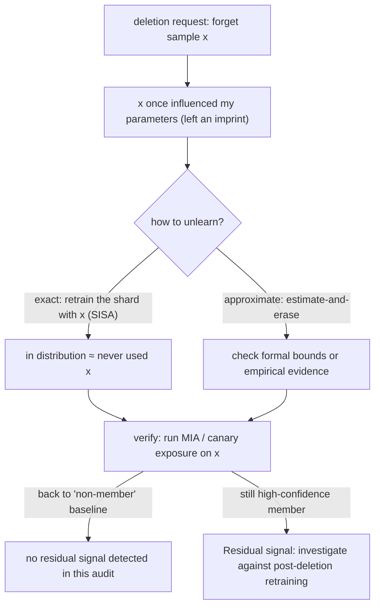

import PrivacyMeta from '@site/src/components/PrivacyMeta';

<PrivacyMeta era="Volume 5 · Frontier and deployment" technique="Machine unlearning & right to be forgotten" audience={['Privacy Engineer', 'ML Engineer', 'Compliance Engineer']} severity="Medium" maturity="Experimental" evidence="Research" />

> In one sentence: deleting a source record does not automatically remove model dependence on it. Exact unlearning compares distributions under the same training procedure after deletion; approximate unlearning may have formal bounds or only empirical evidence. MIA/extraction tests seek counterexamples; non-detection does not prove full-distribution equivalence.

## Mechanism: what happens on my side

A record once influenced my parameters: its gradient update left an imprint on me during training (the very source of memorization, extraction, and membership inference). To "forget" it, I have to erase its influence on the parameters.

- **Exact unlearning**: make the post-unlearning me, in distribution, **equal to "a me retrained from scratch having never used that record."** The gold standard is real retraining, but that's prohibitive for large models. Cao & Yang (2015, who coined machine unlearning) transform the learning algorithm into a **summation form** so deleting one sample updates only a few summations — far faster than retraining; Bourtoule et al. (**SISA**, 2021) **shard** training (Sharded / Isolated / Sliced / Aggregated) so unlearning retrains only **the shard containing that sample**, not the whole model.
- **Approximate unlearning**: the goal is proximity to the retrained distribution under a declared distance or indistinguishability definition. Some methods provide provable approximate bounds; others have only empirical evidence. “Approximate” does not universally mean “no formal guarantee.” Check applicability to the model, repeated deletions, and released views.

Red line: I don't write "I forgot it" — I can't introspect "did I truly forget." What's externally arguable is: **after unlearning, whether my behavior and distinguishability on that record return to the "never seen" level** (verified with metrics like membership inference, see Volume 1 [Membership inference](../01-foundations/membership-inference.mdx)).



## Threat surface: why "deleted" is often false

- **Output suppression ≠ true deletion**: making the model "refuse to output" something leaves it **still in** the weights — a different prompt or bypassed alignment can still extract it (same as training-data extraction).
- **Specify approximate bounds.** Certified methods differ from heuristic reversed gradients. Check distance, adjacency, deletion count, output view, and algorithm assumptions.
- **Deleting one record ≠ deleting its influence**: similar / correlated samples may have "learned" the deleted record's information back; copies in downstream distilled models, caches, logs, and backups must be handled too.
- **Verification is missing**: the most-lacking piece — most methods **can't produce evidence of "truly forgotten,"** only "we ran an unlearning step."

## How the defense works

Formal guarantees and empirical audits answer different questions. Exact unlearning compares with retraining the same procedure without the deleted data; certified approximate methods need explicit bounds and assumptions. Membership inference ([MIA](../01-foundations/membership-inference.mdx)) and canary exposure look for residual signals under declared attacks. Compare results with a matched post-deletion retraining baseline: a detected signal needs investigation, while a non-detection only supports the tested scope. An audit does not prove equality of full model distributions.

## Buildable recipe

```text
1. Pick a route:
   - Small models / shards you can retrain: use exact unlearning (SISA-style
     sharding, unlearning retrains only the affected shard).
   - Large models: evaluate "source deletion + retrain trigger threshold + output
     filtering" as a combination; don't pretend a point deletion = unlearning.
2. Trace the deletion request across the whole chain: training set, related/derived
   data, downstream distilled models, caches, logs, backups (cross-store
   propagation, see data lifecycle).
3. Always run unlearning verification after deletion: run MIA / check canary
   exposure on the target sample — did it return to baseline?
4. Keep deletion evidence: record "what was deleted + when + verification result"
   as an auditable artifact for evaluating the deletion request.
```

Every judgment (retrain trigger threshold, the verification FPR point, acceptable residual signal) carries **your model and threat model**; paper settings may not transfer.

**Minimal testable assertions** (turn "unlearning" into a regression check — don't stop at "we ran an unlearning algorithm"):

- How to test: after deletion, run membership inference (TPR at low FPR) / check injected-canary exposure on the target sample.
- Pass: relative to a matched retrain-without-deleted-data baseline, declared MIA / extraction attacks and budgets plus retained-set utility meet thresholds, with confidence intervals. This empirical gate does not prove equality of full parameter distributions; exact or certified approximate guarantees require algorithm assumptions and proofs.
- Fail: still a high-confidence member / exposure still high → compare against post-deletion retraining and investigate; retrain or change methods if needed — don't settle for output suppression.

## A real case / research progress

(This entry's maturity is "Experimental": what follows is research progress and feasibility, not an endorsement that verifiable unlearning for LLMs is in production.)

Machine unlearning was introduced by Cao & Yang (2015) — transform learning into a summation form so deleting a sample updates only a few summations, faster than retraining (IEEE S&P 2015). Bourtoule et al. (2021)'s **SISA** makes exact unlearning **affordable**: sharded training + cached intermediate state, so unlearning retrains only the shard with that sample, demonstrated across MNIST / CIFAR / ImageNet and various models (IEEE S&P 2021). But **verifiable unlearning at large-language-model scale remains an open problem** — approximate methods abound, strong guarantees are scarce, and evaluation metrics aren't standardized (see survey, 2024).

## Residual risk and trade-offs

Calling out each false security:

- **Output suppression ≠ unlearning.** Refusing to output merely covers it; it's still in the weights and can be bypassed and extracted.
- **Method names do not establish guarantees.** Exact/approximate labels need definitions, assumptions, and evidence; one failed attack is not certification.
- **Deleting one record ≠ deleting its influence.** Without handling related data, downstream models, and cache / log / backup copies, it isn't fully deleted.
- **Verification is hard, and only "at least this attack can't tell."** Passing MIA verification isn't absolute forgetting — just that the current attack can't detect it; a stronger attack might.
- **Exact unlearning is still expensive for large models.** SISA makes shard retraining affordable, but full exact unlearning of a large model is still a real engineering trade-off.

## Compliance mapping

- **Deletion-request evidence:** record the affected data and model versions, storage propagation, algorithm assumptions, and measured results. These support a technical audit trail; a passed MIA test is not proof of complete erasure.
- **Separate legal assessment:** whether a request applies, exceptions, deadlines, and sufficient evidence require review under the relevant jurisdiction and circumstances. This entry does not certify compliance or prescribe unlearning for every deletion request.

## How this differs from neighboring techniques

- **Machine unlearning vs. DP fine-tuning (Volume 3)**: DP is **prevention up front** (bound single-sample influence during training, see [DP fine-tuning](../03-conversational-llms/dp-fine-tuning.mdx)); unlearning is **deletion after the fact** (trained already, now erase one record's influence). Both concern "a single sample," one before, one after; a DP-trained model already bounds single-sample influence, making unlearning easier to argue.
- **Machine unlearning vs. membership inference (Volume 1)**: MIA is the **verification tool** for unlearning — after deletion, use it to falsify "forgotten." The relation is "attack ↔ using the attack to verify the defense" (see [MIA](../01-foundations/membership-inference.mdx)).

## Version notes

:::note Applicable versions
Checked the original SISA work and this book’s verification / benchmark entries on 2026-10-29. SISA compares with retraining the same sharded procedure without the deleted data, not arbitrary monolithic training. Approximate unlearning can have formal bounds, while attack failure remains empirical evidence. Review by 2027-01-29, earlier for changed deletion definitions, retraining baselines, sequential requests, or certified methods / recovery attacks.
:::

## Further reading and sources

- [Towards Making Systems Forget with Machine Unlearning (Cao & Yang, IEEE S&P 2015)](https://dl.acm.org/doi/10.1109/SP.2015.35) — coined machine unlearning: transform learning into a summation form so deletion updates only a few summations, faster than retraining.
- [Machine Unlearning / SISA (Bourtoule et al., IEEE S&P 2021; arXiv 1912.03817)](https://arxiv.org/abs/1912.03817) — sharded training makes exact unlearning affordable: unlearning retrains only the shard containing that sample.
- [Machine Unlearning: A Comprehensive Survey (2024; arXiv 2405.07406)](https://arxiv.org/abs/2405.07406) — a survey of exact vs. approximate unlearning, verification challenges, and open problems.
