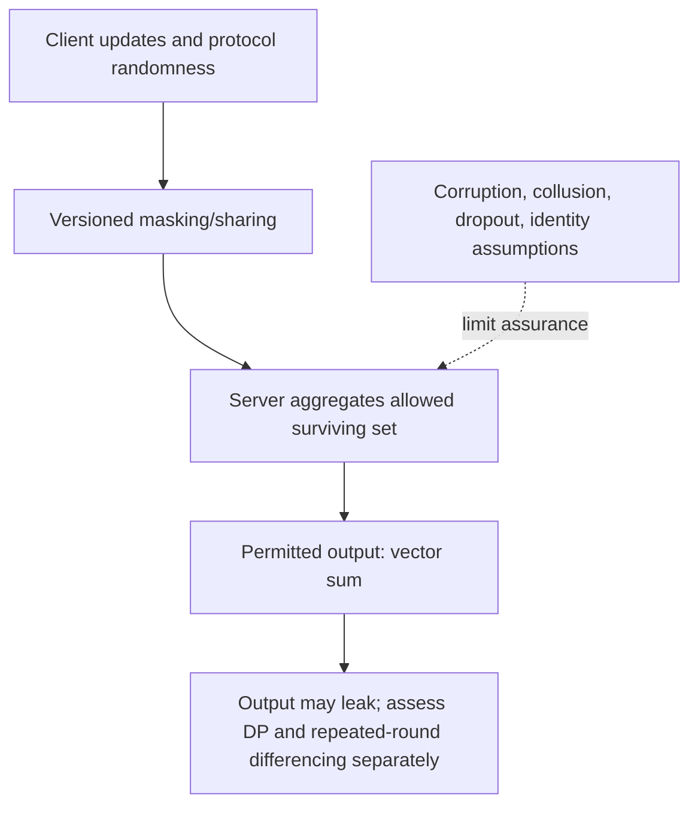

import PrivacyMeta from '@site/src/components/PrivacyMeta';

<PrivacyMeta era="Volume 5 · Frontier and deployment" technique="Federated learning & secure aggregation" audience={['Privacy Engineer', 'ML Engineer', 'Security Engineer']} severity="Medium" maturity="Production" evidence="Research" />

> In one sentence: under a concrete corruption/collusion/dropout model, secure aggregation gives the server a permitted vector sum without additionally exposing honest clients’ individual updates. **The permitted sum itself can still leak**; “learns no individual contribution” is not unconditional. The full CCS 2017 protocol and MLSys 2019 system provide mechanism and production evidence; the 2016 workshop manuscript is a different publication.

## Mechanism: what happens on my side

Devices compute updates and use protocol components including pairwise masks, self masks, and secret sharing. Under the allowed surviving set and recovery procedure, the server removes/cancels the appropriate masks to recover the sum. Pairwise cancellation alone does not implement dropout or active security. Red line: assurances derive from protocol simulation security and parameter assumptions, not my claim that I did not look.



## Threat surface

CCS 2017 analyzes semi-honest and specified active adversaries, so not every malicious-server behavior is inherently out of scope. Check identity forgery, target isolation, collusion, and repeated-round selection against the variant and thresholds. If the adversary already knows every contribution except the target’s, the sum determines the target: a permitted-output and auxiliary-knowledge risk.

## How the defense works

Specify privacy thresholds, dropout tolerance, minimum survivors, and server/client collusion separately rather than using one “t” for every condition. Secure aggregation limits extra protocol-view information beyond permitted output. DP can bound a defined individual’s contribution to released aggregates; these are different objectives.

## Buildable recipe

```text
1. Choose an audited implementation; pin version, adversary model, and parameters instead of assembling masks.
2. Review identity, key agreement, sharing, dropout recovery, and reject/abort paths.
3. Assess small cohorts, known other contributions, and repeated-round differencing; choose DP by objective.
4. Use controlled updates at threshold edges, cancellation, collusion, and recovery; review proofs/implementation separately.
```

**Minimal testable assertion**: recovery and abort behavior match thresholds, the implementation does not explicitly expose target updates, and analysis includes permitted outputs and auxiliary knowledge. Tests are not cryptographic proofs; failed reconstruction does not establish zero leakage in every view.

## Real cases / production deployments

Google’s CCS 2017 publication provides the full protocol and threat model. MLSys 2019 describes secure aggregation in a production FL system to reduce data-center exposure of individual updates. This does not establish that every Gboard model enables it; see [DP-FL](./dp-federated-learning.mdx).

## Residual risk and trade-offs

Implementation errors, identities, excessive collusion, permitted outputs, and repeated-round policies can defeat objectives. Communication, surviving cohorts, and availability have costs; no generic overhead is given without vector dimensions and participation conditions.

## How this differs from neighboring techniques

[Gradient leakage](./gradient-leakage.mdx) attacks visible updates; this entry restricts protocol views. [HE/MPC](../01-foundations/he-mpc.mdx) covers broader secure computation, while secure summation is a specific function.

## Version notes

:::note Applicable versions
Checked CCS 2017 and MLSys 2019 on 2026-10-29, correcting the 2016-workshop citation and active-adversary scope. The protocol was not reproved. Review by 2027-04-29, earlier for protocol versions, identity/collusion/dropout assumptions, or repeated-release policies.
:::

## Further reading and sources

- [Practical Secure Aggregation (full CCS 2017 publication)](https://research.google/pubs/practical-secure-aggregation-for-privacy-preserving-machine-learning/)
- [Towards Federated Learning at Scale (MLSys 2019)](https://arxiv.org/abs/1902.01046)
