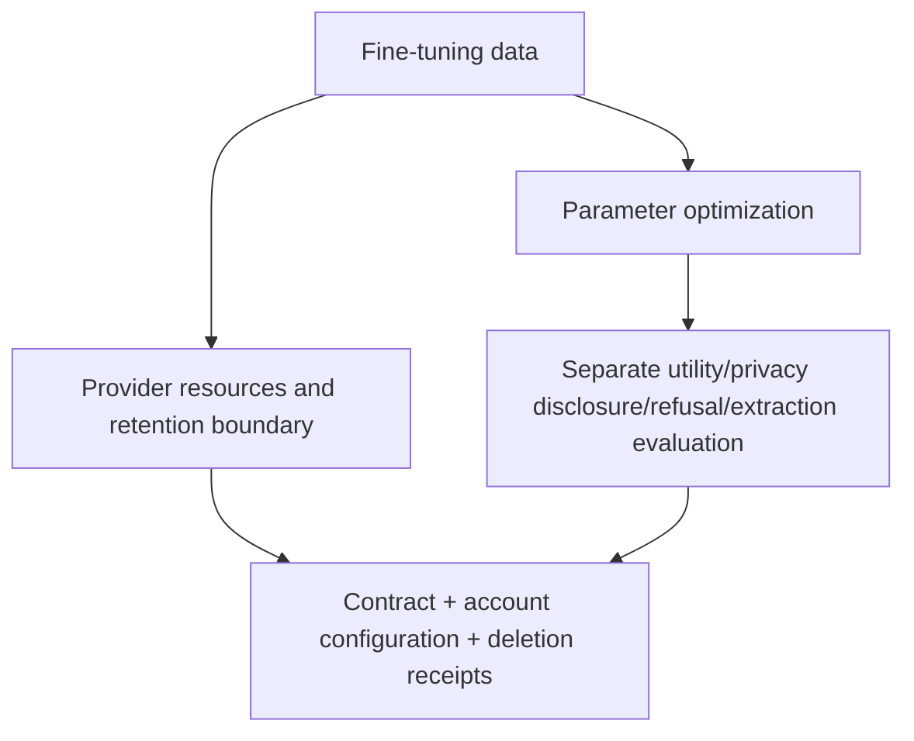

import PrivacyMeta from '@site/src/components/PrivacyMeta';

<PrivacyMeta era="Volume 6 · Governance and compliance" technique="Inference-service privacy" audience={['Privacy Engineer', 'Compliance Engineer', 'ML Engineer']} severity="Medium" maturity="Research" evidence="Official docs" />

> In one sentence: FTaaS requires separate checks of provider access/retention/deletion for data and derived models, and post-tuning behavioral regressions. Qi et al.’s 2023 experiments show safety guardrails can weaken under malicious or benign tuning. **This does not prove every privacy refusal declines or establish training-data extraction**; test privacy tasks separately.

## Mechanism: what happens on my side

Uploaded data, training files, jobs, checkpoints, and models are separate resources to track by endpoint and contract. Optimization changes my parameters and can affect useful tasks, refusals, and memorization together; my self-report cannot certify an isolated intact “privacy-alignment layer.” Compare behavior on the same authorized/unauthorized tasks before and after tuning.



## Threat surface

A provider’s “not used for foundation-model training” does not mean it never processes your requested tuning or stores files/checkpoints. Inference ZDR eligibility does not automatically cover training assets. Both malicious examples and ordinary tuning can affect safety, while privacy disclosure depends on data, recipient authorization, and attacker access; safety refusal rates are not a substitute.

## How the defense works

Minimize uploaded data, pin account/endpoint/model/region, and check retention, human access, ownership, sharing, deletion, and lawful retention by resource. After tuning, separately measure legitimate completion, unauthorized disclosure, correct refusals, and extraction. Suppressing authorized disclosure is not invariably improvement. DP can bound a training unit’s contribution without automatically protecting refusal policy.

## Buildable recipe

```text
1. Inventory training files, jobs, checkpoints, models, evaluations, and logs by retention/deletion/access.
2. Minimize and authorize provenance first; synthesis/sampling a subset does not automatically anonymize.
3. Pin base, tuning settings, canaries, and authorized/unauthorized controls; compare utility and disclosures.
4. Treat provider screening as an extra gate, not a replacement for privacy regressions and boundary checks.
5. Verify every resource and derived object on deletion; do not label unchecked items deleted or ZDR-covered.
```

**Minimal testable assertion**: under matched tasks/budgets/judgment, unauthorized disclosure and correct-refusal changes meet thresholds with intervals and useful-task performance. Inventories match contracts/configuration. No detected leakage from one model does not establish safety for other checkpoints or services.

## Real cases / checked product boundaries

- **Qi et al. (ICLR 2024)**: ten adversarial examples for under $0.20 concerns GPT-3.5 Turbo’s API then; benign-data safety regression was also observed. This historical safety study motivates, but does not demonstrate, a privacy-refusal regression.
- **Current OpenAI SFT docs**: describe training-input and output-model safety screening/thresholds, not individual privacy proofs. Check retention through current data controls and resource configuration.
- **Claude API retention page**: not a general FTaaS contract; feature/model/organization conditions do not establish a hypothetical tuning product’s availability. The old blanket seven-day claim is removed.
- **Current Google governance/ZDR page**: training restrictions and retention have a specific service scope, not zero retention for every tuning asset.

## Residual risk and trade-offs

Absence of a top-venue paper does not establish absence of risk or forbid threat modeling; general safety research also does not establish provider data leakage. Include testable hypotheses in the threat model with explicit evidence levels and controlled validation. Provider terms, screening, and model support evolve.

## How this differs from neighboring techniques

[Inference-service boundaries](./inference-service-data-boundary.mdx) concern runtime; this entry adds training assets. [LoRA leakage](../05-frontier-deployment/lora-adapter-leakage.mdx) concerns published artifacts, and [DP fine-tuning](../03-conversational-llms/dp-fine-tuning.mdx) contribution guarantees.

## Version notes

:::note Applicable versions
Checked Qi’s manuscript and current OpenAI/Claude/Google pages on 2026-10-29. OpenReview was verification-blocked; the author manuscript supports the mechanism. Actual accounts, all tuning contracts, and original experiments were not inspected/rerun. Review by 2026-12-29, earlier for availability, screening/retention terms, or privacy attacks.
:::

## Further reading and sources

- [Qi et al. fine-tuning safety manuscript](https://arxiv.org/abs/2310.03693)
- [OpenAI SFT guide](https://developers.openai.com/api/docs/guides/supervised-fine-tuning)
- [OpenAI data controls](https://developers.openai.com/api/docs/guides/your-data)
- [Claude API retention](https://platform.claude.com/docs/en/manage-claude/api-and-data-retention)
- [Google current ZDR and training restrictions](https://docs.cloud.google.com/gemini-enterprise-agent-platform/resources/zero-data-retention)
