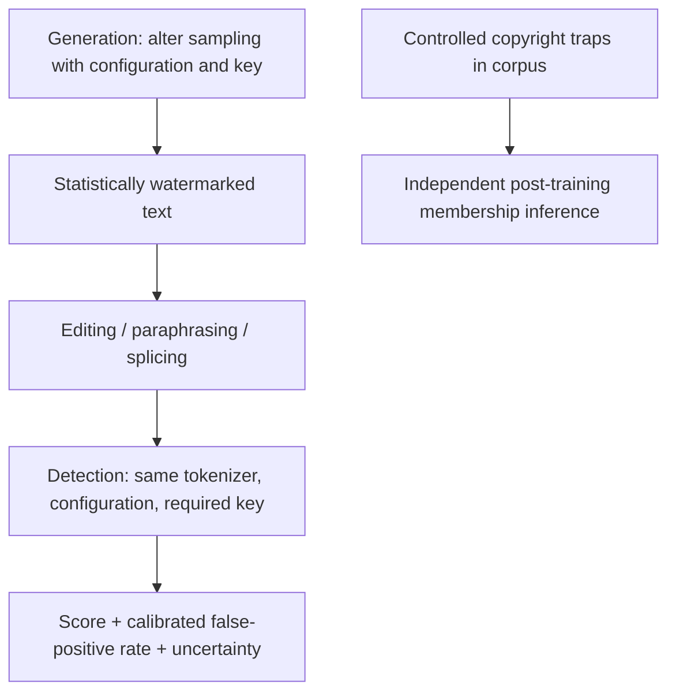

import PrivacyMeta from '@site/src/components/PrivacyMeta';

<PrivacyMeta era="Volume 6 · Governance and compliance" technique="Governance & compliance" audience={['Privacy Engineer', 'Compliance Engineer', 'Security Engineer']} severity="Medium" maturity="Research" evidence="Research" />

> In one sentence: output watermarks support generated-content identification through sampling statistics; copyright traps plant controlled markers in training material to test later use. Both provide conditional forensic evidence. **Paraphrasing can dilute a signal, but one paraphrase does not necessarily erase it**: the ICLR 2024 reliability paper finds detection can survive strong paraphrasing given enough text. Neither provides personal-data confidentiality or automatically establishes infringement.

## Mechanism: what happens on my side

In Kirchenbauer et al.’s ICML 2023 scheme, before each token I pseudorandomly group the vocabulary using prior context and configuration, then bias green-list logits. A detector recomputes green-token frequency with the same tokenizer, grouping algorithm, and required key / configuration. The green fraction is a parameter γ, not invariably one half. Detection without generation-model weights does not mean every scheme is keyless or publicly available.

Red line: external statistics are auditable; my self-report cannot authenticate provenance. A p-value describes the probability of such an extreme statistic under a specified null hypothesis, **not the posterior probability that this text was AI-generated**.



## Threat surface: different effects on the two markers

- **Output watermarks**: short or low-entropy text, cross-language paraphrasing, translation, splicing, and knowledge of detector configuration affect detectability. Robustness depends on scheme, length, and attack budget; one success / failure does not generalize to all watermarks.
- **Training-data traps**: these test learning signals for controlled markers, requiring suitable candidate text and model access. Pretraining deduplication / paraphrasing, marker length, and repetition matter. **Paraphrasing one output after training** does not remove an already learned trap signal; it is not the same removal attack as output-watermark dilution.

## How the defense works

A detectable distributional bias supplements provenance records, with both false positives and false negatives. Fix detector keys and configuration, calibrate on real human text, and handle repeated n-grams and multiple tests across windows / documents. A low p-value is not proof of a person, account, or original training document. No detection does not establish non-use of AI.

## Buildable recipe

```text
1. Pin scheme, generation model/tokenizer, key version, γ/bias/context window, and detector.
2. Build independent human, pristine watermarked, edited, translated/paraphrased, and spliced sets.
3. Report detection at a predefined false-positive rate, sample counts, intervals, and lengths;
   adjust for multiple scanned windows.
4. Test traps separately using controlled fictional markers and controls without injected canaries, without
   real personal data; record preprocessing before training.
5. Keep original provenance and operation logs; never use the score alone for legal or identity claims.
```

**Minimal testable assertion**: on independent human controls, the fixed detector meets its target false-positive rate; report detection and intervals by editing budget and length. Insufficient power means inconclusive. Finite tests prove neither universal removability nor universal persistence.

## Real cases / research and products

- **Kirchenbauer et al. (ICML 2023; ICLR 2024)**: the reliability study finds detection after human / machine paraphrasing, with longer text accumulating evidence. This differs from the old entry’s “one paraphrase erases it” summary. Consult the experimental lengths, false-positive rates, and text conditions; no universal threshold is set here.
- **Copyright Traps (ICML 2024)**: in controlled 1.3B training from scratch, long, heavily repeated traps are more detectable than short / sparse ones. They supply statistical evidence of training use, not automatic authorization or infringement findings.
- **Google SynthID**: the official product page describes text watermarking in Gemini app / web and a SynthID Detector. This scope does not establish that any third party can detect all models.
- **Anthropic (2026-08-14)**: announced a SynthID-Text variant for future Claude models, stating the marker carries no identifier traceable to a specific person, organization, or chat. This records the announcement’s scope, not certification of identical behavior across older models, endpoints, or detectors.

## Residual risk and trade-offs

Power depends on length, entropy, key management, and attack cost. Provider provenance markers do not establish anonymity. Watermarking neither removes PII nor bounds training membership contributions or prevents extraction. Combine it with access controls, provenance logs, and privacy evaluation.

## How this differs from neighboring techniques

Model fingerprints in [model stealing](../01-foundations/model-extraction-stealing.mdx), output-text watermarks, and training-corpus traps concern models, generated content, and training use respectively; their metrics are not interchangeable. [Membership inference](../01-foundations/membership-inference.mdx) is one method for trap-based evidence, not a synonym for watermarking.

## Version notes

:::note Applicable versions
Checked primary sources for the three studies and Google / Anthropic official product material on 2026-10-29. Retained the mechanisms while correcting the reversed summary of the reliability paper; research and provider announcements remain distinct. Review by 2027-01-29, earlier for sampling algorithms, detector keys / thresholds, paraphrasing attacks, or deployment changes.
:::

## Further reading and sources

- [A Watermark for Large Language Models (ICML 2023)](https://proceedings.mlr.press/v202/kirchenbauer23a.html)
- [On the Reliability of Watermarks (ICLR 2024; author manuscript v4)](https://arxiv.org/abs/2306.04634)
- [Copyright Traps for Large Language Models (ICML 2024)](https://proceedings.mlr.press/v235/meeus24a.html)
- [Google SynthID](https://deepmind.google/models/synthid/)
- [How Claude’s text watermark works (2026-08-14)](https://www.anthropic.com/news/claude-text-watermark)
