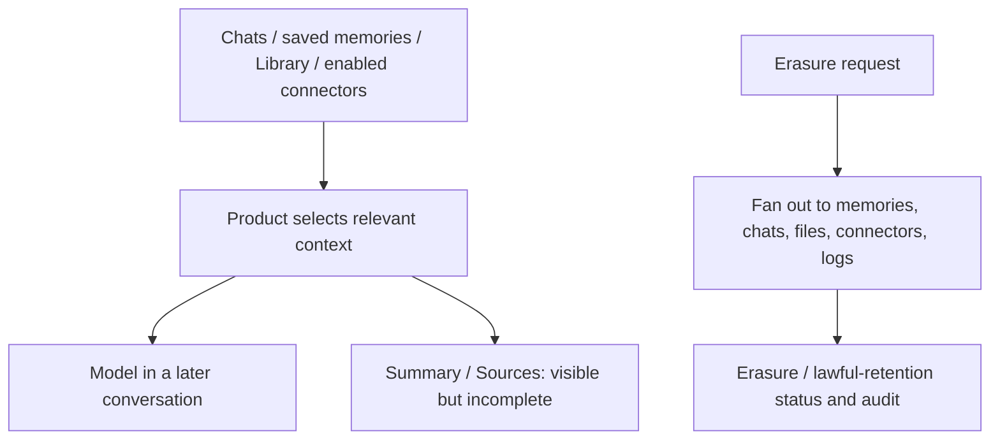

import PrivacyMeta from '@site/src/components/PrivacyMeta';

<PrivacyMeta era="Volume 6 · Governance and compliance" technique="Data lifecycle & data governance" audience={['Privacy Engineer', 'Compliance Engineer', 'Security Engineer']} severity="Medium" maturity="Production" evidence="Official docs" />

> In one sentence: product memory carries information into later conversations by design, but available sources, visible summaries, disabling, and deletion differ. Current ChatGPT documentation includes chats, saved memories, custom instructions, Library, and connected-app sources, varying by account / region / workspace. Govern memory as lifecycle state; “do not mention,” “off,” or disappearance from a summary does not establish deletion of every source.

## Mechanism: what happens on my side

I can use relevant memory / sources supplied by the product, but cannot certify backend-storage completeness through self-report. ChatGPT stores saved memories separately from chat history; improved memory also maintains a broader summary. The official page says summaries and Sources may omit available details, and history is not searched for every answer. No separate history-reference storage limit does not mean every past chat is always consulted.

Claude’s API memory tool differs: I request file operations, the application handler accesses its own `/memories` store, and results return to the model. Client-side means the application controls storage and handling, **not that retrieved contents stay out of the model API request**. Check local retention and API retention / eligibility together.



## Threat surface: inspect retention, reading, and erasure separately

- **Broader sources**: files, email, or connected apps may personalize responses. Disconnecting prevents future access, not deletion of information already present in chats.
- **Disabling does not erase sources**: turning Memory off leaves old chats; reenabling may form new remembered information from them. “Don’t mention this again” changes reference behavior without deleting the original source.
- **Incomplete visibility**: summaries / Sources are review tools, not complete storage inventories. Logs and third-party stores require contractual and operational evidence.
- **Separate safety uses**: the provider documents limited safety-relevant context in rare high-risk situations. Disabling personalization does not disable all safety processing.

## How the defense works

Register product / API memory as separate state: sources, reading scope, write conditions, identity, retention, erasure propagation, and evidence. Delete / disconnect sources individually and inspect related chats, files, and logs; model statements do not replace backend audit. A client memory handler needs per-user isolation, normalized paths, authorization, and erasure, not merely a path-prefix string check.

## Buildable recipe

```text
1. Pin account/plan, region, workspace, and product version; enumerate enabled sources and read/write rights.
2. Test cross-chat references with synthetic canaries; inspect summaries/Sources and underlying sources,
   without storing third-party real PII.
3. Erase memories, source chats, Library files, and other sources; check old chat copies of connector content.
4. Record disabling and erasure separately, with propagation windows, lawful retention, and invisible audit areas.
5. Isolate API memory by identity; check API controls. Client-side storage or ZDR does not erase local files.
```

**Separate temporary-chat reading from writing**: the current ChatGPT page allows choosing Personalized / Unpersonalized before starting. The latter does not use existing memories, custom instructions, or plugins; neither mode creates / updates memories. Saving converts it to a regular chat governed by account model-improvement and Memory settings. Temporary chats can still be kept for up to 30 days for safety; third-party Actions follow the recipient’s policy. This is not end-to-end zero retention.

**Minimal testable assertion**: with controlled canaries, cover new chats, disabling, source erasure, reenabling, and the propagation window. Confirm authorized access still works and disallowed reference paths stop reproducing canaries. Non-reproduction is finite evidence; inspect erasure inventories and provider receipts separately. Not every backend copy will be visible in a summary.

## Real cases / product boundaries

| Form | Checked boundary | Deployment-specific checks |
|---|---|---|
| ChatGPT product memory | Relevant chat / memory / file / connector sources; summaries and Sources are incomplete; reading, writing, and erasure differ | Account, region, workspace availability, source erasure, backend logs |
| Claude API memory tool | Application implements storage operations; `/memories` can map to user directories or a database | Traversal, cross-identity access, content sent into the API, and model/feature ZDR eligibility |

**Historical lawful-retention example**: OpenAI’s 2025-10-22 update states that the earlier indefinite-retention obligation for new content ended on **2025-09-26**, with some **April–September 2025** historical data still segregated under that statement. The statement has specific product / regional exclusions. It is not evidence that every saved-memory object was frozen, nor an independent check of current litigation rulings. The example only supports that applicable legal obligations can affect deletion.

## Residual risk and trade-offs

Memory supports continuity while expanding personalization sources and retained state. Local API files, product memory, and model weights are different objects. Erasing memories does not automatically remove prior training influence; see [machine unlearning](../05-frontier-deployment/machine-unlearning.mdx). [Cross-session memory bleed](../04-rag-agents/cross-session-memory-bleed.mdx) concerns failed identity isolation; this entry concerns retention governance for normally authorized functionality.

## Version notes

:::note Applicable versions
Checked current Memory / Temporary chat pages, Claude memory tool, and OpenAI’s 2025 retention update on 2026-10-29. Review by 2026-11-29, earlier for sources, read/write / erasure controls, account policies, connectors, or lawful-retention changes. This review did not inspect the user’s actual account settings or independently review court records.
:::

## Further reading and sources

- [Memory in ChatGPT](https://help.openai.com/en/articles/8590148-memory-in-chatgpt)
- [Temporary chat in ChatGPT](https://help.openai.com/en/articles/8914046-temporary-chat-in-chatgpt)
- [Claude Memory tool](https://platform.claude.com/docs/en/agents-and-tools/tool-use/memory-tool)
- [OpenAI’s 2025 legal-retention update](https://openai.com/index/response-to-nyt-data-demands/)
