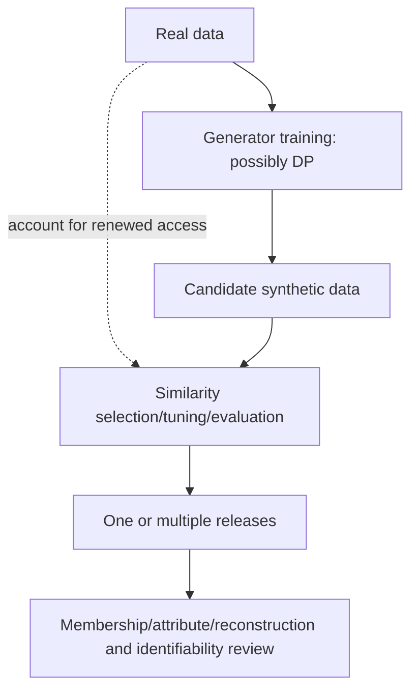

import PrivacyMeta from '@site/src/components/PrivacyMeta';

<PrivacyMeta era="Volume 6 · Governance and compliance" technique="PII detection, redaction & synthetic data" audience={['Privacy Engineer', 'Compliance Engineer', 'ML Engineer']} severity="Medium" maturity="Research" evidence="Research" />

> In one sentence: synthetic data is not automatically anonymous, and similarity tests can miss membership, attribute, and reconstruction leakage. DP can bound a defined unit’s contribution, but must cover the entire training, selection, evaluation, and release mechanism. **DP does not automatically establish legal anonymity**, and its absence does not invalidate every other formal definition.

## Mechanism: what happens on my side

A generator fits real data then samples; inclusion of a record can affect the model or synthetic outputs. Attackers can use candidate records, domain priors, released datasets, or generator access to test differences. A finite static release differs from unlimited generator queries; their budgets are not interchangeable. Red line: my claim that a record is fictional does not certify provenance or anonymity.



## Threat surface

Small similarity does not imply small individual influence, and averages can miss vulnerable groups. Filtering an already-DP-trained model’s outputs against raw data without accounting is not postprocessing that only uses DP output, so the original guarantee does not automatically survive. Individual DP also does not erase attributes inferable from population correlations.

## How the defense works

For a DP objective, fix adjacency, record/user unit, δ, and composition of all private accesses. A fixed DP release can be postprocessed without further real-data access; retraining, selection, and extra releases require accounting. Without a DP claim, state other protection goals, access limits, and evidence rather than “synthetic therefore anonymous.”

## Buildable recipe

```text
1. Define release/adversary: finite data, generator API, or weights; fix query and multiple-release budgets.
2. Map every private access: training, tuning, real-data metric selection, private evaluation, releases.
3. Independently recompute DP units/composition; do not return to unaccounted raw data for selection.
4. Test MIA/attributes/reconstruction on controlled/authorized members, non-members, and vulnerable groups;
   report intervals and task utility.
5. Assess jurisdiction-specific identifiability separately; check vendor defaults/epsilon advice by version.
```

**Minimal testable assertion**: a DP claim accounts for all private accesses and trusted boundaries, with independent agreement; report empirical attacks and utility for the objective. Failed attacks do not prove anonymity; above-chance attacks are not automatically inconsistent with a loose ε.

## Real cases / research

Stadler et al. (USENIX 2022) find the evaluated generators do not improve the privacy/utility trade-off over traditional anonymization; this is not an impossibility theorem for all future generators. ReconSyn (IEEE S&P 2025 v5) gives counterexamples where similarity tests pass despite leakage, including a broken end-to-end guarantee when only the model is DP while raw-data-driven selection is unaccounted. ICO guidance calls for identifiability assessment and ongoing review, not automatic exemption for a “synthetic” label.

## Residual risk and trade-offs

Budget and unit determine protection; generation quality is not privacy evidence. Removing outliers is itself data-dependent preprocessing and must be analyzed when claiming DP from original data to release. This entry does not endorse unchecked vendor defaults, budget recommendations, or PATE-GAN reproduction claims.

## How this differs from neighboring techniques

[PII scrubbing](../03-conversational-llms/pii-regurgitation.mdx) and synthesis differ but neither automatically anonymizes. [DP fine-tuning](../03-conversational-llms/dp-fine-tuning.mdx) accounting applies to generators too. [Deduplication](../02-memorization-extraction/training-data-deduplication.mdx) reduces repeated exposure, with data-dependent preprocessing still requiring analysis.

## Version notes

:::note Applicable versions
Checked ReconSyn v5, USENIX 2022, ICO, and final NIST guidance on 2026-10-29. Retained counterexamples/end-to-end DP conditions, removing without checked sources current vendor parameters and “only DP gives any bound” universal claims. Generator experiments were not rerun. Review by 2027-01-29, earlier for generation/selection, release budgets, or anonymity guidance.
:::

## Further reading and sources

- [ReconSyn (IEEE S&P 2025)](https://arxiv.org/abs/2312.05114)
- [Synthetic Data – Anonymisation Groundhog Day](https://www.usenix.org/conference/usenixsecurity22/presentation/stadler)
- [ICO anonymization guidance](https://ico.org.uk/for-organisations/uk-gdpr-guidance-and-resources/data-sharing/anonymisation/introduction-to-anonymisation/)
- [NIST SP 800-226 final](https://csrc.nist.gov/pubs/sp/800/226/final)
