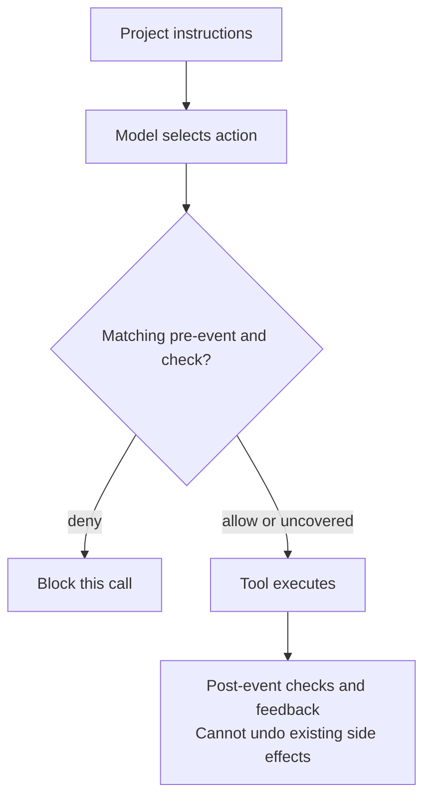

import PitfallMeta from '@site/src/components/PitfallMeta';

<PitfallMeta roles={['Engineer', 'DevOps Engineer']} phase="Setup & Collaboration" severity="High" appliesTo="Claude Code with hooks support" evidence="Official docs" />

> In one sentence: prompts express requirements but do not enforce checks. Attach mechanically checkable requirements to hooks or CI, and test event coverage, failures, and bypass paths.

## Symptom

Here's how I often see you set the rules: you write into CLAUDE.md "run `prettier` after every edit," "run `npm test` before committing," "do not modify `package-lock.json` or `.env`" — all spelled out plainly, and then you consider the matter settled.

For the first few turns I really do follow them. But as the session grows and the tasks pile up, you notice: I edited three files but only formatted one; I committed straight away and skipped the tests; once I even "casually" edited the `.env` you had explicitly forbidden. You assumed that what's written down in black and white is an iron law. From where I sit, those lines were always just "requirements I should follow but that lack enforcement" — never "things that will definitely happen."

## Why this happens

CLAUDE.md supplies persistent instructions, not enforcement. Instructions can be missed; that does not mean they lack priority or may be ignored, nor that compaction necessarily removes them.

**The client triggers command hooks; implementation determines check correctness.** Event, matcher, and configuration conditions still apply, alongside failures, timeouts, and uncovered tools. Prompt and agent hooks call models, so their semantic judgments are not universally deterministic.

Exit behavior depends on the event. Exit code 2 from `PreToolUse` can prevent that tool call. At `PostToolUse`, the tool has already run and side effects cannot be recalled. `PermissionRequest` denial requires the documented JSON response rather than a universal exit-2 rule.



## Consequences

- **What should run doesn't.** format/lint gets skipped, and style drift quietly enters the repo; tests get skipped, so regressions surface at a later stage and increase investigation cost.
- **What should be blocked isn't.** I must follow an instruction not to touch `.env`, but it is not an access-control rule. Without another control, a call that violates the instruction may still execute.
- **Discipline you can't reproduce.** The same rule is followed this time and ignored the next, so no one on the team can rely on it — and CI may discover a covered issue later, turning something that could have been fixed locally in seconds into a failed pipeline.
- **CLAUDE.md keeps growing.** You keep adding "please be sure to…" to compensate for my unreliability, and more instructions may add maintenance burden without providing execution checks.

## What to do instead

1. **Format after editing.** Use a `PostToolUse` `Edit|Write` matcher. This configuration calls a trusted repository script that must be implemented, reviewed, and tested; copying the configuration alone is insufficient:

```json
{
  "hooks": {
    "PostToolUse": [{
      "matcher": "Edit|Write",
      "hooks": [{"type": "command", "command": "node \"$CLAUDE_PROJECT_DIR/.claude/hooks/format-file.cjs\""}]
    }]
  }
}
```

The script parses event JSON from stdin, validates `tool_input.file_path` against the permitted project scope, invokes a pinned installed formatter with separate arguments, and handles failures. Do not send filenames through `xargs` or command-string concatenation; paths can contain spaces or option characters.

2. **Combine pre-call denial with actual access isolation.** Validate paths in `PreToolUse` and return the documented blocking response. Test shell, other write tools, symbolic links, and path changes; a path regex does not cover every write route. On most events, missing, crashing, or timed-out command / HTTP hooks let the action proceed. In Claude Code v2.1.295+, set `onFailure: "block"` and test those failures. Unset behavior has exceptions, including Windows without Git Bash; older versions need external access controls instead of relying on this field. See [failure handling](https://code.claude.com/docs/en/hooks#block-the-action-when-a-hook-fails).
3. **Use actual commit and release gates.** Run proportionate checks and inspect their status. CI needs required-check configuration to gate merging. A timeout or failure is not a pass.
4. **Retain judgment-based instructions.** Reuse policies and style trade-offs belong in CLAUDE.md. Missing hook events can also be addressed by external policy, permissions, or process, rather than leaving prompts as the only option.

## Example

**Before (written into CLAUDE.md):**

```text
# CLAUDE.md
- After every code edit, always run prettier
- Always run npm test before committing
- Do not modify .env

→ What actually happens:
Me: edited a.ts, b.ts, c.ts; ran prettier only on a.ts (missed two)
Me: git commit straight away (forgot the tests)
Me: tweaked .env to make the build pass (you explicitly said not to)
```

**After (made into hooks):**

```text
# In .claude/settings.json:
# PostToolUse(Edit|Write) → auto-prettier every edited file
# PreToolUse → exit 2 to veto .env; v2.1.295+ onFailure: "block", with failure tests

Me: edited a.ts, b.ts, c.ts
harness: (formats all three automatically, no remembering needed)
Me: attempt to write .env
harness: exit 2, blocked → "Blocked: .env matches protected pattern"
Me: (get the feedback, switch to config injection, leave .env alone)
```

The difference isn't that I became more disciplined — it's that the few things that "must happen" were moved out of my goodwill and handed to an explicit event handler whose tool coverage and failure behavior still need verification.

## When the exception applies

"Make it a hook" rests on "it must happen every time." When that premise doesn't hold, leaving it in a prompt is the right call:

- **The requirement is genuinely soft, judgment-based.** "Prefer existing helper functions," "name things to match the module" — things I should weigh case by case and can occasionally bend. A hook would reject the reasonable exceptions along with the rest and just get in the way.
- **The rule is still churning, or used only once.** A throwaway convention you tweak daily during exploration, a check inside a one-off script — the hook's upkeep cost (writing, debugging, keeping it in sync) outweighs the reliability it buys; a prompt is cheaper.
- **No corresponding event.** Consider CI, controlled tools, or backend policy. If only prompting is available, state that it has no mechanical enforcement guarantee.

The test, in one line: **ask "does missing it once cause harm?" — if it does and you can hang it on a deterministic trigger, make it a hook; if it doesn't, or there's nothing to hang it on, leave it in the prompt.**

Two things you only meet after the hook is written. They don't change the conclusion above, but they decide whether your hook actually works.

**One: is it stopping a string, or a behavior?** Matching dangerous commands with a regex goes wrong in both directions. Perfectly harmless text — say, the name of a dangerous command written into an explanatory paragraph that gets written to a file — is blocked on a literal hit. Conversely, splitting the same flag into two string pieces and concatenating them, or moving the command into a script file and running that, sails straight through. String matching stops "looks like," not "does." So design this kind of hook for the worst case (false positives beat misses) and **don't treat it as a boundary against deliberate evasion** — it stops slips of the hand.

**Two: the state it reads isn't necessarily the state at execution time.** The interception point runs *before* the command, so it sees the world as it stood beforehand. A typical consequence: write staging and committing as one line (`git add -A && git commit ...`) and the check judges the **previous** staged snapshot, reporting the very violation you just fixed. The rule: **make sure whatever the hook inspects is already in its final state when the hook runs** — split it into two steps rather than hoping the hook can see the second half of the same command.

## Version notes

:::note Versions
Checked the current Hooks reference on 2026-10-29. Events, exit codes, model-based hooks, and failure policies evolve. Test allowed, denied, and error paths in the installed version. Hook commands themselves are not automatically protected by the Bash sandbox.
:::

## Further reading and sources

- [Hooks reference (Claude Code)](https://code.claude.com/docs/en/hooks)
- [Configure the sandboxed Bash tool (Claude Code)](https://code.claude.com/docs/en/sandboxing)
