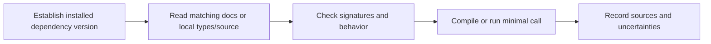

import PitfallMeta from '@site/src/components/PitfallMeta';

<PitfallMeta roles={['Engineer', 'Architect']} phase="Setup & Collaboration" severity="High" appliesTo="All coding agents" evidence="Official docs" />

> In one sentence: you never wired me to an authoritative, version-matched doc source, then asked me to call a library from my training memory plus a web search. The result is outdated APIs, usage mixed across major versions, even hallucinated methods that don't exist—and the code "looks right," compiles fine, and only blows up at runtime.

## Symptom

Here's how you often start: your `package.json` pins the library at, say, 3.x, and you just tell me "use this library to write X"—no version mentioned, no doc source wired in. So I work from memory, and that memory might be the 2.x API. Or I fire off a `WebSearch`, find a blog post, and copy from it.

The code comes out. The names and arguments look reasonable, so you merge it. Then it throws `xxx is not a function` at runtime, or one argument's default behavior turns out to be the opposite of what you expected. Only then do you trace it back and find I wrote it the way a different major version does.

## Why this happens

**Training knowledge is not the project's version state.** I can mix API versions, but can also obtain newer information from repositories, retrieval, and tools. A cutoff does not mean all later facts are unknowable.

**Retrieved material needs applicability checks.** Search results can be stale; a documentation MCP may lack the requested version or return irrelevant fragments. Read lockfiles, installed packages, type declarations, source, and official version documentation, then verify signatures and defaults.



## Consequences

- **Outdated APIs.** I use a deprecated or re-signatured method; it may compile fine and only surface at runtime.
- **Mixed versions.** One block of code blends 2.x and 3.x usage—each line looks correct on its own, but together it won't run.
- **Hallucinated methods.** I call a method this library never had, with a name convincing enough that you can't catch it at a glance in review.
- **Debugging cost shifted onto you.** These errors usually don't surface while I'm writing; they show up when you run tests, or after release—where locating them costs far more than handing me the docs would have.

## What to do instead

**Wire me to a version-matched source of truth, and tell me explicitly: defer to the docs, don't trust memory.** A few things you can do right away:

1. **Wire in a version-aware doc source.** Context7 offers MCP and CLI/Skills retrieval options. Its maintainer describes version-specific documentation; verify the returned library ID, version, and passages. Do not assume every library release is covered or require an extra MCP when local evidence already suffices.

```text
# Name the version in your prompt, and tell me to consult the doc source
You: Use <library>@3.4 to write X. First check Context7 for the real 3.4 signatures, defer to the docs, don't go from memory.
```

2. **Bring the pinned version's official docs into context.** Without MCP, the next best thing: download the key pages of that version's docs into the repo, or write the dependency version and a docs link into `CLAUDE.md` so I can match against it every time.

3. **For critical APIs, state explicitly "defer to what you gave me, not my memory."** The request helps focus the work, but does not guarantee correct source use. Record the actual source and version checked.

4. **For unfamiliar or fast-moving libraries, make me verify the real signatures.** Have me check every method name and argument I use against the doc source, rather than calling it done the moment I've written it. Where I'm unsure, I'd rather say "I couldn't find this in the docs, you'll need to confirm" than guess.

## Example

**Before:**

```text
You: Use somelib to write a connection pool
Me: (from memory, calls somelib.createPool(...)—that's the 2.x way;
     the 3.x you pinned changed it to new somelib.Pool(...), so it
     fails at runtime)
```

**After:**

```text
You: Use somelib@3.x for a connection pool. First check Context7 for the 3.x API, defer to the docs.
Me: (confirms from the doc source that 3.x is new somelib.Pool(...),
     writes it to the real signature, and notes "per the somelib 3.x official docs")
```

The difference isn't that I understand the library better—it's that I now hold a fact that matches your version, so I no longer have to bet on what "looks right."

## When the exception applies

Reliable local types, official examples, or tests can be sufficient without installing another documentation tool. Stable APIs and disposable prototypes can justify lighter checks, but model familiarity alone is not verification. One-time scripts that alter persistent data still need version and side-effect checks.

## Version notes

:::note Scope
Checked Context7 maintainer guidance and Claude Code documentation on 2026-10-29. Versioned sources support verification rather than guarantee correctness. Recheck changes to libraries, source coverage, or retrieval tools.
:::

## Further reading and sources

- [Context7 (maintainer repository)](https://github.com/upstash/context7)
- [Claude Code best practices](https://code.claude.com/docs/en/best-practices)
