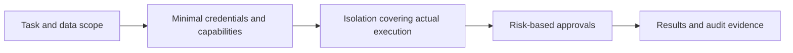

import PitfallMeta from '@site/src/components/PitfallMeta';

<PitfallMeta roles={['DevOps Engineer', 'Engineer']} phase="Setup & Collaboration" severity="High" appliesTo="All coding agents" evidence="Official docs" />

> In one sentence: skipping approvals removes human interception opportunities. Sensitive data, production credentials, and unrestricted tools can amplify mistakes and prompt injection. Match autonomy to action risk and effective isolation.

## Symptom

Here's a start I run into a lot. You launch me for the first time, get interrupted by a few permission prompts, find them annoying, and reach for `--dangerously-skip-permissions` — or you drop `Bash(*)` and `Write(*)` straight into the `allow` list in `settings.json`. From then on I read files, change code, run commands, install dependencies, and push to Git without ever checking with you.

Your expectation is less friction, letting me run end to end. And most of the time it works that way — right up until the one run where I execute a command you would never have approved, and by then there's no "approve" step left.

## Why this happens

Approvals, permission rules, and sandboxes are separate layers. A person or monitor judges an action, rules govern corresponding calls, and a sandbox limits resources available to covered processes. Removing prompts does not necessarily remove isolation; retaining prompts does not guarantee correct decisions.

**Human confirmation can fatigue, and automatic monitors can fail.** Anthropic's 2026-10-22 study tested September monitor snapshots and demonstrated monitor injection, multi-context attacks, and policy failures. These are controlled red-team results, not real incidents or success rates for all current products.



## Consequences

- **Irreversible damage.** Accidental deletes, overwrites, a wrong `git push --force` — by the time you notice, there's usually no undo.
- **Data leakage.** Injected instructions use tools I've already been granted (an allowed API, `curl`) to ship private content outward, and every step looks legitimate.
- **Privilege overreach.** I run a command with production credentials that was only ever meant for a test environment, because no boundary told me "not here."
- **Hard to investigate.** Per-action human approval records may shrink, while tool, policy, and service audits can remain. Check actual coverage rather than assuming automation is untraceable.

## What to do instead

1. **Inspect effective permissions.** Claude Code currently evaluates `deny` → `ask` → `allow`; a narrower allow does not override a matching deny or ask. This is a partial Manual-mode example, not a complete isolation policy:

```json
{
  "permissions": {
    "allow": ["Glob", "Grep"],
    "ask": ["Bash(git push *)"],
    "deny": ["Read(./.env)", "Read(./secrets/**)"]
  }
}
```

Denying `Read` does not automatically block shell or MCP access to the same files. Command rules do not establish database or network authorization. See [Permissions configuration](../toolkit/permissions-config.mdx).

2. **Keep approvals proportional to risk.** Authorized, reversible project edits and tests can proceed within their boundary. Production changes, external transfers, and irreversible actions need appropriate independent controls. Avoid requiring approval for every ordinary edit or expanding task authorization to unrelated external actions.
3. **Verify boundaries before unattended work.** Check mounts, credentials, networking, and remote tools even in disposable environments. A container alone does not establish complete isolation.
4. **Automatic review is not a hard boundary.** Auto mode can reduce prompts, but a classifier makes model-based judgments. Check supported scope, management policy, and current behavior rather than treating fixed denial counts as a permanent interface.

## Example

**Before:**

```text
You: skip approvals, clean build artifacts, and rebuild.
Me: misread the path and delete; the environment permits access beyond the project.
```

**After:**

```text
Environment: only a disposable project is mounted; no production credentials; external writes stay controlled.
You: clean project build artifacts and rebuild.
Me: work within the established boundary; explain targets and impact before requesting broader access.
```

A denied command is rejected. It cannot then be described as reaching an ask prompt and being approved. Review policy rather than silently changing syntax to bypass it.

## When the exception applies

It's not "never go full-auto" — it's "don't go full-auto where there's a real blast radius." When the blast radius is already boxed in by the environment, skipping per-action confirmation is reasonable, even more efficient:

- **An isolated sandbox / throwaway container / VM**: filesystem and network isolated, no production credentials, disposable and easy to rebuild. This is exactly what the best practice above means by "put full-auto in a sandbox" — the environment replaces the human-confirmation gate.
- **A temporary, disposable scratch repo**: no sensitive data, no outbound-communication capability, nothing you'd mourn if it's wiped.

Conversely, the moment the environment still carries two or three of "private data / reads untrusted content / can talk outward," the exception is off — back to least privilege by default. The test, in one line: **what makes full-auto safe isn't "I trust the model," it's "even if it does the worst thing, it can't get out of this box."**

## Tool differences

Mode names are not interchangeable. Claude Code's skipped approvals, auto mode, and Bash sandbox need separate checks. Codex also configures approval policy and sandbox mode separately; `never` alone does not mean unsandboxed. Supported management policies can restrict the available choices.

Gemini, Cursor, and Copilot can differ across local, cloud, and headless execution. Old matrices do not establish current denylists, shortcuts, or default isolation. Consult the [tool matrix](../tool-matrix.mdx) and inspect the actual session.

## Version notes

:::note Versions
Checked official permissions, sandboxing, and monitor research on 2026-10-29. Approvals provide interception opportunities, not a guarantee that people or models detect danger. Recheck changes to modes, executors, managed policy, or tools.
:::

## Further reading and sources

- [Configure permissions (Claude Code)](https://code.claude.com/docs/en/permissions)
- [Agent approvals and security (OpenAI)](https://learn.chatgpt.com/docs/agent-approvals-security)
- [Managed configuration (OpenAI)](https://learn.chatgpt.com/docs/enterprise/managed-configuration)
- [Red-teaming auto mode (Anthropic)](https://alignment.anthropic.com/2026/red-teaming-auto-mode/)
