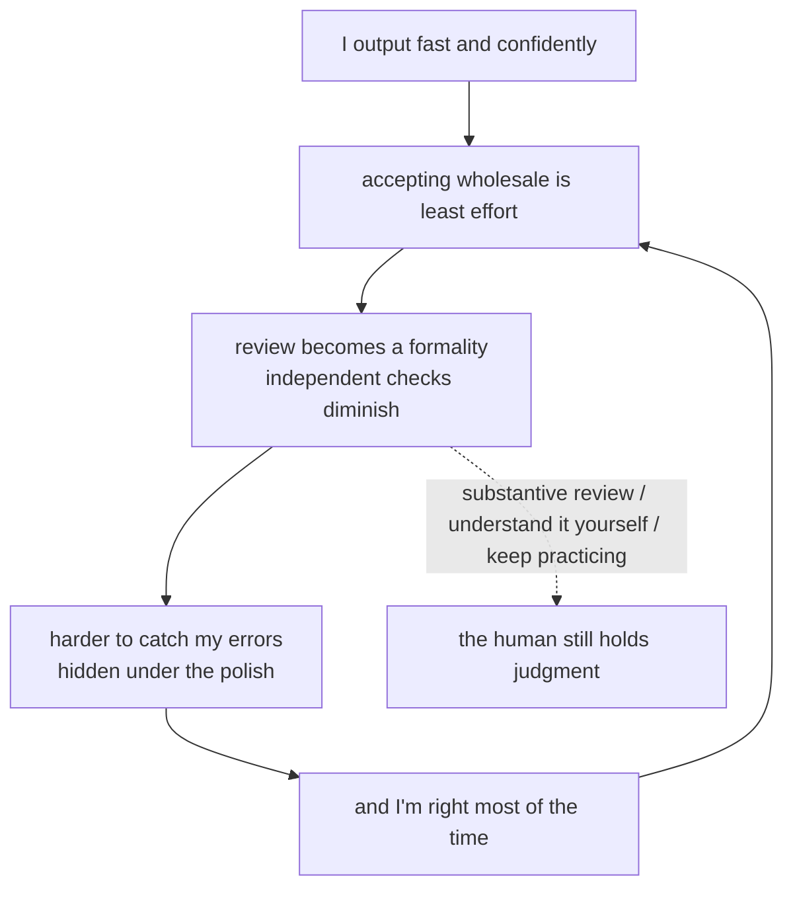

import PitfallMeta from '@site/src/components/PitfallMeta';

<PitfallMeta roles={['Project Manager', 'Engineer', 'Architect']} phase="Setup & Collaboration" severity="High" appliesTo="All coding agents" evidence="Research" />

> In one sentence: fluent AI output can reduce independent checking. Inspect actual evidence according to task risk and preserve the team’s ability to understand and recover the system. Long-term skill effects still require specific evidence.

## Symptom

At first you read what I write line by line, questioning here and there. Gradually, after I haven't let you down too many times, you relax: you glance at my PR's diff and merge it; I say "I already tested it" and you believe me; for a module you don't know well you just toss me the whole directory — "handle it."

One scenario to monitor is core code repeatedly changed by me without corresponding team understanding, leaving incident response dependent on more AI answers. For newcomers, check opportunities to locate and explain errors independently rather than assuming AI use necessarily prevents learning.

These are workflow risks to monitor, not inevitable long-term outcomes established jointly by these studies. I should supply checkable evidence, and the organization should identify who owns acceptance and recovery.

This runs in a different direction from two existing pitfalls; don't conflate them:

- *[When you bring me an idea to validate, I lean toward supporting you](../01-ideation-feasibility/sycophancy-idea-validation.mdx)* is about **my side** — I tend to please you. This entry is about **your side** — you over-trust me. Opposite directions.
- *[Trust, but don't verify](../06-testing/trust-then-verify.mdx)* is about "code I wrote that looks right ≠ is right" (about the output itself). This entry asks whether review retains independent evidence (about your review behavior).

## Why this happens

**Automation bias is humans' natural tendency in front of automated systems: the system gives an answer, and people lean toward accepting it and relaxing independent verification.** This isn't a lack of professionalism — it's a cognitive shortcut confirmed by repeated research, especially when the system is right most of the time and the answer arrives effortlessly; the motivation to "check it again" keeps sliding (see the Springer review of automation bias).

When my output is fluent, complete, and confident without clearly stating evidence and limits, it can reinforce misplaced trust. A nicely written, neatly structured block of code naturally looks "right" — and my errors hide precisely in that polish: an unhandled edge case, a security assumption that doesn't hold, invisible on the surface. The more you trust "it's always been reliable," the less you look under that polish.

Separate the evidence. METR’s early-2025 randomized study involved 16 experienced developers familiar with their repositories and 246 tasks. AI access increased completion time by 19%, while participants later estimated a 20% speedup. This shows a perception–measurement gap in that setting, not that everyone is slower today or that skills atrophy.

Echoes of AI found no systematic disadvantage in later maintenance time or code quality in its two-phase, 151-participant experiment. Cognitive debt and long-term skill effects were future research questions, not established outcomes.



## Consequences

- **Errors leak downstream.** Rubber-stamp review equals no review — my "looks right" edge and security problems, which should have been stopped at your gate, get waved into the trunk.
- **You can't catch the fall during an incident.** When something really breaks and I'm stuck too, the problem that needs deep system understanding lands back on you — but your mental model of this code has gone empty.
- **Team capability hollows out.** Juniors use me to skip the fundamentals; seniors let their instincts rust. Short-term delivery speeds up; long-term, opportunities for independent debugging may shrink; actual skill decline requires longitudinal evidence.
- **You can't even estimate how much you depend on me.** METR shows that perception can be inaccurate in a specific setting; dependence also needs task, defect, review, and recovery evidence.

## What to do instead

**Core: make "human-in-the-loop" real, not for show. I can be leverage, but judgment and understanding must stay with you.**

- **Substantively review key changes, don't glance at the diff and merge.** For changes touching core logic, security, or data, require yourself to be able to explain "why this is written this way and where it might go wrong" before merging. If you can't read it, don't merge it — not being able to read it is exactly where the risk is.
- **Ask for checkable evidence and use it to assess the conclusion.** Don't take only the conclusion; ask for concise justification and checkable evidence, list assumptions, flag the uncertain parts (see [single option, no trade-offs](../03-architecture/single-option-no-tradeoffs.mdx)); consider a plan for complex work without adding a fixed plan-approval step to simple reversible tasks. What you review is the argument, not my tone.
- **Deliberately keep "no-AI" practice space.** On critical paths and during juniors' growth, deliberately write it yourself once, debug it yourself once. Treat practice as a way to develop and assess capability, not as proof that outsourcing inevitably causes atrophy.
- **Don't toss me the whole repo to think for you.** "So I don't have to think" is the slipperiest on-ramp to over-reliance. The more critical the scope, the more you need your own judgment first, then use me to execute and accelerate — not to replace judgment.
- **Set team-level rules.** For example, "AI-generated code passes review only if someone can explain it out loud," "no pure-AI changes to critical modules merged directly" — turn "human-in-the-loop" from good intentions into mechanism (same idea as [use hooks, don't just write it in the prompt](./hooks-not-prompts.mdx): rely on mechanism, not on goodwill).

## Example

**Before:**

```text
You: (my last few PRs all passed first try, you've relaxed)
Me: (submit a PR: casually refactored the auth middleware, 300-line diff, "tested")
You: (glance, it's green, merge)
Two weeks later: intermittent auth bypass in production — I got one boundary wrong in that "casual refactor," and no one read it
```

**After:**

```text
You: this PR touches auth — a critical path. Before the diff, explain:
    which trust boundaries did you change? what input makes it fail? which counterexamples do the tests cover?
Me: (lists the changed boundaries, assumptions, counterexamples, and coverage)
You: (spot a counterexample that isn't covered, require a test added and that you understand the section before merging)
You: (add the core auth change to the "must be explainable out loud to pass review" list)
```

The difference isn't that I wrote it better this time — it's that you didn't treat "it's always been reliable" as a reason to wave it through. You kept judgment in your own hands.

## When the exception applies

"Human-in-the-loop" has to be real — but that doesn't mean "you read every line yourself." Spreading the same review intensity over all output burns effort where it isn't worth it. When the cost is boxed in by the environment, lighter review can be reasonable, while still inspecting the relevant evidence:

- **Low-risk, reversible, machine-verifiable changes.** Lighter review can suffice, but check coverage and real rollback cost. A one-off script is not low-risk merely because it runs once.
- **Output you won't maintain long-term.** A disposable analysis or temporary tool can need less maintenance review, but its results and persistent side effects still need checking.

Conversely, the moment a change touches core logic, security, or data, or will settle into code you'll maintain, the exception is off — back to substantive review, understand it before merging. The test, in one line: **what decides whether to review closely isn't "do I trust it," it's "what happens if it's wrong and hits the worst case" — high-impact or irreversible, vet it by hand; small and reversible, you can skip.**

## Version notes

:::note Research scope
METR's findings concern tested early-2025 tasks and tools. Echoes of AI v3 (2026-02-26) reports a late-2024 assistant-based experiment preceding contemporary agents, with no systematic maintainability disadvantage within its measures. The automation-bias review spans several domains. Practice and risk-based review are recommendations, not proof that every model inevitably causes skill loss.
:::

## Further reading and sources

- [METR early-2025 developer productivity study](https://metr.org/blog/2025-07-10-early-2025-ai-experienced-os-dev-study/)
- [Exploring automation bias in human–AI collaboration](https://link.springer.com/article/10.1007/s00146-025-02422-7)
- [Echoes of AI (v3)](https://arxiv.org/html/2507.00788v3)
