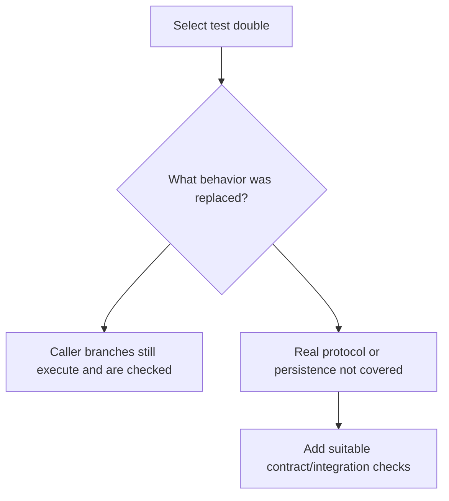

import PitfallMeta from '@site/src/components/PitfallMeta';

<PitfallMeta roles={['Engineer', 'QA Engineer']} phase="Testing" severity="Medium" appliesTo="All coding agents" evidence="Experience" />

> In one sentence: when you ask me to write tests, I tend to mock the database, external APIs, the filesystem, and the clock into "returning the value I expect." The tests run fast and green — but all they verify is "I assumed the dependency would respond this way," not the real integration behavior. Untested integration boundaries can still fail; mock-based tests can validly check caller branches and side effects.

## Symptom

You ask me to "add tests to this order service," and I quickly hand you a set: I mock `PaymentGateway` to return `{status: "success"}`, mock the database layer to return a record I made up, mock `clock.now()` to a fixed timestamp, mock the config-file read to return the string I want. It runs all green, finishes in milliseconds, and the coverage number looks great.

Checking that a successful gateway response marks an order paid can validly test the success branch, but not the real gateway protocol or failures. Replacing the very function being verified and merely asserting its configured return or invocation loses coverage of that target behavior.

## Why this happens

Test doubles isolate unstable or costly dependencies, but inaccurate responses can hide boundary errors. A constant success response does not check rejection, timeouts, or retries.

Fowler distinguishes state verification from behavior verification and discusses both testing styles; he does not declare interaction testing invalid. Sending one email or avoiding duplicate charges can be real contracts. The problem is replacing the behavior being tested and merely asserting the configured result, or treating incidental internal ordering as a requirement.



## Consequences

- **Green tests give false safety.** They prove not "the integration is correct" but "my assumptions about the integration are self-consistent." The seams most likely to break — the dependency's real error branches, contract mismatches — were never executed once.
- **Contract drift goes silent.** A third party renames a field or changes the semantics of an error code; my mock keeps returning the old value under the old contract, and the tests stay green right up until the first real request hits production and explodes.
- **Tests get welded to the implementation.** The mocks are full of "call A, then B, with argument C" implementation details ; Google's test-fidelity guidance also recommends inspecting this coupling. Reorder some internal calls in a refactor and a pile of mock-based tests all go red at once — they were guarding my coding posture, not the behavior.
- **Tautological tests are pure liability.** A test that "mocks out the object under test and asserts the mock was called" costs time to maintain yet protects against zero real failures — worse than nothing, because it occupies the slot labeled "there's a test here."

## What to do instead

- **Identify the test layer and contract.** Do not replace the core behavior being verified. Internal collaborators can sometimes be substituted, and meaningful business interactions can be asserted.
- **Choose appropriate fidelity.** Real implementations, fakes, stubs, and mocks have different uses. Testcontainers runs real service instances, not in-memory fakes. An in-memory fake does not establish SQL, transaction, or locking behavior.
- **Prefer real implementations or owner-maintained fakes for third-party types.** When those are unavailable, Google's guidance suggests a narrow owned wrapper and separate checks of its actual integration.
- **Check critical boundaries.** Official sandboxes, contract checks, and replay can verify some behavior; old recordings do not automatically detect current protocol drift. Live calls require isolated credentials and controlled costs and effects.
- **Record gaps.** State which errors and failure semantics each double covers and which real risks need other checks.

```text
Review questions:
- Does the business logic execute? Are assertions meaningful rather than repeating setup?
- How does the fake differ from the real service? Who tests protocol, transactions, rejection, and timeouts?
- If call count is asserted, is it contractual, such as preventing duplicate charges?
```

## Example

**Before:**

```text
You: Add tests to createOrder().
Me: (mock PaymentGateway to always return success, mock repo to return a fabricated order)
    mockPayment.charge.returns({status: "success"})
    mockRepo.save.returns(fakeOrder)
    assert createOrder(cart).paid === true
You: (all green, 95% coverage, merge)
Production: on insufficient balance the gateway returns {status: "declined", code: "INSUFFICIENT"},
            createOrder never handled that branch, and the order is wrongly marked as paid.
```

**After:**

```text
You: Add tests to createOrder(). Rules: PaymentGateway is third-party and may be substituted,
     but cover its real error codes; use an in-memory fake for the repo, don't mock it;
     and add a contract test that runs real (or recorded) responses for the gateway's
     declined/timeout branches.
Me: (check business-layer state with an in-memory fake, without claiming real database persistence coverage; write success / declined /
    timeout cases for the gateway, asserting that on declined the order must NOT be marked paid)
Me: (the declined case fails immediately — createOrder really did miss that branch)
You: Now fix the implementation so all three pass.
Me: (add handling for declined and timeout, red turns green)
Result: this time the green light really means "ordering behaves correctly even when payment fails."
```

Same service: "mock everything" yields a green light talking to itself; "split out the ownership boundary + real/fake dependencies + a contract test" yields tests that actually touched the failing seam.

## When the exception applies

"Don't mock" targets your own logic and boundaries you can run for real; for a few kinds of dependency, a mock (or test double) is the right answer:

- **External dependencies that genuinely can't run in CI**: a metered third-party API, one needing human credentials / an SMS code, or a vendor with no sandbox at all — when every test run costs money or external cooperation, use a double, and guard the fields and error codes with a separate contract test that hits the real endpoint on its own.
- **Nondeterministic inputs**: controlled clocks, seeds, and fault injection can improve reproducibility for time, randomness, and latency. Contractual ranges or invariants can also be checked; not every assertion requires frozen time.
- **Disaster branches you have to construct deliberately**: disk full, connection dropped, a third party returning 500 — a real dependency can barely produce these, so injecting the failure through a double is how you verify your fallback and retry.

The test: the exception holds when what you're replacing is a boundary you **don't own, can't run cheaply for real, or that's inherently nondeterministic**, and you can answer for every double "what real behavior it replaces and which real risks it lets through." The moment the mocked thing is your own core logic, or a seam you could have run against a fake or a real dependency, fall back to the default: don't mock — run it against close-to-real behavior.

## How this differs from neighboring pitfalls

The testing phase has a few pitfalls that are easy to confuse, each with a different root cause:

- [Happy-path-only](./happy-path-only.mdx): the tests only cover the normal branch — boundary and error cases simply **weren't written**.
- [Gaming the tests](./gaming-tests.mdx): a test goes red and I **change the test** (loosen the assertion, add a skip, swallow the exception) instead of fixing the code.
- [Trust then verify](./trust-then-verify.mdx): I **never built** a verification loop at all and shipped on "it reads correctly."
- **This pitfall (over-mocking)**: the verification loop exists and the boundaries were considered, but I **replaced the real dependencies with return values I invented** — so the tests verify my assumptions, not the real integration. Green with full confidence, yet the real bug walks right through.

## Version notes

:::note Evidence scope
Fowler and Google provide testing design guidance, not an experiment proving every AI model overuses mocks. Select fakes and mocks according to contracts and cost. Reassess dependencies, protocols, and test doubles when they change.
:::

## Further reading and sources

- [Mocks Are Not Stubs (Martin Fowler)](https://martinfowler.com/articles/mocksArentStubs.html)
- [Do Not Mock Types You Do Not Own (Google)](https://testing.googleblog.com/2020/07/testing-on-toilet-dont-mock-types-you.html)
- [Increase Test Fidelity By Avoiding Mocks (Google)](https://testing.googleblog.com/2024/02/increase-test-fidelity-by-avoiding-mocks.html)
