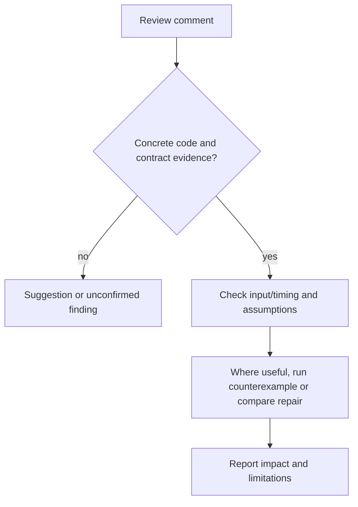

import PitfallMeta from '@site/src/components/PitfallMeta';

<PitfallMeta roles={['Engineer', 'QA Engineer']} phase="Testing" severity="High" appliesTo="All coding agents" evidence="Research" />

> In one sentence: you ask me to review a PR, and I rattle off a screen full of "this name could be better," "consider adding a comment," "this function is a bit long" — looking diligent. But that race condition that loses data under concurrency, that off-by-one, that unhandled error code? I never mention them. Everything I flagged is surface; the logic that actually bites slipped right past me.

## Symptom

You hand me a change to review. I come back fast with a long list of comments: this variable name isn't semantic enough, that spot is missing a comment, this function should be split up, that block has inconsistent indentation, this could be written in a more "modern" way. Lots of items — it looks like I reviewed it carefully.

But the things you actually worried about — whether this concurrent code drops an update when two requests arrive at once, whether this pagination logic comes up one short on the last page, whether there's a fallback when this external call fails, whether this boundary value runs the array out of bounds — I didn't touch a single one. I surfaced a pile of **harmless** nits and managed to miss exactly the ones that **get you paged at 3 a.m.**

## Why this happens

Visible style suggestions can crowd out logic review, while semantic failures often require state tracing, caller contracts, or concurrency counterexamples. Output style does not reveal training motives or establish that every model is inherently better at generation than review.

The current SWR-Bench paper evaluates review comments on real PRs, reports limitations in tested systems, and finds ACR tools more adept at detecting functional errors. It does not establish a permanent capability ordering for all generation models.

Are LLMs Reliable Code Reviewers? finds false rejection of correct implementations in tested requirement-conformance tasks. More detailed prompts requiring explanations and fixes sometimes increase error. A plausible failure story therefore remains a lead: inspect assumptions and executable evidence.



## Consequences

- **"Rigorously reviewed" is an illusion.** A report full of style comments signals to the team "this code was looked at carefully," while not one of the real high-severity defects was caught — more dangerous than no review at all, because it makes you lower your guard.
- **The author's attention gets consumed by noise.** The style nits I rattle off pull the author's energy toward renaming and adding comments, which dilutes the real question of "is the logic here correct."
- **Risk and output are inverted.** The places I comment on most are usually the least consequential; the changes that most need to be stopped are exactly the ones with the most convoluted logic — the kind I'm most likely to wave through.

## What to do instead

**Order review attention by risk: correctness, security, and boundaries first; hand style to deterministic tools and don't waste my deep-reasoning budget on it.**

- **Let formatters / linters handle style.** Indentation, formatting, and unused variables can follow explicit rules; naming semantics and readability can still require judgment: hand them to tools like Prettier, gofmt, ESLint, or Ruff and let them gate in CI. Don't spend my review compute on what a machine can judge in a millisecond; free it up for the logic a machine can't.
- **Use a checklist to force me to cover the logic dimensions.** Give me a review checklist and make me answer item by item: are boundary values (empty, zero, max, negative) handled? Do the error / failure branches have fallbacks? Is it concurrency- and re-entry-safe? Does the cross-file call contract still hold? — replace the open-ended "any problems?" with hard items I have to clear one by one.
- **Require me to give a reproducible failure path, not vague opinions.** For every defect I claim, make me write out "what input / what timing triggers it." If no concrete trigger is available, label the finding unconfirmed. Even with one, check its assumptions, actual execution path, and test evidence rather than accepting an invented counterexample.
- **Hold me accountable for the worst case.** For critical changes, force me to answer "how does this code break in the worst case" — this pushes me from "find a few surface blemishes" toward "actively imagine how it fails," which is exactly what review is supposed to do.

```text
A priority order you can drop into CLAUDE.md or a review prompt:
- Style / formatting / naming → hand to formatter + linter; AI review doesn't redo the work.
- AI review only watches: correctness, boundaries, error handling, concurrency, security, cross-file contracts.
- Every defect must come with "the input / timing that triggers it," or it's treated as unconfirmed.
- For critical changes, ask one more question: how does it break in the worst case?
```

## Example

**Before:**

```text
You: review this PR (adds concurrency handling to account debits).
Me: 1) suggest renaming balance to currentBalance; 2) this function is a bit long, consider splitting;
   3) suggest adding a doc comment to deduct(); 4) inconsistent indentation on line 12.
You: (renamed and added comments accordingly, merged)
In production: two debits arrive concurrently, both read the same stale balance, each subtracts,
      the later write overwrites the earlier → the account is under-charged by one debit.
      And that race? I never said a word about it.
```

**After:**

```text
You: review this PR. Style goes to the linter; you only look at concurrency safety, boundaries,
   error branches; give a concrete scenario that triggers each issue.
Me: ⚠ deduct() is read-modify-write, with no lock / no optimistic concurrency control:
   two requests read balance=100 at the same time, each subtracts 30, the later write overwrites
   the earlier → final 70 instead of 40.
   Trigger: two concurrent debits on the same account. Suggest a row-level lock or CAS retry.
   ⚠ When the balance exactly equals the debit amount, does it use <= or <? If rejection is `if balance <= amount: reject`, it rejects a legitimate full-balance debit; under a contract allowing a zero balance, check whether the comparison should be `<`.
You: (those two are the ones that actually bite — fix them first)
```

Same PR: "review it open-ended" rakes in a pile of style noise and misses the race; "order by risk + require a reproducible path" forces me onto the real logic flaws.

## When the exception applies

Readability is itself the review target for pure formatting or copy changes. Existing tests can shift attention but do not establish complete logic coverage; high-risk changes still need checks of new assumptions and uncovered paths. Without a linter, manual or AI style comments can help, provided suggestions and defects are distinguished.

## How this differs from neighboring pitfalls

- [Context-starved review that only sees the diff](./context-starved-review.mdx): that one is about me **not having** the repo context — you can't make bricks without straw; this one is about me **having** it and still not digging in, picking the easy surface stuff on purpose — one is short on material, the other short on effort.
- [Testing only the happy path, not the boundaries](./happy-path-only.mdx): that's me covering only the normal branches when I **write tests**; this is me picking only surface problems when I **review code**. The same "dodge the hard part" impulse, at different stages of the pipeline.
- [Trust then verify](./trust-then-verify.mdx): that's no review / verification being set up at all; this is review being set up but aimed at the inconsequential places.

## Version notes

:::note Research scope
Checked current titles and abstracts on 2026-10-29. Benchmark results depend on tested models, tasks, context, and evaluation methods. They do not prove a permanent limitation across releases. Reassess models, benchmarks, and review workflows when they change.
:::

## Further reading and sources

- [SWR-Bench: Assessing LLM Performance in Real-World Code Review Comment Generation](https://arxiv.org/abs/2509.01494)
- [Are LLMs Reliable Code Reviewers? Systematic Overcorrection in Requirement Conformance Judgement](https://arxiv.org/abs/2603.00539)
