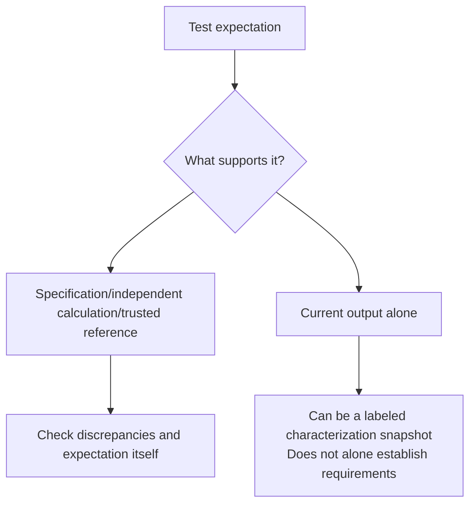

import PitfallMeta from '@site/src/components/PitfallMeta';

<PitfallMeta roles={['Engineer', 'QA Engineer']} phase="Testing" severity="High" appliesTo="All coding agents" evidence="Research" />

> In one sentence: synthetic fixtures are a normal testing method. The risk is data that violates its contract or expectations without independent support, presented as real samples or correctness evidence.

## Symptom

I can supply internally consistent fixtures without explaining whether they satisfy the input contract or independently support the expectation. Review those foundations rather than whether a person or model synthesized the data.

- **Assume an identifier exists without setting up a fixture.** A `getUser("u_88231")` expectation needs corresponding isolated test data or configuration. Invented IDs are legitimate; missing setup, unsupported contracts, or presenting synthetic data as real are the problems.
- **Copy the current output (even if it's wrong) as the "right answer."** I run the code once, see it spit out `{total: 119.7}`, and write `assertEqual(total, 119.7)` — I didn't compute "what the with-tax total *should* be" from the requirement; I treated **whatever the code happened to emit** as the yardstick. If that 119.7 is itself the result of broken tax logic, I just froze the bug in place as the "expected."
- **Cover only tidy common cases.** Uniform rows are not inherently wrong, but leave gaps when requirements include nulls, non-ASCII, or boundary amounts that no test exercises.
- **Treat an error response as the baseline fixture.** During integration a third party returned a payload that was actually an error, and I saved it as `fixtures/order_response.json` as the "normal response," and every later assertion orbits that wrong sample.

Report whether inputs are synthetic, sanitized, recorded, or characterization snapshots, alongside expected-value sources. A failure can also mean a wrong fixture or expectation, not necessarily a wrong implementation.

## Why this happens

Inputs, expectations, and implementation can share one unchecked assumption and agree without meeting requirements. Regression snapshots can faithfully record existing defects; they remain useful for detecting change without proving intended behavior.

Understanding LLM-Driven Test Oracle Generation is not direct evidence that LLMs mostly copy implementations. Its background discusses traditional regression oracles. The experiment studies 36 Java bugs with StarCoder 1.0 and a configuration labeled GPT-4o but identified as `gpt-4o-mini-2024-07-18`. Models generated bug-revealing oracles but could also reject correct versions, with results depending on context and prompting.

The unit-testing review covers research through March 2025 and motivates evaluating oracle generation, not a fabrication rate for all current agents. Reward-gaming analogies cannot replace that empirical question.



## Consequences

- **Green evidence has limited scope.** Synthetic inputs and implementation can agree correctly or share mistakes; they do not necessarily pass. Inspect the expectation’s basis rather than equating consistency with every requirement.
- **A bug gets frozen in place as "correct."** Once I copy the mis-taxed 119.7 in as the expected value, that defect stops being a defect — it becomes the "correct behavior" the test guards. Later, when someone fixes the tax, the test goes *red*, so the correct fix is blocked by the wrong test.
- **False confidence, compounding.** You see green, you see coverage, you merge and ship with peace of mind — while the one thing that most needed verifying, "is this number actually right," was never independently checked even once.
- **Regression protection turns into regression forgery.** A fixture that records wrong behavior will actively prevent any correction in the future — it guards not against "don't regress" but against "don't become correct."
- **Real data shapes are never touched.** Pristine fixtures of 10-character names and 3-item orders mean that null, overlong, empty collections, non-ASCII, boundary amounts — the shapes that genuinely exist in production and are most bug-prone — never enter a test at all (the flip side of [Happy-Path Only](./happy-path-only.mdx)).

## What to do instead

- **Construct synthetic fixtures to the contract.** Production data is usually unnecessary. Manual or property-based inputs can cover nulls, boundaries, non-ASCII, and valid relationships; generation does not automatically match a real distribution.
- **Independently support important expectations.** Use specifications, calculations, trusted references, or invariants, checking rounding, units, and tolerance. Copying current output does not verify requirements.
- **Authorize and minimize real samples.** Sanitize recordings and control credentials, retention, and copies. A real response may be an error rather than a correct baseline.
- **Use red → green as one check.** Failure must arise from the target defect. Correct erroneous specifications or fixtures transparently instead of preserving incorrect assertions forever.
- **Label snapshot purpose.** Deliberately recording current behavior is valid, without claiming it independently establishes correctness.

```text
Fixture review record:
- Source: synthetic / approved sanitized sample / recording / characterization snapshot.
- Scenario and constraints: identifiers, boundaries, and error-response classification.
- Expected-value basis: specification, independent calculation, or reference; list uncertainties.
```

## Example

**Before:**

```text
You: Add tests for calcInvoice(items), with tax.
Me: (just ran the code once, saw it return 119.7)
    assertEqual(calcInvoice(cart).total, 119.7)
    // and casually invent a fixture: 3 items, all integer prices, user "u_88231"
Me: Tests pass ✅, 92% coverage
Result: the tax rate was actually written as 0.197 instead of 0.13, so 119.7 is itself wrong;
        I pinned that wrong value in as the "expected." Later someone fixes the rate, total
        becomes 113 — and the test goes red, so the correct fix is blocked by this fabricated assertion.
```

**After:**

```text
You: Add tests for calcInvoice. Rule: compute the expected value from the requirement yourself,
     write it into the assertion, then run; do not copy the code's current output. Tax rate per
     spec section 4.2 (13%). Use the synthetic order in fixtures/ built to the contract and record the expectation source.
Me: (per spec: subtotal 100, tax 13%, with-tax should be 113; write assertEqual(total, 113) first)
Me: (run against the synthetic fixture — it goes red immediately, actual return is 119.7)
Me: expected 113, actual 119.7. The gap matches a tax rate written as 0.197 — the implementation is wrong, not the assertion.
You: Fix the implementation, turn it red → green, leave the assertion alone.
Me: (change the rate back to 0.13, rerun, 113 == 113, green)
Result: the test supports the subtotal-100, 13%-tax example yielding 113. Null memos and fractional amounts need their own assertions; this one pass does not establish them.
```

For the same function, "copy the current output + invent a fixture" yields a self-talking green that also freezes a bug in place; "independently supported expectation + contract-valid fixture" yields a test that can actually catch the defect.

## When the exception applies

Synthetic data is not merely a fallback when real samples are unavailable; it is a common privacy-preserving way to control cases. Characterization snapshots can intentionally record current behavior, and exploratory data can aid diagnosis. Label their purpose and limits without presenting unconfirmed behavior as correctness proof.

## How this differs from neighboring pitfalls

A few pitfalls in the testing phase are easy to confuse; the layer each tampers with differs:

- [Gaming the Tests](./gaming-tests.mdx): there I edit the **assertion / verdict** (loosen a red assertion, align it to the current value, add a skip); here I edit the **input and fixture data**, feeding in fake data and an invented expectation. One distorts the yardstick, the other forges the thing being measured.
- [Trust, Then Verify](./trust-then-verify.mdx): there I **never built** a verification loop at all; here the loop is built, but **the data fed into it is invented by me** — read this as a concrete instance of "trust, then verify" at the test-data layer.
- [Happy-Path Only](./happy-path-only.mdx): there I **never wrote** the boundary and error cases; here the pristine fixtures I fabricate **often ARE** that convenient happy-path data — the two frequently co-occur, but one root cause is "missing branches," the other is "distorted data."
- [Over-Mocking](./over-mocking.mdx): there I **swap a real dependency for my invented return value** (I replace the dependency); here I **fabricate the test's input data and expected values** (I replace the data itself). One emphasizes coverage after substituting dependencies; the other emphasizes support for inputs and expectations.

## Version notes

:::note Research scope
Read the oracle study's full text and review abstract on 2026-10-29. Its tested models and Java bugs do not represent every current model. The invoice calculation remains an illustrative example, not an incident report. Reassess model, specification, fixture, or reference-expectation changes.
:::

## Further reading and sources

- [Understanding LLM-Driven Test Oracle Generation (full text)](https://arxiv.org/html/2601.05542v1)
- [Large Language Models for Unit Testing: A Systematic Literature Review](https://arxiv.org/abs/2506.15227)
