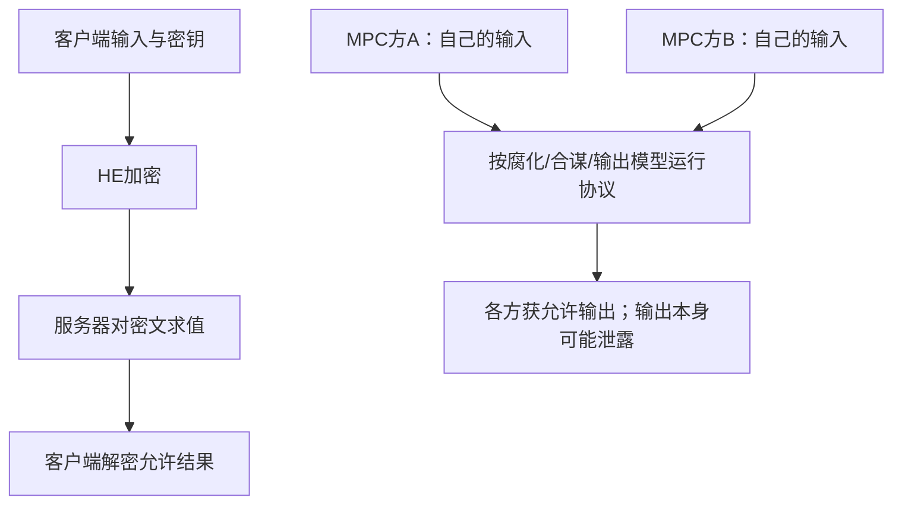

import PrivacyMeta from '@site/src/components/PrivacyMeta';

<PrivacyMeta era="卷一 · 隐私根基" technique="隐私保护计算" audience={['隐私工程师', '安全工程师', 'ML 工程师']} severity="中" maturity="试验" evidence="研究支持" />

> 一句话摘要：同态加密让持钥客户端把输入加密后交服务器计算；MPC 让多方按协议联合计算。机密性来自具体密码假设、参数与腐化模型，仍须保护端点、密钥和实现。允许输出可能透露输入；性能取决于方案、电路与通信，不能给无匹配基准的统一开销倍数。

## 机制：我这边发生了什么

HE 服务器在密文上求值后返回密文，客户端解密。Gentry2009 给出首个全同态方案，用 bootstrapping 控制噪声、支持更深电路；具体编码、近似误差与正确性依方案分析。MPC 参与者本就知道自己的输入；秘密分享、混淆电路等技术使其视图在指定模型内不额外披露自身输入与允许输出以外的信息。红线：功能测试正确不证明密码安全，HE 输入机密性也不自动证明恶意服务器返回了正确结果。



## 威胁面

HE 的输入机密性不覆盖持钥端点失陷、未分析的元数据或输出使用。MPC 的半诚实模型不自动满足恶意安全；合谋、掉线、公平性和保证输出交付须按协议核。即使安全计算完全正确，某些函数输出配合辅助知识也能确定他人输入，这并不违反只允许该输出的安全定义。

## 防护原理

HE/MPC不把远端执行硬件当机密性的唯一信任根，却仍依赖本地硬件、随机数、库和密钥管理。若目标还包括限制某记录对统计输出的贡献，可另设计DP机制并核隐私单位、邻接、预算与组合；不是任意函数都能只加一点噪声，DP也不承诺零披露。

## 落地实现（配方）

```text
1. 定义输入持有者、获准输出及对手；选 HE 外包或多方协议，列明腐化/合谋/掉线模型。
2. 固定方案、参数、安全估算器、库版本、密钥/随机数来源和端点责任。
3. 近似算术验证误差；恶意服务器场景另验证计算完整性，MPC 另核公平与输出交付。
4. 按真实电路、数据规模、通信与 bootstrapping 设置测时延/吞吐/带宽，不迁移通用倍数。
5. 单独评估允许输出及辅助知识；若选择 DP，独立核单位、贡献限制、预算与组合。
```

**最小可测试断言**：明文/安全计算结果在声明误差内，参数和协议模型经独立复核，输出接收者符合授权。测试只支持这些实现检查，不能替代安全证明；未测攻击失败不证明无泄露。

## 真实案例 / 工程可行性

Gentry 提供 FHE 奠基，Evans 等提供 MPC 系统化介绍；它们不认证某 2026 LLM 部署的延迟或安全。私有推理是否可用须针对模型、精度、通信与密钥责任实测，本文不从早期原型外推全规模生产状态。

## 残余风险与权衡

计算方视图、允许输出、正确性和可用性是不同目标。通信轮次、密文扩张、深电路与近似误差可能成为瓶颈，具体幅度必须实测。加密不自动解除合同或个人数据义务；本文不作具体法域认证。

## 与相邻技术的区别

[TEE](./trusted-execution-environment.mdx)依赖硬件隔离、证明与获准软件；HE/MPC 依赖相应密码协议且仍信端点。[DP](../03-conversational-llms/dp-fine-tuning.mdx)限制指定单位在发布物中的可区分性，与隐藏计算中间视图是不同目标，可按需要组合。

## 版本说明

:::note 适用版本
2026-10-29 核对 FHE 奠基与作者维护 MPC 书籍仓库；书籍 PDF 直链读取超时，未声称逐项重新证明协议或核实具体部署。没有同条件一手性能基准时不给通用倍数。2027-04-29 前，或密码方案/估算器、腐化模型、实现和工作负载基准变化时复核。
:::

## 延伸阅读与出处

- [Gentry：Fully Homomorphic Encryption Using Ideal Lattices（STOC2009）](https://research.ibm.com/publications/fully-homomorphic-encryption-using-ideal-lattices)
- [A Pragmatic Introduction to Secure Multi-Party Computation：作者仓库](https://github.com/evansuva/pragmaticmpc)
