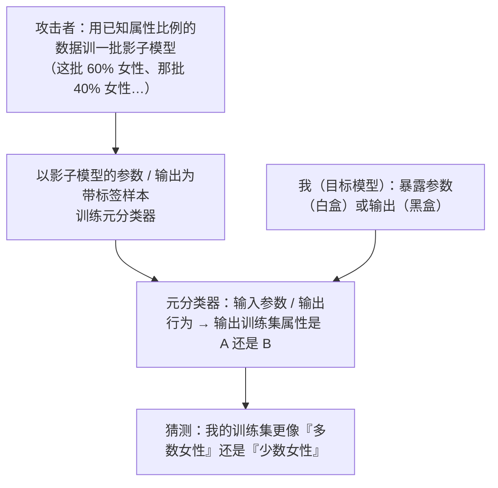

import PrivacyMeta from '@site/src/components/PrivacyMeta';

<PrivacyMeta era="卷一 · 隐私根基" technique="推断类攻击" audience={['隐私工程师', 'ML 工程师', '安全工程师']} severity="中" maturity="研究" evidence="研究支持" />

> 一句话摘要：这条不是判定某人在不在（成员推断），也不是重建某条样本（反演），而是套出我整个训练**集**的**统计属性**——「这个模型是用『多少比例女性 / 某族裔』的数据训出来的」。Ganju 等（CCS 2018）用一个**元分类器**做到了：在美国人口普查收入数据上，能区分「训练集 38% 女性 vs 65% 女性」、「0% 白人 vs 87% 白人」两种构成。Suri & Evans（PoPETs 2022）进一步把它**形式化**为「分布推断」，并给出 `n_leaked` 指标量化风险。结论先行：**训练集的群体构成本身就可能敏感**（商业机密 / 群体隐私），别只盯着保护单个个体——有时攻击者要的根本不是某一条记录。

## 机制：我这边发生了什么

我的**参数**和**输出统计**，在数学上携带了训练集**整体分布**的痕迹——不是某一条记录，而是「这批数据长什么样」。攻击者据此训一个**元分类器（meta-classifier）**：输入是我的参数（白盒）或我的输出行为（黑盒），输出是「这个模型的训练集属性更像 A 还是 B」（如「女性占多数还是少数」）。

具体到 Ganju 等（CCS 2018）的白盒做法：全连接网络（FCNN）的神经元有**置换不变性**——同一层里把神经元换个顺序，函数完全不变，但**原始权重向量的排列**会变。直接把权重喂给元分类器，它会被这种无意义的排列噪声淹没；他们用一个**对神经元置换不变的表示**（先把每个神经元的参数映射成特征、再对一层内做置换不变聚合）来喂元分类器，于是元分类器学会从「一层的整体参数分布」里读出训练集属性。攻击者先用**已知属性比例**的数据训出一批「影子模型」（这批训练集 60% 女性、那批 40% 女性…），拿它们的参数当带标签样本来训元分类器；训好后，对着我的参数跑一次，就得到对我训练集比例的猜测。

红线说清楚：不是「我知道我训练集里有多少比例女性 / 我记得这批数据的构成」——我无法内省自己训练集的比例。可被外部复算验证的是：**我的参数 / 输出统计随训练集的群体构成而变，足以让攻击者训一个元分类器把不同构成区分开**。



## 威胁面：能推什么、攻击者要什么前提

**能推**：训练集的**聚合 / 群体属性**——某敏感特征的**比例 / 构成**（多少比例女性、某族裔占比、某地区样本占比、正负样本比例），而不是任何一条具体记录。Ganju 等在人口普查收入数据上区分的是 38% vs 65% 女性、0% vs 87% 白人这类**整体构成**差异。

**攻击者模型 / 前提**（决定可行性，照 BACKLOG-privacy.md「分类必核清单」写清）：

- **白盒 vs 黑盒**：Ganju 等针对可获取参数的白盒设定；后续也有查询输出的黑盒攻击，实测相对强弱取决于攻击方法与知识，不能保证黑盒总弱于白盒。
- **能训影子模型**：攻击者需要能用**已知属性比例**的数据训出与我同架构的影子模型（知道或能逼近我的训练流程与架构）。
- **二选一 / 区分式**：经典设定是**区分两种构成**（A vs B），不是直接读出连续比例；要估到「具体百分之多少」更难，且强依赖影子模型覆盖的比例范围。
- **成功判定**：元分类器在留出的目标模型上的**区分准确率**——以及（见下）Suri & Evans 把它折算成的 `n_leaked`。

## 防护原理

分布推断风险来自模型对训练集构成的可观测依赖，但特定敏感属性并非必然被编码或泄露。按实际任务测量泄露，评估重采样、训练与发布控制；不能从「模型能学到东西」推出「任意群体属性都可推断」。

在此前提下，能做的是**抬高攻击成本、缩小泄露**：

- **差分隐私有一定帮助、但靶心不对**：DP 限制**单个样本**对参数的影响，对「针对训练中某个体」的攻击（成员推断 / 个体反演）直接有效；但分布推断要的是**整体构成**这个聚合量，DP 的个体级保证**不直接覆盖**它——别把 DP 当分布推断的银弹。（DP 机制见《[DP 微调](../03-conversational-llms/dp-fine-tuning.mdx)》。）
- **控制参数暴露面**：按需发布权重或托管 API，分别测量白盒 / 黑盒攻击；蒸馏和限额可能改变风险，安全聚合仅保护传输中的单个更新，不移除最终模型里的群体信息。
- **用 `n_leaked` 量化、而非感觉**：Suri & Evans（PoPETs 2022）把「元分类器的区分准确率」折算成一个直觉量——**攻击者若改为直接从总体分布里采样、要采多少条记录才能达到同样的区分力**。这把抽象的「攻击成功率」变成「相当于泄露了 N 条采样」，便于和你的资产敏感度对齐。

## 落地实现（配方）

```text
1. 先认清暴露面：你的模型是开源权重 / 联邦传参（白盒），还是仅 API（黑盒）？
   分别测白盒与黑盒分布推断——把"是否必须公开权重"当成隐私决策，而非工程默认。

2. 把"训练集群体构成"列入资产清单：它可能是商业机密（数据来源构成）或群体隐私
   （某敏感属性比例）。别只在威胁建模里写"保护单条记录"。

3. 跑分布推断红队（区分式）：用已知比例的数据训影子模型 + 元分类器，评估"在你的
   暴露面（白盒 / 黑盒）下，能否区分你关心的两种构成（如某属性 30% vs 70%）"。
   白盒可参照 Ganju 等的置换不变表示思路。

4. 用 n_leaked 报风险，而不是只报一个准确率：把元分类器的区分力折算成"相当于
   攻击者直接采样多少条记录"（Suri & Evans）。固定属性比例对与攻击条件时，区分准确率越高，n_leaked 越大、等效泄露越多。

5. 收紧暴露面：能蒸馏 / 仅暴露 API / 加安全聚合就做，把白盒推回黑盒。叠 DP 可削
   个体级攻击，但在隐私评估里如实标注"DP 不直接覆盖分布推断"，别承诺清零。
```

每个结论都绑定**你的模型架构、暴露面与你关心的属性**——论文里在人口普查数据上的可区分程度**不能直接迁移**到你的设置。

**最小可测试断言**（把分布推断风险收成可回归的检查）：

- 怎么测：用已知属性比例的数据训一批影子模型 + 元分类器，在你的真实暴露面（白盒参数 / 黑盒输出）下，测元分类器对「你关心的两种群体构成」的区分准确率，并折算 `n_leaked`。
- 通过：固定属性比例对、先验、模型与访问方式后，区分准确率及置信区间满足预设门槛，等效 `n_leaked` 较低。它是分布信息量标尺，不是实际恢复记录数；不同属性比例对不可只凭其大小直接排名。
- 失败：在声明条件下能显著区分两种构成，且等效 `n_leaked` 高于容许门槛 → 记录群体泄露，评估重采样、发布方式等缓解并重测。安全聚合隐藏单个更新，不自动消除最终模型的群体属性信号。

## 真实案例 / 研究进展（工程可行性）

（本条 maturity 标「研究」：以下是**实证攻击 / 形式化**证据，强绑实验数据集与设定，不是「任何模型都能随手读出训练集比例」的背书。）

- **从全连接网络读出训练集群体构成（白盒）**：Ganju 等（ACM CCS 2018）提出利用 FCNN **置换不变性**的元分类器属性推断，在美国**人口普查收入**数据上，能区分训练集「**38% 女性 vs 65% 女性**」「**0% 白人 vs 87% 白人**」这类整体构成——揭示「共享一个在敏感人群上训出的模型权重，等于泄露了这批训练数据的群体构成」。（本条不引一个具体的「顶线准确率」数字：该数字未能核验；这里只描述其设置与可区分的构成条件。）
- **`n_leaked` 的正确方向**：Suri & Evans（PoPETs 2022）以直接从候选分布采样达到同等区分力所需的等效样本量作标尺。固定候选分布时，值越高意味着模型泄露的分布信息越多；它不是攻击者必须再获取的样本成本，也不是已恢复的真实记录数。论文的 95% 准确率示例：比例 0.5 vs 1.0 对应约 3，0.5 vs 0.52 对应约 42；比例间距不同，不能单凭数字跨任务排名。
- （奠基线索：元分类器式属性推断最早可追溯到 Ateniese 等「Hacking Smart Machines with Smarter Ones」，Int. J. Security and Networks 2015；上述两篇把它推进到神经网络与形式化量化。引用具体增强方法前核最新文献。）

## 残余风险与权衡

逐条点破假安全：

- **不能用一般统计直觉证明不可避免。** 某属性是否泄露取决于任务、数据与机制；按明确属性对测量，避免承诺绝对安全或宣称任何缓解均不可能。
- **DP 不是这条的银弹。** DP 给的是**个体级**保证，分布推断要的是**聚合构成**——靶心不重合。叠 DP 能削个体攻击，但别把它当分布推断的解药。
- **访问方式不是风险排名本身。** 额外参数访问扩大可用信息，但某个白盒攻击未必强于更好的黑盒方法；比较应固定模型、知识和攻击预算。
- **「群体构成」也是要保护的资产。** 它可能是商业机密（数据来源）或群体隐私（敏感属性比例）。只防「单条记录」会漏掉这一整类风险。
- **数字绑定设定。** Ganju 的群体比例来自特定人口普查任务；`n_leaked` 的 3 / 42 示例来自指定候选比例与 95% 准确率的分析，不能迁成任意模型的泄露记录数。

## 与相邻技术的区别

把「**个体 vs 群体**」这条轴讲清——这是本条与两个邻居的根本分界：

- **vs 《[成员推断](./membership-inference.mdx)》（本卷）**：成员推断问「**某一个个体在不在**训练集」（一个是 / 否比特）；本条问「训练**集整体**的群体构成是什么」（一个聚合属性）。前者是个体级，后者是群体级——同属「推断类攻击」板块，但泄露的单位不同。
- **vs 《[模型反演与属性推断](./model-inversion-attribute-inference.mdx)》（本卷）**：那条的「属性推断」是推**某一个个体**未公开的敏感属性（这个人的基因型），或重建**某一类的代表样本**；本条推的是**整个训练集**的群体属性（多少比例女性）。一个落在**个体**身上，一个落在**总体**分布上——名字都带「属性」，但作用单位正相反，别混。

## 版本说明

:::note 适用版本
2026-10-29 依据原论文修正 `n_leaked` 风险方向与验收断言。补核 SaTML 2023 的 Dissecting Distribution Inference：在其多数设置里黑盒攻击强于此前白盒攻击，重采样也可有效，故不把「白盒必更强」或「任何属性必泄露」当全称结论。2027-04-29 前，或攻击者知识、属性比例、模型发布形态变化时复核。
:::

## 延伸阅读与出处

- [Property Inference Attacks on Fully Connected Neural Networks using Permutation Invariant Representations（Ganju 等，ACM CCS 2018）](https://dl.acm.org/doi/10.1145/3243734.3243834) —— 白盒属性推断：利用 FCNN 置换不变性的元分类器，在人口普查收入数据上区分训练集群体构成（38% vs 65% 女性、0% vs 87% 白人）。本条主源。
- [Formalizing and Estimating Distribution Inference Risks（Suri & Evans，PoPETs 2022）](https://arxiv.org/abs/2109.06024) —— 定义分布推断与等效 `n_leaked`；高值表示更多等效信息泄露。
- （奠基，选读）Ateniese 等，「Hacking Smart Machines with Smarter Ones」（Int. J. Security and Networks 2015）—— 元分类器式属性推断的源头。

- [Dissecting Distribution Inference（SaTML 2023）](https://arxiv.org/abs/2212.07591)
