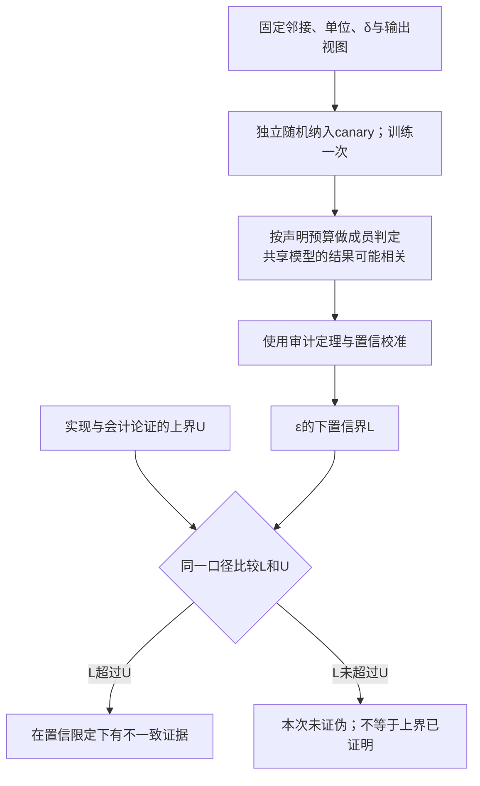

import PrivacyMeta from '@site/src/components/PrivacyMeta';

<PrivacyMeta era="卷二 · 记忆与抽取" technique="隐私评测与审计" audience={['隐私工程师', 'ML 工程师', '安全工程师']} severity="中" maturity="研究" evidence="研究支持" />

> 一句话摘要：DP 审计用受控成员推断等攻击，给满足指定邻接关系与 δ 的隐私参数 ε 构造**统计置信下界**，用来寻找声称上界的反例。它不提供形式上界，也不能认证实现无误。一次训练审计可独立随机纳入多条 canary，但**共享训练模型的隐私损失 / 判断不因此彼此独立**，必须使用相应定理校准。

## 机制：我这边发生了什么

我在训练后表现出的成员可区分性可被外部测试，而不是靠我自述「记得谁」。审计固定隐私单位、相邻数据集定义、δ、可见输出与置信水平，将攻击结果转换为 ε 的下界 L。置信水平属于审计统计误差；δ 属于 DP 定义，二者不能混为一个「失败概率」。

Steinke、Nasr、Jagielski（NeurIPS 2023）在同一次运行中独立决定各 canary 是否纳入，利用 DP 与统计泛化联系分析观察结果，避免把每个探针当一次独立训练。成员打分可共享模型且相关；不能直接用朴素独立伯努利公式代替其校准。



## 威胁面：能力与盲区

- **下界高于声称上界**：在置信校准、邻接 / δ / 可见视图一致的条件下，是值得调查的不一致证据；也要排查审计实现、测试选择与多重比较，不直接认定某个裁剪 bug。
- **下界远低于上界**：可能是理论上界松、攻击弱、观测受限或实际泄露较小，单凭差距不能判断实现对错。**不是额外的 bug 证据**。
- **下界贴近上界**：说明已测攻击接近分析界，不是密码学证明或实现认证。
- **访问方式与探针**：中间梯度、最终参数或纯 API 输出给出的可见视图不同。审计视图若强于声称 DP 保护的发布视图，不能直接判定该发布的声明被推翻。

## 防护原理

实现审查与完整隐私会计给出有条件的形式上界；审计从外部行为寻找反例，两者互补。统计检验有误差，且攻击自适应选阈值、重复审计或挑最好结果会改变置信校准。记录全部选择规则，不能把同一批数据既选攻击又无校正地报告显著性。

## 落地实现（配方）

```text
1. 固定被审机制、邻接关系、保护单位、δ、输出视图、分析上界 U 与审计置信水平。
2. 用合成、可追踪且不含真实 PII 的 canary；按原方法独立随机纳入，不换掉待审训练实现。
3. 固定成员打分器、阈值选择/弃权、攻击预算与统计程序；单独记录自适应选择。
4. 用匹配的审计定理计算下置信界 L，报告 canary 数、纳入随机化、δ与置信水平。
5. 对照 L 和 U；若超界，检查训练/会计/审计三侧；未超界只记录未发现反例。
```

**最小可测试断言**：审计程序在已知机制 / 对照上具有所声明覆盖率，L 与 U 使用同一邻接、δ及视图；在预设多重比较策略下未出现超界。通过是经验闸门，形式保证仍须完整机制论证；不要求每次 L 都贴近 U，也不因更强攻击提高 L 就自动判失败。

## 研究进展与工程可行性

- **NeurIPS 2020 DP-SGD 审计**：利用投毒构造高影响样本、重复运行机制估计隐私下界，提供攻击式检查路径。
攻击参数、阈值或多次审计若按最佳结果选择，须纳入相应选择/多重检验校准，不能把每次置信水平直接沿用为最终结论。

- **一次训练审计（NeurIPS 2023）**：在允许攻击者注入任意梯度的白盒 CIFAR10 / WideResNet 实验中，5000canary 设置下理论 ε=1/2/4/8 对应经验下界 0.7/1.2/1.8/3.5，δ=10⁻⁵。原条目将 ε8 与下界 1.8、上界 4 拼为同一设置，已纠正。数字只示范论文配置，不是新部署的门槛或普遍检测力。

## 残余风险与权衡

审计修改数据会影响效用与训练成本；探针覆盖不到所有实际个体，多个探针的隐私损失也不独立。上界需要分析实现、采样与所有发布的组合，审计需要独立统计校准。两者均不可被「用了知名库」替代。

## 与相邻技术的区别

[量化记忆](./quantifying-memorization.mdx)的 exposure 是候选排名指标；本条构造 ε 的统计下界。[DP 微调](../03-conversational-llms/dp-fine-tuning.mdx)描述机制与会计；本条尝试证伪其有条件声明，不能替代证明。

## 版本说明

:::note 适用版本
2026-10-29 阅读一次训练审计全文§6/§7 与前序研究，核对数值和相关性限制。未重新运行原论文训练或证明所有审计变体。2027-04-29 前，或审计定理、置信校准、邻接/δ、采样和可见输出变化时复核。
:::

## 延伸阅读与出处

- [Privacy Auditing with One (1) Training Run（全文）](https://arxiv.org/html/2305.08846)
- [Privacy Auditing with One (1) Training Run（论文页）](https://arxiv.org/abs/2305.08846)
- [Auditing Differentially Private Machine Learning（NeurIPS2020 作者稿）](https://arxiv.org/abs/2006.07709)
