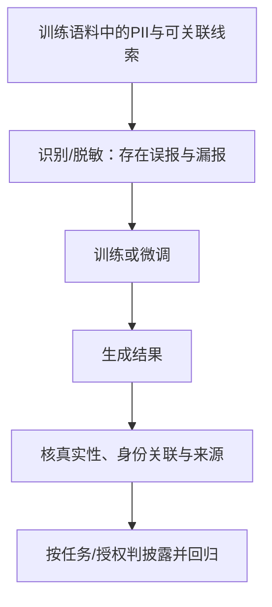

import PrivacyMeta from '@site/src/components/PrivacyMeta';

<PrivacyMeta era="卷三 · 对话大模型" technique="PII 检测与脱敏" audience={['隐私工程师', 'ML 工程师', '合规工程师']} severity="高" maturity="研究" evidence="官方文档" />

> 一句话摘要：训练语料中的真实个人信息可能在生成中被复现；脱敏工具可减少暴露，却可能漏检或被跨字段关联绕过。Presidio**源自微软，现由 Data Privacy Stack 社区维护**，不是微软现行官方产品；Google/AWS/Azure 则有各自托管服务。工具、阈值、语种与 PII 类别都需按任务验证，不能由「扫过」推出「不含个人信息」。

## 机制：我这边发生了什么

我可能生成与训练文本相同的姓名、地址或关联片段；但 PII 格式命中也可能来自当前上下文、公共知识、推断、巧合或错误编造。输出匹配本身不证明私有训练来源。Lukas 等研究在其模型与语料中区分抽取、推断和重构，表明清洗可能降低而未消除风险。红线：源归因要靠数据与实验对照，不能靠我说「我记得」。



## 威胁面

格式检测可能漏掉语义敏感内容，跨字段与背景知识可重建关联。移除直接标识符不自动匿名，哈希或可逆占位也不等于去标识完成。包含多个片段的一个人不自动受句子级 DP 的用户级保护。

## 防护原理

减少不必要数据，按语言与实体类型组合 NER、规则、词典与校验，再做受控抽取/重构审计。若声称 DP，要核邻接、单位、完整会计与可信边界；不能把检测器漏检率当形式隐私预算。

## 落地实现（配方）

```text
1. 定义需要保护的人与字段、合法任务及接收方，先移除不必要语料。
2. 自托管 Presidio 或选托管识别器，固定版本/语种/实体/阈值并测精确率与召回。
3. 用合成 canary 或获授权数据测抽取、推断、跨字段重构；避免测试日志新增真实 PII 副本。
4. 核真实身份关联和来源，对正常授权披露与越权披露分别打分。
5. 输出过滤作补充；如有 DP，独立核单位和会计，按新语料/攻击重测。
```

**最小可测试断言**：各语种/PII 类别在独立标注集上的精确率、召回和重构指标达到门槛，附区间与漏检案例。测试未发现 PII 不证明匿名；像电话号码的串也不直接证明泄露。

## 真实案例 / 工具现状

- **Presidio 项目文档**：社区 FAQ 明确不保证发现全部敏感信息，并建议补充保护；项目没有厂商 SLA。自托管须自己核模型、实体与维护版本。
- **Google Sensitive Data Protection**：infoType 识别与去标识变换需按数据选择，检测不完美且不自动证明合规。
- **AWS Comprehend**：当前文档支持英/西文 PII 检测、实体分数与偏移；不要将另一服务或语言的覆盖移植过来。
- **Azure Language PII 透明说明**：服务能力与限制需纳入整体流程和人员，不能凭云服务名称认证清洗充分。
- **Lukas 等 2023**：研究显示特定文本模型/数据域的清洗与 DP 设置仍需分别衡量残余 PII，不提供任意产品的普遍漏检率。

## 残余风险与权衡

召回与误报、效用与最小化有权衡。清洗映射表、人工复核与审计日志本身可能成为新的敏感副本，需权限和保留控制。合规匿名判断另按法域与可识别性评估，不由工具开关决定。

## 与相邻技术的区别

[训练数据抽取](../02-memorization-extraction/training-data-extraction.mdx)研究原文恢复，本条聚焦真实个人信息与关联；[合成数据](../06-governance-compliance/synthetic-data-privacy.mdx)和去标识都不自动等于匿名。

## 版本说明

:::note 适用版本
2026-10-29 读取现维护 Presidio FAQ、Google/AWS/Azure 限制与 Lukas 论文；旧 FAQ 失效已更新，删除长引语和未必要的实体数量。未实跑全部工具。2026-12-29 前，或维护主体、模型/语言/实体、语料来源与 PII 攻击变化时复核。
:::

## 延伸阅读与出处

- [Presidio 社区 FAQ](https://raw.githubusercontent.com/data-privacy-stack/presidio/main/docs/faq.md)
- [Google infoTypes 与限制](https://docs.cloud.google.com/sensitive-data-protection/docs/concepts-infotypes)
- [AWS Comprehend PII](https://docs.aws.amazon.com/comprehend/latest/dg/how-pii.html)
- [Azure PII 透明说明](https://learn.microsoft.com/en-us/azure/foundry/responsible-ai/language-service/transparency-note-personally-identifiable-information)
- [Lukas 等 PII 研究](https://arxiv.org/abs/2302.00539)
