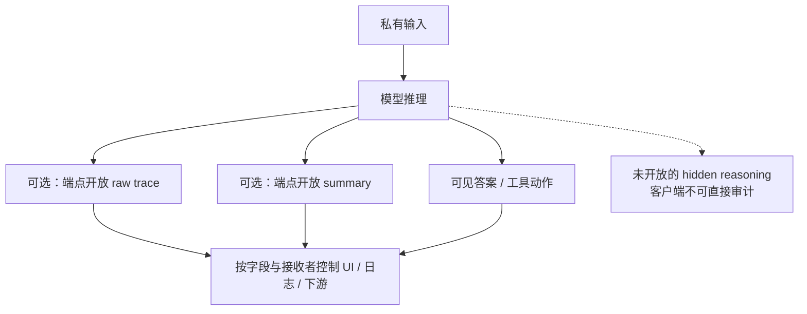

import PrivacyMeta from '@site/src/components/PrivacyMeta';

<PrivacyMeta era="卷三 · 对话大模型" technique="上下文面隐私" audience={['安全工程师', '隐私工程师']} severity="高" maturity="研究" evidence="研究支持" />

> 一句话摘要：**能被展示、记录或交给下游的推理文本，可能带出最终答案没有暴露的敏感信息。** 但原始推理链、推理摘要和未开放的隐藏推理不是同一个对象。先核端点实际返回什么，再控制各条可达路径；「推理越多就一定漏得越多」不能从特定研究设置推广成所有模型的定律。

## 机制：我这边发生了什么

推理模型可能在中间文本中再次引用输入里的账户号、病历或其他私有字段。如果应用把这份文本原样展示、落日志或传给另一个 agent，就增加了可读副本；只过滤最终答案会漏掉这条路径。**是否对外可读，由模型端点、返回格式和应用数据流决定，不由「都是生成 token」直接推出。**

先区分实际审计对象：

| 对象 | 例子与边界 | 应怎么审 |
|---|---|---|
| 原始推理链（raw reasoning trace） | 某些开放权重 / 自托管实现返回的 `analysis` / `<think>` 文本；OpenAI 的 gpt-oss 文档明确区分 raw CoT 与可展示内容 | 对实际返回字段做访问控制、流式与日志治理，不把完整原文默认展示 |
| 推理摘要（reasoning summary） | OpenAI 托管 reasoning API 文档提供可显式请求的 summary，并说明不暴露 raw reasoning tokens | 摘要本身仍是输出，按内容与接收者审计；不能把它当完整内部轨迹 |
| 隐藏推理（hidden reasoning） | 端点未向客户端开放的推理内容 | 记为「不可直接观测」，不能声称已抓取、已脱敏或零泄露；另测可见答案与动作 |

我不能可靠自述「思考里没有秘密」。可检验的是客户端实际收到的字段、应用保存或转发的内容及其接收权限。**隐藏内容不能用来伪造一个「审计零命中」的分数。**



## 威胁面：谁能看到哪些推理文本

攻击者可能是终端用户、无权读取 trace 的操作人员、下游 agent 或第三方观测平台。前提必须写清：**哪份文本实际对其可达**。在明确返回 raw trace 的部署中，可以直接测敏感字段和套取攻击；只有 summary 的端点，就测 summary 与答案 / 动作，不能把「复述你的思考」生成的自述当 raw trace。

Leaky Thoughts（EMNLP 2025 主会）在 AirGapAgent-R 探针与 AgentDAM agentic 设置上测可见推理文本，观察到敏感数据在轨迹里被引用、部分内容进入答案，以及推理预算变化影响泄露。它说明**可见轨迹值得单独治理**；不证明每家托管 API 都返回完整推理，也不证明所有模型的预算—泄露关系都单调。

## 防护原理

- **按返回字段控制暴露。** 分开 raw trace、summary、答案和工具参数；分别记录谁能看、会去哪个日志 / 下游。
- **在序列化与转发边界执行。** 默认不展示 raw trace，不落无必要原文；确需共享时按接收者授权脱敏。不能只靠页面隐藏 `<think>` 标签，底层响应和日志仍可能保留正文。
- **不开放 raw 不等于所有路径安全。** summary、答案和动作仍可能带出私有字段，照常评测；供应商侧处理边界另见《[推理服务数据边界](../06-governance-compliance/inference-service-data-boundary.mdx)》。
- **预算按端点评测。** 同时量任务效果与可见路径的隐私，别把提高推理预算当隐私防护，也别把关闭推理当普遍解法。

## 落地实现（配方）

```text
1. 对实际端点 / 模型版本抓一次受控响应，列出 raw trace / summary / answer /
   工具参数哪些可达；未开放的字段记「不适用 / 不可直接观测」。
2. 画 UI、流式输出、日志、trace 平台和下游 agent 的接收权限；raw trace 默认不展示，
   只在必要且授权时留存。summary、答案和工具参数同样检查。
3. 用合成档案与无真实 PII 的 canary，分别测各可达字段中的未授权披露及注入套取。
   字面检测只是候选，还要按用途与收件人判断是否违规。
4. 在支持的推理预算档位对照任务完成与隐私指标，固定其他条件，报告样本量与不确定性。
5. 换端点 / 模型 / summary 设置 / 日志或下游时回归，不复用旧版「思考不可见」假设。
```

**最小可测试断言**：

- 怎么测：逐项检查实际响应及 UI / 日志 / 下游收到的内容；对可达的 raw trace、summary、答案与动作分别跑 canary 和注入用例。未开放 raw trace 的端点只报告可见路径，记录覆盖缺口。
- 通过：各可达路径的未授权披露满足预设门槛，访问与留存策略生效；任务效果达标，预算变化的结果被记录。没有把不可观测字段写成「已证无泄露」。
- 失败：raw trace 被原样发给无权主体、summary / 答案 / 动作带出未授权信息、日志绕过了控制，或把模型自述冒充内部轨迹证据；修对应路径后重测。

## 真实案例 / 研究进展（工程可行性）

本条 `maturity=研究`：论文说明风险与测量方式，官方文档说明接口区别，不能据此宣称防御普遍有效。

- **Leaky Thoughts（EMNLP 2025）**：探针使用 AirGapAgent-R 的 **20 个合成画像 × 26 字段 × 8 场景**，另有 AgentDAM agentic 设置。结果显示，在受测可见轨迹中，答案侧谨慎可以与轨迹侧敏感信息复现并存；增加预算也可能增加暴露。必须保留其模型、任务和提示条件，不能迁移成今日任一端点的泄露率。
- **OpenAI 官方接口文档（核验 2026-10-29）**：托管 reasoning guide 将 raw tokens 与显式选用的 summary 分开；gpt-oss 的 raw-CoT 文档则讨论可返回原始分析文本的情形。两类接口恰好说明，不能按「推理模型」一词推断暴露面。
- **Trend Micro 的 DeepSeek-R1 分析（2025-03-04）**：是显式 `<think>` 暴露的历史安全分析示例，保留为补充来源，不当当前全模型现状或量化主源。

## 残余风险与权衡

- **答案干净不能抵消另一条可读路径的泄露。** raw trace、summary、工具与日志分别检查。
- **摘要也可能含敏感信息。** 但它不是完整原始推理链；不要用摘要结果推断隐藏内容已经被穷尽审计。
- **检测器和攻击集有盲区。** 合成 canary 未命中只说明这套用例没有发现更多，不能证明没有其他语义泄露。
- **限制 trace 留存会影响调试。** 保留复核必需证据、限定接收者和时间，并公开任务效用代价。

## 与相邻技术的区别

《[上下文面隐私](./context-surface-privacy.mdx)》讲输入窗口里的秘密被套取；本条讲推理相关的额外文本路径。两者可能叠加，但都不等于《[PII 回吐](./pii-regurgitation.mdx)》所讲的训练权重记忆；本条也不把对隐藏推理的自述当模型内省证据。

## 版本说明

:::note 适用版本
本次核验于 **2026-10-29**，修订 raw trace / summary / hidden reasoning 的接口边界与验收方式。Leaky Thoughts 保留 **EMNLP 2025** 的受测条件；Trend Micro 保留 **2025-03** 历史标签。可见性与流式字段随端点变化，先读对应版本文档并检查实际响应；不声称能抓取托管端点未开放的原始推理。
:::

## 延伸阅读与出处

主要：研究支持（Leaky Thoughts）；补充：官方接口文档与历史安全分析。

- [Leaky Thoughts（EMNLP 2025 主会）](https://aclanthology.org/2025.emnlp-main.1347/) · [arXiv 原文](https://arxiv.org/abs/2506.15674) —— 可见推理文本的隐私测量与实验条件。
- [OpenAI — Reasoning models](https://developers.openai.com/api/docs/guides/reasoning) —— 托管 reasoning API 的隐藏 tokens 与可选 summary。
- [OpenAI — How to handle the raw chain of thought in gpt-oss](https://developers.openai.com/cookbook/articles/gpt-oss/handle-raw-cot) —— gpt-oss 原始推理文本与展示内容的区别。
- [Trend Micro — Exploiting DeepSeek-R1（2025-03-04）](https://www.trendmicro.com/en_us/research/25/c/exploiting-deepseek-r1.html) —— 历史补充，不作为当前通用泄露率。
