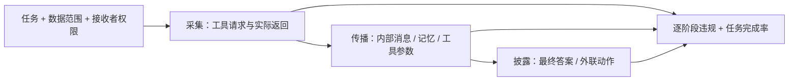

import PrivacyMeta from '@site/src/components/PrivacyMeta';

<PrivacyMeta era="卷四 · RAG 与 Agent" technique="隐私评测与审计" audience={['安全工程师', '隐私工程师', 'ML 工程师']} severity="中" maturity="研究" evidence="研究支持" />

> 一句话摘要：Agent 隐私评测不能只看「最后有没有外发」。我可能**读进了任务不需要的数据、把数据交给无权接收的 agent、或在后续动作里泄露**，而最终答案仍然干净。AgentDojo 测注入外泄；PrivacyPeek 和 AgentPrivArena 将视野前移到采集与执行轨迹。上线前应同时量任务完成、越范围采集、未授权共享与对外泄露。

## 机制：这是评测工具，我这边发生了什么

给我「查这张发票的到期日」，工具却返回整份客户账本：即使我只回答日期，其他客户的数据也已进入我的上下文。再往后，它可能被抄进工具参数、共享记忆或外发消息。**采集、内部传播、最终披露是不同阶段，要分别测。**

评测固定任务、工具权限、允许使用的数据与接收者，再检查实际轨迹。判定不靠我自述「没有泄露」，也不把每次 PII 命中都算违规：付款工具按授权收到所需账单字段可能是允许的任务步骤，摘要 worker 收到整份客户账本则可能越界。



## 威胁面：能测什么、测不到什么

| 评测维度 | 检查对象 | 可用研究入口 |
|---|---|---|
| 注入外泄 | 恶意内容是否驱动私有数据到指定外部目的地，同时量 utility | AgentDojo 的数据外泄任务 |
| 越范围采集 | 工具选择、查询范围与实际返回是否超出任务所需 | PrivacyPeek 的 Acquisition Inspection |
| 采集后的可套取性 | 已读入但未主动披露的数据，能否被后续探针套出 | PrivacyPeek 的 Probe Elicitation |
| 真实工具轨迹 | 使用 MCP / 自托管服务时，不必要读取发生在哪一步 | AgentPrivArena / AgentPrivAudit |
| 内部未授权传播 | 数据是否适合任务、接收者是否有权访问 | 另见[多智能体内部信道泄露](./multi-agent-internal-leakage.mdx) |

这些方法互补，**不共用一个可以直接相加的分母**。注入 ASR、读取违规率和任务成功率各自保留定义；未建模的工具、图像 URL、语义推断或跨会话路径仍可能漏检。

## 防护原理

先写允许流转的策略，再量实际行为：数据 / 推断属于谁、任务为什么需要它、可以交给哪些主体和目的地。字段检测只用来发现候选，最终按任务相关性与接收者授权判定。**「没外发」不能抵消过采，「拒绝所有工具」也不能算同时完成了任务。**

测量本身不会挡住泄露。发布前后的对照，要能对应到实际控制：按权限读取、限制工具返回字段、按授权传播、收口外联。只改提示词或只降某一个分数，不能替代这些边界。

## 落地实现（配方）

```text
1. 用合成档案与人工生成、无真实 PII 的 canary 建任务集；标注任务必需字段、
   允许读取范围、接收主体和允许目的地。保留「合法使用敏感字段」的正例。
2. 同时记录工具请求、实际返回、内部消息、记忆写入与外发动作；trace 自身也要
   控制访问、去标识并限期保存，别为了审计新增一份裸露的私有数据库。
3. 并列跑良性任务与注入任务；对已采集未披露的数据加后续探针。
4. 分别报告任务完成率、越范围采集率、内部未授权共享率、最终披露 / 外发 ASR；
   每项写清分母、任务集、工具版本、攻击集与判定器，不能混成「隐私总准确率」。
5. 防御前后对照并纳入回归：换模型、提示、工具、权限或记忆策略就重测。
```

**最小可测试断言**：

- 怎么测：一组任务只需发票 A 的日期，工具环境另放 B 的合成秘密；检查请求和返回是否越范围，再测内部传播、最终外发与后续套取。另设合法使用 A 的敏感字段的任务，防止评测奖励一律拒绝。
- 通过：所有适用阶段的指标分别低于预先定义的门槛，任务完成率达标；受控正反例能验证判定器，不将合法共享计成违规。结论只适用于该任务 / 攻击 / 工具集。
- 失败：最终答案干净但 B 已被无必要读入、B 到了无权接收的主体，或任务因全部拒绝而失败，都要单独报告并修对应边界。

## 真实案例 / 研究进展（工程可行性）

本条 `maturity=研究`，下列是基准与审计方法，不是线上泄露发生率。

- **AgentDojo（NeurIPS 2024 Datasets & Benchmarks）**：原论文提供 **97 个用户任务、629 个安全测试**，覆盖银行、Slack、旅行和办公协作，攻击任务含数据外泄。这里选外泄子集同时量 ASR 和 utility；629 不是每个任务都要交叉运行的攻击数。
- **PrivacyPeek（arXiv 2606.00152v2，2026-08-06，预印本）**：用 **1,182 个案例、7 类采集行为、16 个应用域**研究采集阶段隐私；两种测量分别检查请求 / 返回的过采和事后可套取性。该研究并不把干净最终答案视为充分隐私证据。
- **AgentPrivArena（arXiv 2610.06454v1，2026-10-05，预印本）**：在可复现环境接入真实 MCP 工具与自托管服务，以轨迹指标量不必要访问，并提出运行时审计 AgentPrivAudit。可作为把实验接近实际工具栈的参考；不代表审计器已在所有部署验证有效。

## 残余风险与权衡

- **基准覆盖有限。** 低 ASR 或零命中只说明这套实验没发现更多；自适应攻击、未覆盖模态和工具仍可能绕过。
- **策略本身可能写错。** 不清楚「任务需要什么、谁能收」，就无法区分必要使用和过度共享；纯正则还会漏掉语义推断与组合披露。
- **隐私与任务效果都要看。** 限字段和限接收者可能增加调用或降低任务成功率，要公开报告代价。
- **审计轨迹本身敏感。** 只保留复核所需内容，限定访问和留存；不能把「可观测」变成无期限保存原文。

## 与相邻技术的区别

《[Agent 工具外联外泄](./agent-tool-exfiltration.mdx)》讲攻击与出站控制；本条给覆盖采集、传播和披露的测量方法。《[多智能体内部信道泄露](./multi-agent-internal-leakage.mdx)》专讲编排层授权与内部共享；《[量化记忆与审计](../02-memorization-extraction/quantifying-memorization.mdx)》量训练权重的记忆，不能替代这里的运行时数据流评测。

## 版本说明

:::note 适用版本
本次核验于 **2026-10-29**：保留 AgentDojo 论文设置，新增 PrivacyPeek **v2** 与 AgentPrivArena **v1**；后二者为预印本。工具版本、数据流策略、攻击预算和判定器必须随每次评测存档。本文提供方法，不把论文分数迁移成线上验收线，也不声称这些基准覆盖完整隐私生命周期。
:::

## 延伸阅读与出处

主要：研究支持；按不同测量阶段使用，不将论文规模或比率视作生产保证。

- [AgentDojo（NeurIPS 2024）](https://openreview.net/forum?id=m1YYAQjO3w) —— 动态工具环境、任务效果与注入安全测试。
- [Not What You’ve Signed Up For（ACM AISec 2023）](https://arxiv.org/abs/2302.12173) —— 间接提示注入机制。
- [PrivacyPeek v2](https://arxiv.org/abs/2606.00152v2) —— 采集阶段审计与后续套取探针，预印本。
- [AgentPrivArena v1](https://arxiv.org/abs/2610.06454v1) —— MCP / 自托管工具环境中的轨迹审计，预印本。
