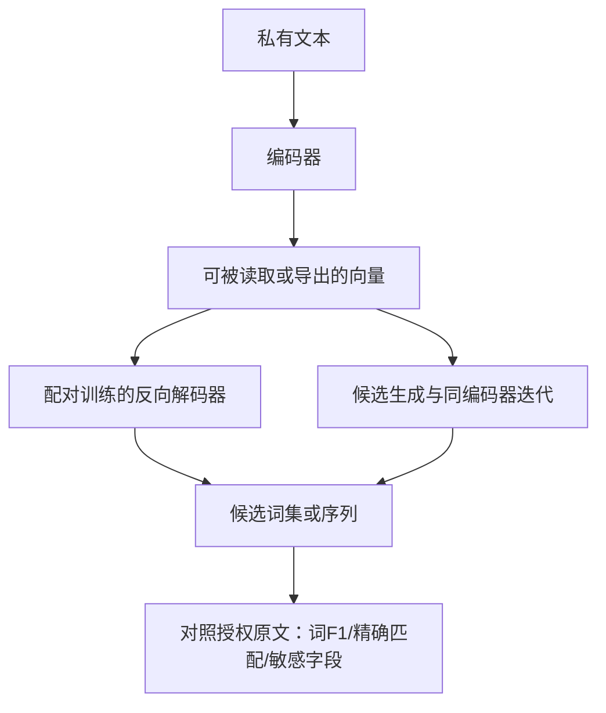

import PrivacyMeta from '@site/src/components/PrivacyMeta';

<PrivacyMeta era="卷四 · RAG 与 Agent" technique="RAG 与 Agent 隐私" audience={['隐私工程师', '安全工程师', 'ML 工程师']} severity="高" maturity="研究" evidence="研究支持" />

> 一句话摘要：文本向量不自动匿名。Song 与 Raghunathan 在所测句嵌入上报告词集恢复 F1 约 0.5–0.7；vec2text 在指定 GTR-base、32-token 输入与迭代攻击设置中达到 92% 逐字恢复。指标、编码器、文本长度与对手能力不同，不能合并成所有向量的统一泄露率。

## 机制：我这边发生了什么

编码器把文本变成向量，可能保留可用于恢复词或序列的信息。攻击者可训练文本—嵌入配对的反向解码器，或生成候选、用同一编码器再嵌入并迭代纠正。红线：向量匹配或优化收敛不证明候选是唯一原文；成功须通过有权持有的原文、敏感字段或明确指标外部验证，不靠我自述“没有存原文”。



## 威胁面

对手须能获得目标向量；配对训练、编码器知识与查询权限影响反演。泄露的索引、备份、日志或 API 返回都可能提供向量。32-token 强结果不能直接外推长文档、另一编码器或低精度向量；词 F1 也不是词召回率或姓名恢复率。

## 防护原理

把可关联敏感原文的嵌入纳入访问、导出、保留与删除控制，不因“只是数字”降级。静态加密/CMK 保护特定存储和密钥边界，不阻止获授权运行服务处理明文向量。噪声、量化和降维可能改变反演与检索效用；没有明确 DP 机制和会计时，只能给经验结论。

## 落地实现（配方）

```text
1. 列出编码器、版本、文本长度/领域、向量精度以及对手能否查询同一编码器。
2. 收紧索引、备份、日志与 API 的读取/导出权限；授权身份和租户由可信服务决定。
3. 最小化嵌入内容并处理 PII；残余漏检与推断仍要审计。
4. 在合成或授权文本上跑解码器和迭代攻击，分别报词 F1、exact-match、敏感字段及区间。
5. 变更噪声/量化/降维时同时报告检索质量；删除请求扇出到嵌入及其副本。
```

**最小可测试断言**：固定攻击预算与上述条件后，恢复指标和任务效用满足预设门槛，读取/导出与删除控制另行通过。一次攻击失败不证明匿名；余弦距离收敛不替代文本匹配。

## 真实案例 / 研究进展

Song 与 Raghunathan（CCS2020）的词集反演 F1 约 0.5–0.7，不含顺序；vec2text（EMNLP2023）报告指定设置的 32-token 逐字恢复 92%。Pinecone 与 Azure 文档提供静态加密、密钥和访问控制配置，不能据此认证所有运行时访问隔离。EDPB 意见 28/2024 讨论 AI 模型匿名性的个案评估，非对所有向量库的直接裁定。

## 残余风险与权衡

向量已外流后，后续撤权不能收回对手已有副本。更长文本或新编码器可能改变结果，不等于自动安全；短文本强结果也不是普遍必可逆定理。原文脱敏、向量变换与加密各有不同边界，不能互相代替。

## 与相邻技术的区别

[RAG 检索泄露](./rag-retrieval-leakage.mdx)是授权失败返回原 chunk；本条是在持有向量后尝试恢复文本。[模型反演](../01-foundations/model-inversion-attribute-inference.mdx)还可能只恢复类别代表；[删除传播](../06-governance-compliance/data-lifecycle-deletion.mdx)须覆盖残留向量。

## 版本说明

:::note 适用版本
2026-10-29 核对 Song 作者稿、vec2text 及厂商文档，纠正词 F1 被当召回和收敛被当唯一原文。未复现反演或检查实际账户配置。2027-01-29 前，或编码器/精度、攻击、导出权限与服务加密边界变化时复核。
:::

## 延伸阅读与出处

- [Information Leakage in Embedding Models（CCS2020 作者稿）](https://arxiv.org/abs/2004.00053)
- [Text Embeddings Reveal (Almost) As Much As Text（EMNLP2023）](https://aclanthology.org/2023.emnlp-main.765/)
- [Pinecone 安全总览](https://docs.pinecone.io/admin/security/security-overview)
- [Azure 客户自管密钥](https://learn.microsoft.com/en-us/azure/search/search-security-manage-encryption-keys)
- [EDPB 意见 28/2024](https://www.edpb.europa.eu/system/files/2024-12/edpb_opinion_202428_ai-models_en.pdf)
