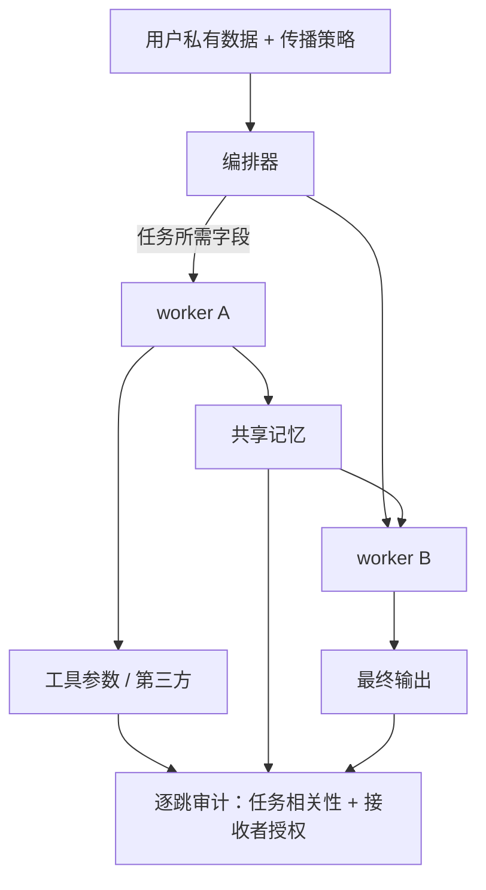

import PrivacyMeta from '@site/src/components/PrivacyMeta';

<PrivacyMeta era="卷四 · RAG 与 Agent" technique="RAG 与 Agent 隐私" audience={['安全工程师', '隐私工程师', 'ML 工程师']} severity="中" maturity="研究" evidence="研究支持" />

> 一句话摘要：私有数据在多个 agent 间流转时，**最终回答干净，不代表内部消息、共享记忆和工具参数没有越界**。AgentLeak 在其编排器–worker 设置里测到内部信道比最终输出更易泄露；其他基准分别研究正常协作和对抗对话。工程上要逐跳检查「任务是否需要、接收者是否有权」，而不是把所有敏感字段传递都判违规。

## 机制：我这边发生了什么

一个编排器把用户任务交给 worker，worker 又写记忆、调工具。每一跳都可能改变数据的可见主体：同一份病历对诊疗 worker 可能必要，对负责排期的 worker 可能只需一个时间，对外部日志平台则未必允许留存。**是否越界取决于任务目的、接收者与传播条件，不由「内部」两个字决定。**

可外部检验的是实际消息、记忆读写和工具载荷，不是我对自己隐私意识的自述。只看最终输出会漏掉内部动作；只搜 PII 字面量又会把必要共享误判、漏掉语义推断。若编排框架默认转发完整上下文，暴露面还可能随工作流扩张。



## 威胁面：内部传播与最终披露

- **非对抗过度共享**：任务正常执行，但不必要数据进入 worker、共享记忆或可观测性平台；有权执行任务不等于有权读取全部用户数据。
- **跨用户边界**：同一组织共享 agent 和 memory，数据仍须按用户权限传播。基础设施键隔离之外，还要防 agent 在正常消息里主动转发给错误用户。
- **对抗对话**：另一个 agent 可以提出貌似合理的恶意索取。ConVerse 研究这种对抗设置，不能将其 ASR 与非对抗协作违规率直接比较。

对手或观察者可能是无权收件者、恶意服务 agent、第三方工具或 trace 读者。检测口径必须说明谁被允许看什么、在哪条信道；内部出现了任务必需且授权的敏感数据，**本身不算泄露**。

## 防护原理

用任务相关性和接收者授权两轴检查每一跳。这与 **情境完整性（contextual integrity，CI）**关注数据是否在适当情境与条件下流转一致。字段检测只标候选，策略才定义违规。

- 编排器只传当前子任务需要的字段；能传受权句柄就不传原文，句柄取回时仍鉴权。
- 消息、共享记忆、工具参数与 trace 都按实际读者授权；日志平台也算接收方。
- 任务效果与违规分别报告，保留授权使用敏感数据的正例；不能靠一律拒绝换隐私高分。
- 若同时存在注入与外联能力，还要执行《[Agent 工具外联外泄](./agent-tool-exfiltration.mdx)》的出站控制。

## 落地实现（配方）

```text
1. 定义每个任务的必要数据、发送者、允许接收者、用途和后续传播条件。
2. 用合成档案 / 无真实 PII 的 canary 建正反例；给每个数据项标两轴：
   ①是否适合此任务 ②哪些用户 / agent 被授权访问。
3. 插桩消息、memory 读写和工具载荷，逐跳核策略。NER / 正则提供候选，
   另检查语义推断、商业秘密与多个字段组合出的敏感结论。
4. 最小共享、授权读取和必要脱敏落在编排 / 存储层；trace 最小化并限期留存。
5. 用同一组轨迹比较最终输出审计与全信道审计，按违规事件去重；同时报告任务完成率。
```

**最小可测试断言**：

- 怎么测：让诊疗 worker 按授权使用 A 的合成病历；排期 worker 只能得时段，B 用户和外部日志不能得病历。核消息、memory、工具参数和最终输出；加允许共享与拒绝共享的受控对照。
- 通过：任务完成率达标，各信道未授权 / 与任务不相称的传播低于预设门槛；合法共享被判定为合法。报告单信道和去重后的系统事件数，别把同一次违规复制成多次独立泄露。
- 失败：病历到了无权主体、超出用途进入共享 memory，或评测把合法诊疗也判违规；分别修授权 / 最小化或判定器。最终输出干净不能抵消内部越界。

## 真实案例 / 研究进展（工程可行性）

下表集中列证据状态，避免在每节重复来源警示。`maturity=研究`：这些测量不能替代生产系统审计，百分比各有自己的任务、模型、拓扑与判定口径。

| 工作与核定版本 | 场景与可支持结论 | 状态 |
|---|---|---|
| AgentLeak，arXiv **2602.11510v3，2026-06-15** | 1,000 场景、5 个受测 LLM、4,979 轨迹的编排器–worker 设置；C2 内部消息泄露 **68.8%**，C1 最终输出 **27.2%**，跨 C1/C2/C5 聚合系统暴露 **68.9%**。单信道率与聚合率不能相加 | 本文引 v3；页面关联 IEEE DOI，不将其等同已复核的最终期刊版 |
| MAGPIE | 200 个高风险、非对抗协作任务，研究完成任务与私有信息共享的张力 | NeurIPS 2025 ResponsibleFM **Workshop**，非主会 |
| ConVerse | 旅行 / 房产 / 保险三域、12 画像、864 次对抗（611 隐私、253 安全）；受测隐私攻击最高成功约 **88%**，展示貌似合理的 agent 对话仍可索走数据 | **Findings of EACL 2026，2026-03 正式发表** |
| PiSAs，arXiv **2607.05318v2，2026-10-19** | 多用户共享 agent 系统；「适合任务吗 / 谁可访问」双 CI 标注，覆盖输出、内部消息与 memory | 预印本 |

这些工作支持扩展审计视野，但不能合并成「所有多 agent 默认比单 agent 更危险」的普遍结论。AgentLeak 自己也报告多 agent 的最终输出泄露低于其单 agent 基线，新增内部路径才改变了系统总暴露。

## 残余风险与权衡

- **内部不是天然可信，但内部共享也不是天然违规。** 必须有明确主体、任务与传播策略，PII 命中数不能代替隐私违规数。
- **检测器可能看不见语义泄露。** 把姓名替成 ID 后，组合属性仍可能识别人；要留人工复核和受控对照。
- **更强模型不等于更安全。** ConVerse 的能力—泄露关联限于其对抗设置，既不能当通则，也不能把换模型当授权防护。
- **审计会新增敏感副本。** trace 本身按最小权限、必要留存处理；最小共享的效用和延迟代价也要量。

## 与相邻技术的区别

《[Agent 隐私评测](./agent-privacy-benchmark.mdx)》给采集、传播、披露的评测总览；本条聚焦多 agent 编排的接收者授权。《[跨会话记忆串味](./cross-session-memory-bleed.mdx)》讲存储 / 缓存隔离 bug；本条还覆盖隔离正确但消息内容过度转发的情况。注入驱动的外发控制见《[Agent 工具外联外泄](./agent-tool-exfiltration.mdx)》，host↔server 字段边界见《[MCP 数据流与最小采集](./mcp-data-flow-privacy.mdx)》。

## 版本说明

:::note 适用版本
核验于 **2026-10-29**。AgentLeak 数字固定为上述 **v3** 的信道 / 聚合口径，不混用早期版本区间；MAGPIE 保持 workshop 标注，ConVerse 改引正式 EACL Findings，PiSAs 引 **v2**。本文未重跑这些基准，也未用同行评审状态替代独立复现；自己的发布门槛仍须绑定拓扑、策略、检测器和任务集。
:::

## 延伸阅读与出处

主要：研究支持；状态与版本见证据表。

- [AgentLeak v3](https://arxiv.org/abs/2602.11510v3) —— 固定版本的内部信道与系统聚合结果。
- [MAGPIE（ResponsibleFM Workshop）](https://openreview.net/forum?id=vZgdho8Vx0) —— 非对抗协作的隐私权衡。
- [ConVerse（Findings of EACL 2026）](https://aclanthology.org/2026.findings-eacl.170/) —— 对抗 agent 对话；不能等同正常协作的违规率。
- [PiSAs v2](https://arxiv.org/abs/2607.05318v2) —— 任务相关性与授权用户双标注，预印本。
