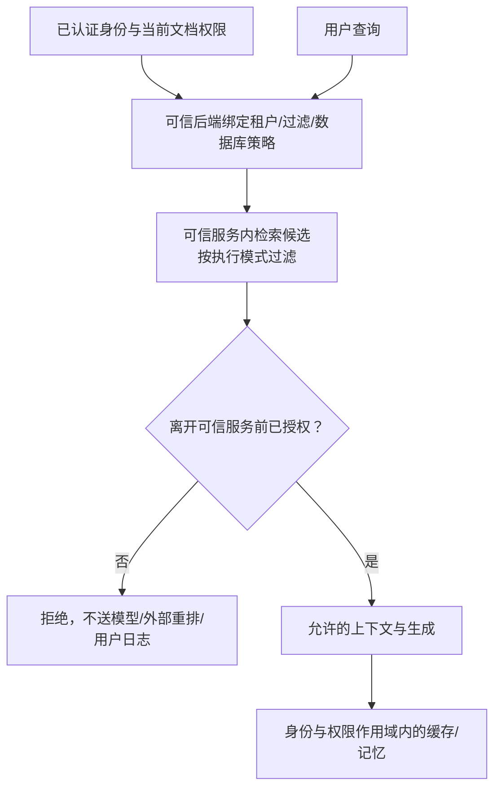

import PrivacyMeta from '@site/src/components/PrivacyMeta';

<PrivacyMeta era="卷四 · RAG 与 Agent" technique="RAG 与 Agent 隐私" audience={['隐私工程师', '安全工程师', 'ML 工程师']} severity="高" maturity="试验" evidence="官方文档" />

> 一句话摘要：多租户 RAG 的隐私边界由认证身份、文档授权、检索/重排/上下文和缓存共同决定。向量不是匿名化，namespace 也不是调用者授权。过滤要在越权内容离开可信边界前生效；**检索服务内部的 post-filter 不自动等于泄露**，更不能把 Azure security trimming 一概称为应用层后过滤。

## 机制：我这边发生了什么

我收到检索内容后才能作答，不能替系统判断每个 chunk 应授权给谁。可信后端应从已认证身份和当前权限构造租户范围，把允许文档送入检索、重排与生成。任何越权内容进入外部模型、重排服务、用户可见响应或日志，都是单独的披露点。

嵌入反演是相邻的表示风险：拿到原始向量后，攻击者在特定编码器/先验下可尝试恢复文本；并非每个向量都必然可逐字反演，详见[嵌入反演](./embedding-inversion.mdx)。



## 威胁面：授权可能在哪一层丢失

- 调用者可伪造 tenant / namespace / group_ids，后端却直接信任。
- 检索正确但重排、生成上下文、trace、缓存、导出或备份使用另一套宽权限。
- 文档权限已撤销，旧缓存或长期 memory 仍返回旧内容。
- 原文受限而原始向量可下载，形成反演面；加密存储不阻止持有查询凭据的服务读取。

## 防护原理

把身份认证、访问授权和数据分区分开：namespace / shard 控制数据在哪，权限控制谁能选这个分区。可信后端强制绑定身份，并在检索结果离开其边界前验证授权。ANN pre-filter / post-filter 是执行与召回选择，不是安全与不安全的二元标签；后过滤若已让越权内容进入模型或外部日志，则已太晚。

## 落地实现（配方）

| 系统 | 已核原语 | 需要额外建立的授权条件 |
|---|---|---|
| Pinecone | namespace 级数据分区，多租户文档也说明共享索引 metadata 方案 | 按身份选择 namespace；不能给调用者任意切换权限 |
| Azure AI Search | OData security filter；另有 native ACL 方案 | 字符串 principal 不是身份认证；过滤由可信后端绑定。向量查询的 pre/post 模式另核 |
| Weaviate | 每租户独立 shard | 租户选择、集合权限与调用凭据仍需限制 |
| Qdrant | payload 租户字段与租户索引、分层多租户 | 分区优化不是自动授权；核 JWT/服务端过滤与读写端点 |
| PostgreSQL / pgvector | RLS 与 FORCE ROW LEVEL SECURITY | superuser/BYPASSRLS仍绕过；owner通常绕过。应用用低权限角色，租户变量可信绑定并在连接池复用时重置 |

```text
1. 从已认证会话取得身份与当前 ACL，拒绝调用者任意指定别人的租户/组。
2. 查询、重排、生成、原始向量导出、trace 与 cache 都使用同一授权范围。
3. 减少需索引的敏感字段，保留文档到向量/缓存的删除与撤权血缘。
4. 每租户注入合成 canary；用不同真实认证身份测读/查/导出/更新/撤权后的越权。
5. 保留合法同租户和授权共享的阳性对照，避免「全拒绝」伪装隔离通过。
```

**最小可测试断言**：A/B 身份下，B 无法从响应、模型/外部重排上下文、返回向量、用户可见 trace 或 cache 取得 A 的未授权 canary，A 的合法读仍成功；撤权与缓存更新后重复。所有断言须同时成立，有限测试通过不证明全部路径安全。

## 真实案例与产品范围

各服务官方文档给出了可部署原语，但本条不认证每个账户已正确配置。Azure security-filter 模式是基于字符串的查询过滤，不自行认证该 principal；原生 ACL 与数据源/API 资格另核。PostgreSQL 当前稳定文档为 18，19 仍为 RC，不以「current」URL 推断部署版。

2023 年 OpenAI 缓存事故是相邻状态隔离故障，**不是向量 RAG 泄露实证**。官方称特定 9 小时活跃 Plus 订户中约 1.2% 的付款信息可能受影响，不等于该群体数据全部实际被他人看到；本例只说明共享状态也必须授权与核归属。

## 残余风险与权衡

严格授权可能改变召回与成本，实际效果须测；不能笼统声称共享大索引必比正确分区召回更好。过滤无法修复已经导出的向量或旧日志副本，权限变更与删除必须传播。[跨会话串味](./cross-session-memory-bleed.mdx)与[生命周期](../06-governance-compliance/data-lifecycle-deletion.mdx)分别展开这些状态问题。

## 版本说明

:::note 适用版本
2026-10-29 核对 Pinecone/Weaviate/Qdrant、Azure security/vector filter、PostgreSQL RLS 与嵌入研究。没有访问具体账户验证实际权限，native ACL 的来源/API 与预览状态也须部署时核。2026-12-29 前，或身份、ACL/租户 API、RLS 角色、重排/日志/缓存和产品资格变化时复核。
:::

## 延伸阅读与出处

- [Pinecone multitenancy](https://docs.pinecone.io/guides/index-data/implement-multitenancy)
- [Azure security-filter pattern](https://learn.microsoft.com/en-us/azure/search/search-security-trimming-for-azure-search)
- [Azure vector-filter modes](https://learn.microsoft.com/en-us/azure/search/vector-search-filters)
- [Weaviate multitenancy](https://docs.weaviate.io/weaviate/manage-collections/multi-tenancy)
- [Qdrant multitenancy](https://qdrant.tech/documentation/manage-data/multitenancy/)
- [PostgreSQL row security](https://www.postgresql.org/docs/current/ddl-rowsecurity.html)
- [Text Embeddings Reveal (Almost) As Much As Text](https://arxiv.org/abs/2310.06816)
- [OpenAI 2023 outage](https://openai.com/index/march-20-chatgpt-outage/)
