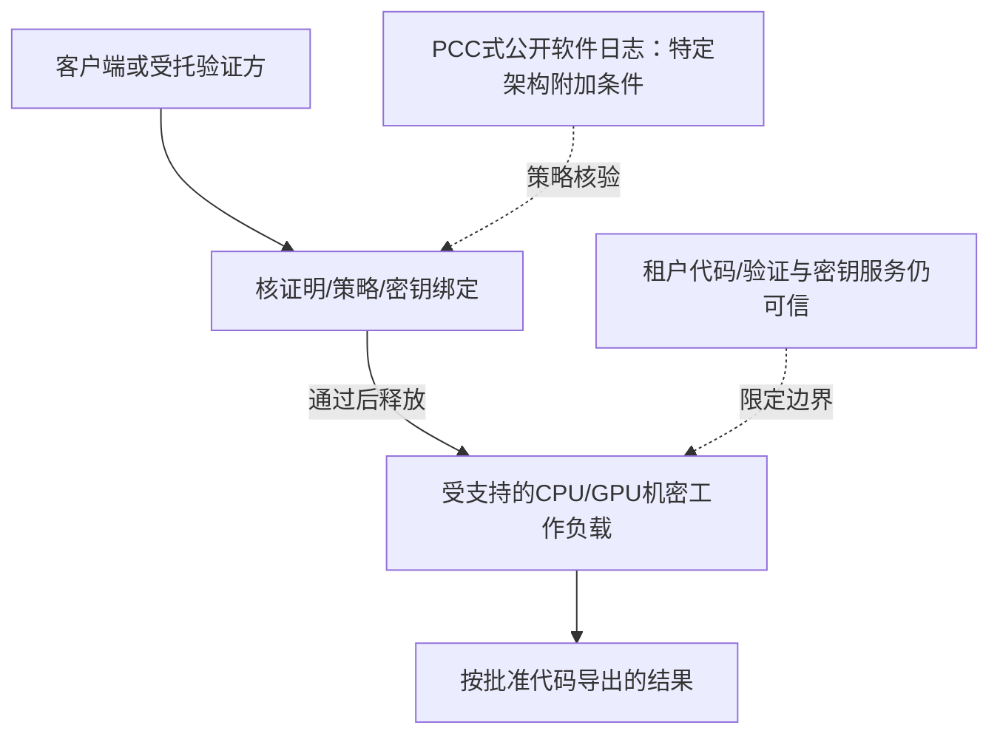

import PrivacyMeta from '@site/src/components/PrivacyMeta';

<PrivacyMeta era="卷五 · 前沿与落地" technique="隐私保护计算" audience={['隐私工程师', '安全工程师', 'ML 工程师']} severity="中" maturity="生产" evidence="官方文档" />

> 一句话摘要：机密推理用受支持的硬件隔离、远程证明和密钥释放策略减少宿主运营商读取输入/权重的能力。**CVM 里的租户软件仍可处理明文**，不能从“用了机密 VM”推出应用服务方看不到请求。Apple PCC 将软件透明性和设备端验证组合；其他部署不自动具有同一透明日志架构。

## 机制：我这边发生了什么

我在批准的 CPU/GPU 执行环境处理输入。验证方检查硬件证书、固件/软件 measurement、新鲜性、撤销与安全模式，并将密钥绑定获准接收端后才释放。证明软件身份不证明代码无后门；租户、镜像签发者、验证与密钥服务的可信角色都需列明。



## 威胁面

平台只保护其威胁模型覆盖的内存和链路；日志、外部工具、允许输出与不受保护的互联仍可泄露。NVIDIA 当前 Dev 模型区分 Blackwell 多 GPU CC 加密 NVLink 与 Hopper Protected PCIe 的未加密 GPU 间 NVLink；不能只见 CPU-GPU 加密就认证整集群。

## 防护原理

先分宿主运营商、租户应用、芯片厂商与最终用户等角色；要对应用服务方保密，还须批准其实际工作负载与数据导出策略。PCC 公开软件与设备校验可减少悄悄换镜像的空间，但可审不等于已审、证明不等于没有漏洞。

## 落地实现（配方）

```text
1. 固定硬件代际、安全模式、CPU/GPU 固件、驱动、运行时与模型负载。
2. 明示各方可信关系，检查完整 CPU-GPU/GPU-GPU 与客户端链路。
3. 将证明新鲜性/撤销/measurement 策略/密钥绑定设为敏感数据发送前置。
4. 盘点日志、trace、工具、存储和输出；只有受保护路径可主张机密性。
5. 篡改镜像、过期证明、撤销证书及错误密钥做负测；正常获准路径作阳性对照。
```

**最小可测试断言**：不匹配策略时拒绝释放敏感密钥，且无未保护旁路；测完整负载的效用/延迟。有限负测不证明没有硬件侧信道，未验明也不等于硬件从未提供任何隔离。

## 真实案例 / 部署现状

- **Apple PCC**：2024 设计把设备检查、获准软件发布与公开透明性联系，适用该架构。
- **NVIDIA 2026-09-22**：生产推理文章说明 TensorRT-LLM 需适配数据移动、调优与多 GPU；不是“只加一验签步骤”。
- **Google 2026-10-21**：Confidential G4（RTX PRO6000 Blackwell Server）已 GA；同文 Confidential Space 支持为未来数周推出，不能混写同日全部 GA。
- **HE/MPC路线**：不同信任模型与计算开销，具体 LLM 规模是否可行须按方案/负载基准，不宣布所有全程私有推理都不可能。

## 残余风险与权衡

可用性、侧信道、租户代码缺陷、输出推断和供应链更新仍需治理。适用法律义务可能影响保留/处理安排，但不能从法律命令直接推出硬件已有可读明文副本；技术可见性与法律责任分开评估。

## 与相邻技术的区别

[TEE](../01-foundations/trusted-execution-environment.mdx)是机制，[本地推理](./on-device-inference-privacy.mdx)减少云端输入，[服务数据边界](../06-governance-compliance/inference-service-data-boundary.mdx)管理端点/合同/留存；本条是完整机密推理的集成与验证。

## 版本说明

:::note 适用版本
2026-10-29 核对 PCC、NVIDIA Dev 威胁模型/生产集成与 G4 GA 公告；Dev 文档不是每个发行版保证，未核各地区实际供应。2026-12-29 前，或硬件/驱动、证明/密钥策略、产品资格和安全公告变化时复核。
:::

## 延伸阅读与出处

- [Apple PCC 设计](https://security.apple.com/blog/private-cloud-compute/)
- [NVIDIA Dev 威胁模型](https://docs.nvidia.com/confidential-computing/virtual-machines/threat-model)
- [NVIDIA 生产机密推理集成](https://developer.nvidia.com/blog/enabling-private-high-performance-production-ai-inference-with-nvidia-confidential-computing/)
- [Google Confidential G4 GA](https://cloud.google.com/blog/topics/ai-infrastructure/confidential-g4-gpus-are-ga/)
