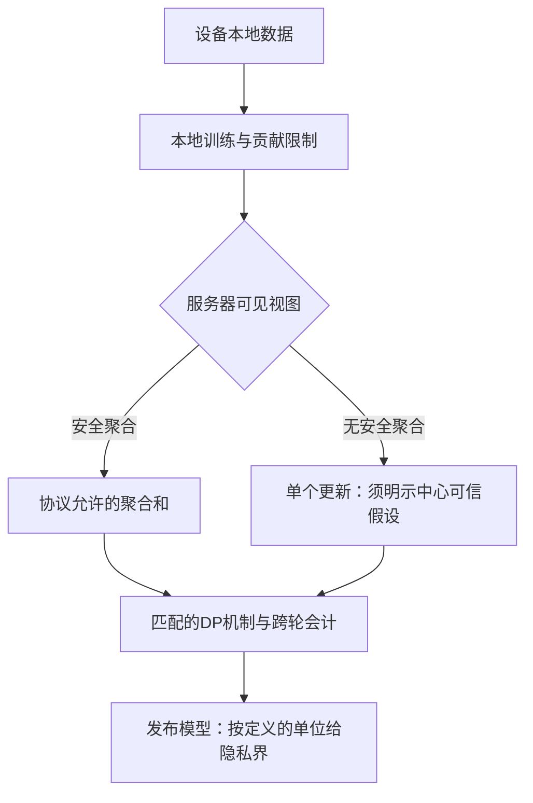

import PrivacyMeta from '@site/src/components/PrivacyMeta';

<PrivacyMeta era="卷五 · 前沿与落地" technique="联邦学习与安全聚合" audience={['隐私工程师', 'ML 工程师']} severity="中" maturity="生产" evidence="研究支持" />

> 一句话摘要：FL 减少集中原始记录，却不自动使上传更新或最终模型私有。DP 限制指定隐私单位对发布结果的贡献，安全聚合限制服务器对单个更新的可见性；是否组合取决于威胁模型。Gboard 2023 论文部署 20 多个 DP 模型，**其中 2 个另启安全聚合**，不是所有生产配置都使用同一组合。

## 机制：我这边发生了什么

我的参数由设备侧本地训练与服务器聚合共同更新。Gboard 采用 DP-FTRL 机制，在贡献限制与噪声假设下给出隐私分析，不要求均匀抽样客户端；这不等于没有参与约束、随机性或会计。噪声可由可信中心或协议分布式实现，不能假定每个 FL 部署都在设备端独立加足噪声。

红线：客户端是工程单位，用户是保护目标；一个人多设备、多人共设备或一人多轮参与，都须纳入定义与会计。我无法通过自述认证这些映射。



## 威胁面

不加安全聚合的中心 DP 可保护发布模型对外的贡献界，却不隐藏加噪前的个体更新对可信服务器的可见性。安全聚合又不限制聚合输出本身的个体信息。参与次数、可用性相关选择、小群体与恶意服务器都须按协议单独分析。

## 防护原理

先声明防服务器还是只防发布物接收者，再选中心 DP、分布式 DP/安全聚合或本地 DP。Apple 2017 遥测是**事件级本地 DP**并限制上传次数，不是整个用户终身全部行为的同一ε保证。去标识可辅助最小化，但不替代保护单位和组合。

## 落地实现（配方）

```text
1. 定义记录/设备/用户邻接关系、跨设备映射、贡献裁剪与参与上限。
2. 记录服务器和客户端可见视图、合谋与掉线假设，选匹配的 DP/聚合机制。
3. 按实际采样、噪声和跨轮参与复算会计；私有调参、评估及额外发布一并组合。
4. 以受控 canary 测梯度反演和成员推断，同时报告任务效用；经验攻击不替代形式分析。
```

**最小可测试断言**：独立会计在同配置数值容差内一致，协议/参与限制真实执行；明示中心可见哪些数据。有限反演失败或「FL」标签不构成用户级保证。

## 真实案例 / 生产部署

Gboard 2023 v2 报告 20 多个语言模型使用 DP-FTRL，并报告ρ-zCDP；换成 (ε,δ) 须声明δ及组合。仅 2 模型额外训练时启用安全聚合。Apple 2017 报告事件级本地 DP 生产遥测。这些是具名历史部署，不能外推 2026 所有功能或未来默认值。

## 残余风险与权衡

保护受预算、单位与可信边界限制。客户端本地安全、发布模型的群体统计与恶意更新完整性不是同一个 DP 声明。噪声和贡献限制影响效用，须在自身任务测量，不能照搬厂商参数。

## 与相邻技术的区别

[DP 微调](../03-conversational-llms/dp-fine-tuning.mdx)讨论训练机制，[安全聚合](./secure-aggregation.mdx)讨论服务器视图，本条讨论联邦参与与真实部署条件。

## 版本说明

:::note 适用版本
2026-10-29 重读 Gboard v2 与 Apple 一手部署，修正全模型 SecAgg 和客户端等于用户的泛化；未核全部当前产品设置。2027-01-29 前，或参与/单位、会计、生产模型与聚合配置变化时复核。
:::

## 延伸阅读与出处

- [Gboard DP-FL (ACL2023 Industry)](https://arxiv.org/abs/2305.18465)
- [Apple Learning with Privacy at Scale (2017)](https://machinelearning.apple.com/research/learning-with-privacy-at-scale)
