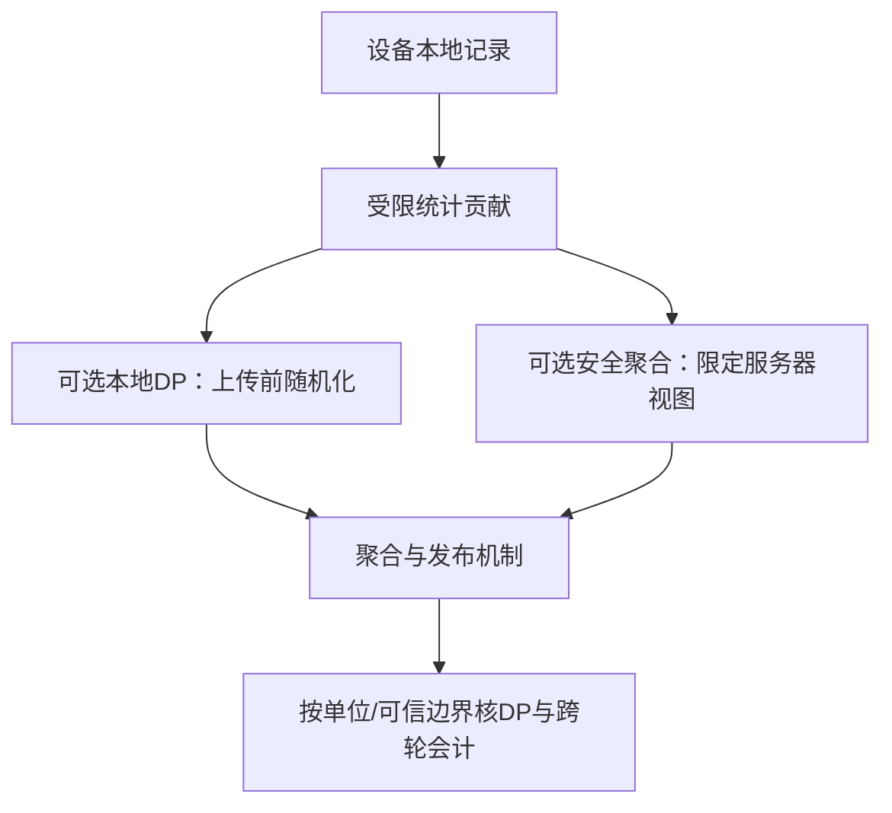

import PrivacyMeta from '@site/src/components/PrivacyMeta';

<PrivacyMeta era="卷五 · 前沿与落地" technique="联邦学习与安全聚合" audience={['隐私工程师', 'ML 工程师', '合规工程师']} severity="中" maturity="生产" evidence="研究支持" />

> 一句话摘要：联邦分析在设备本地算统计贡献，减少集中原始数据。安全聚合限制服务器看单点，DP 限制指定单位对发布统计的影响；中心 DP、本地 DP 与分布式 DP 有不同可信边界，不是所有私有统计都必须使用同一组合。

## 机制：我这边发生了什么

设备对本地记录算计数、直方图或候选频繁项，系统合并后发布统计。这不必训练模型；若统计后又训练我，训练泄露须另分析。红线：“原始数据留在设备”描述数据流，不认证上传贡献或发布结果的隐私。



## 威胁面

服务器可能看单台设备贡献，发布方可能看小群体或跨轮差分。安全聚合允许的和可结合辅助知识披露个体；DP 又不隐藏可信中心加噪前已见的信息。本地 DP 可直接保护上传报告，但事件级保证不自动升级为终身用户级。

## 防护原理

先定义要防哪一方，再选择机制。若保护目标同时包括隐藏单点贡献和限制个体对发布统计的影响，可组合安全聚合与匹配 DP。Zhu 等的采样/阈值保证依赖其特定 heavy-hitters 算法与假设；任意 top-K、去标识或低频项阈值不自动满足 DP。

## 落地实现（配方）

```text
1. 定义统计目的、隐私单位、邻接关系、贡献上限和跨设备/跨轮参与。
2. 记录设备、服务器与发布接收者所见；选择中心、本地或分布式 DP 及聚合协议。
3. 核验协议的腐化、合谋、掉线和允许输出；不把有限运行测试当密码学证明。
4. 独立复算 epsilon/delta 及所有查询/发布组合；阈值和采样参数匹配具体算法。
5. 用授权或合成群体测小群体/差分攻击，同时报告统计误差和稀有群体效用。
```

**最小可测试断言**：实际参与与发布符合协议/DP 分析，独立会计一致；攻击指标与效用满足预设门槛。未发现反演不证明单点不可恢复，单有聚合不构成 DP。

## 真实案例 / 生产部署

Google2020 说明 Pixel Now Playing 用安全聚合统计歌曲流行度；这支持当时具名部署，不认证所有统计均 DP。Apple2017 报告事件级本地 DP 遥测。AISTATS2020 的联邦 heavy-hitters 论文提供特定 DP 算法；生产案例和算法保证须分别引用，不能互相填补未说明配置。

## 残余风险与权衡

查询选择、私有调参和跨轮发布也可能花预算；小群体与辅助知识须纳入威胁模型。噪声、贡献限制与阈值会影响误差和覆盖，不能只报平均效用。设备本地安全及恶意客户端完整性不是同一个 DP 保证。

## 与相邻技术的区别

[安全聚合](./secure-aggregation.mdx)是限制输入视图的原语；[DP-FL](./dp-federated-learning.mdx)发布模型；本条发布统计。[梯度泄露](./gradient-leakage.mdx)解释可见更新的风险，不能直接代替任意统计查询的隐私分析。

## 版本说明

:::note 适用版本
2026-10-29 复核 Google2020、Apple2017 及 AISTATS2020 一手资料，保留具名历史生产证据，移除所有私有统计必须同一组合的全称。未检查当前产品全部查询配置。2027-04-29 前，或查询目的、参与规模、贡献上限、DP 算法与多轮发布变化时复核。
:::

## 延伸阅读与出处

- [Google Federated Analytics (2020)](https://research.google/blog/federated-analytics-collaborative-data-science-without-data-collection/)
- [Federated Heavy Hitters Discovery with Differential Privacy (AISTATS2020)](https://proceedings.mlr.press/v108/zhu20a.html)
- [Apple Learning with Privacy at Scale (2017)](https://machinelearning.apple.com/research/learning-with-privacy-at-scale)
