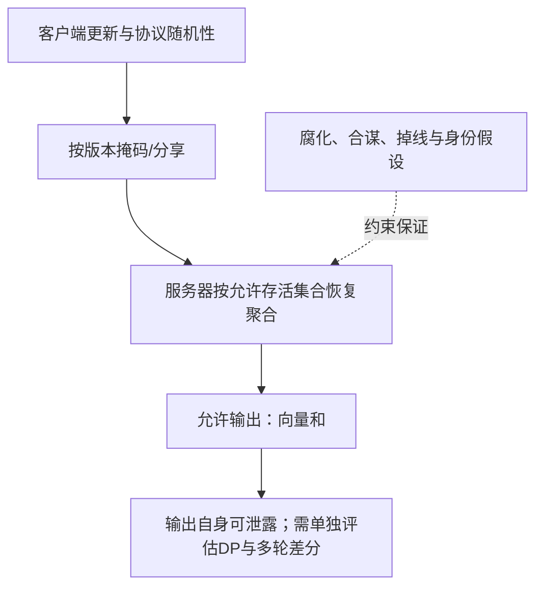

import PrivacyMeta from '@site/src/components/PrivacyMeta';

<PrivacyMeta era="卷五 · 前沿与落地" technique="联邦学习与安全聚合" audience={['隐私工程师', 'ML 工程师', '安全工程师']} severity="中" maturity="生产" evidence="研究支持" />

> 一句话摘要：安全聚合让服务器在具体腐化/合谋/掉线模型内得到允许的向量和，而不额外看到诚实客户端的单个更新。**允许的和本身仍可能泄露**，不能把「学不到任何单点」当无条件结论。Bonawitz 等 CCS2017 完整协议与 MLSys2019 系统提供机制与生产依据；2016 workshop 稿不是同一书目。

## 机制：我这边发生了什么

设备计算本地更新，使用成对掩码、自掩码与秘密分享等协议组件上传；在允许的存活集合与恢复流程下，服务器移除/抵消相应掩码得到和。成对抵消只是直觉，不足以实现掉线与主动安全。红线：这里的保证来自协议模拟安全与参数假设，不是我自述「我没看」。



## 威胁面

CCS2017 分别分析半诚实与指定主动对手模型，不能把所有恶意服务器行为统称协议外。具体身份伪造、目标隔离、合谋和多轮选择是否覆盖，要按协议变体与阈值核。若攻击者已知道除目标外全部贡献，和即可决定目标；这属于允许输出与辅助知识风险。

## 防护原理

明确隐私门限、掉线容忍、最小存活人数与服务器/客户端串通模型，不能用一个「t」替代全部条件。安全聚合限制协议视图超出允许输出的额外信息；DP 可限制聚合发布对指定个体的贡献，二者目标不同。

## 落地实现（配方）

```text
1. 选经审计的协议实现，固定版本、对手模型与参数，不自行拼成对掩码方案。
2. 核身份、密钥协商、秘密分享、掉线恢复与拒绝/中止逻辑。
3. 对小群体、已知其他贡献及多轮差分评估允许输出泄露，按目标决定 DP。
4. 以受控更新覆盖门限边缘、取消、串通与恢复；另做协议证明/实现审查。
```

**最小可测试断言**：功能恢复与中止符合声明阈值、实现不显式暴露目标单个更新，允许输出与辅助知识纳入分析。测试通过不是密码学证明，攻击未恢复单点不证明所有视图无泄露。

## 真实案例 / 生产部署

Google 作者的 CCS2017 页面给出完整协议与威胁模型；MLSys2019 描述规模化生产 FL 系统把安全聚合用于减少单设备更新在数据中心的暴露。该系统证据不能证明所有 Gboard 模型都启用安全聚合，具体组合见[DP-FL](./dp-federated-learning.mdx)。

## 残余风险与权衡

错误实现、身份管理、超阈值合谋、允许输出与多轮策略均可能破坏目标。通信、存活人数与可用性有成本；本条不提供脱离向量维度/人数的通用开销数字。

## 与相邻技术的区别

[梯度泄露](./gradient-leakage.mdx)是更新可见时的攻击；本条限制协议视图。[HE/MPC](../01-foundations/he-mpc.mdx)讲更一般的安全计算，而安全求和是一个具体功能。

## 版本说明

:::note 适用版本
2026-10-29 核对 CCS2017 与 MLSys2019，纠正 2016 workshop 混标与主动模型范围；未重新证明协议。2027-04-29 前，或协议版本、身份/合谋/掉线假设与多轮输出策略变化时复核。
:::

## 延伸阅读与出处

- [Practical Secure Aggregation（CCS2017 完整出处）](https://research.google/pubs/practical-secure-aggregation-for-privacy-preserving-machine-learning/)
- [Towards Federated Learning at Scale（MLSys2019）](https://arxiv.org/abs/1902.01046)
