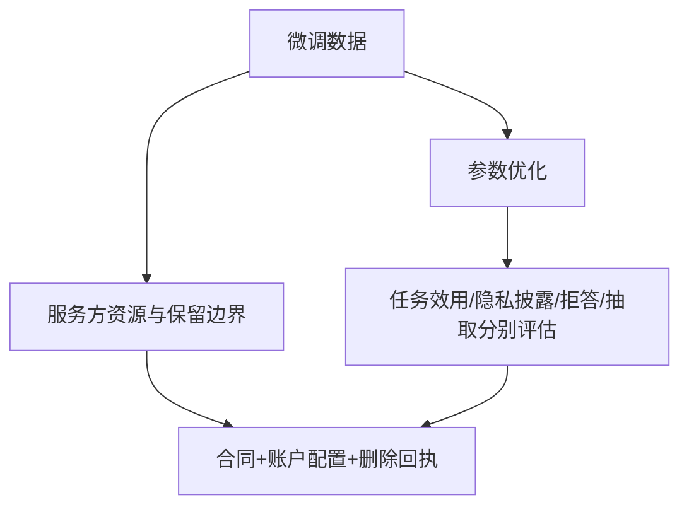

import PrivacyMeta from '@site/src/components/PrivacyMeta';

<PrivacyMeta era="卷六 · 治理与合规" technique="推理服务期隐私" audience={['隐私工程师', '合规工程师', 'ML 工程师']} severity="中" maturity="研究" evidence="官方文档" />

> 一句话摘要：FTaaS 有两组需要独立核实的风险：数据/派生模型在服务方的访问、保留和删除，以及微调后的行为退步。Qi 等 2023 实验显示安全护栏可能受少量恶意或良性微调削弱；**这不是已证明每项隐私拒答都下降，更不是训练数据抽取证据**。隐私任务须单独回归。

## 机制：我这边发生了什么

微调上传数据、训练文件、作业、checkpoint 和模型是不同资源，须按端点和合同分别追踪。我的参数经优化改变，可能同时影响有用任务、安全拒答与记忆；并无可由我自述证明完整保留的独立“隐私对齐层”。比较同一授权/越权任务在微调前后的行为，才是可观察证据。



## 威胁面

供应商“不用于训练基础模型”不表示不处理你的微调训练、不存文件或 checkpoint。API 推理的 ZDR 资格也不自动覆盖训练资产。行为侧，恶意样本与正常业务微调都可能改变安全性；隐私泄露取决于具体数据、接收授权与攻击能力，不能用安全拒答率直接替代。

## 防护原理

最小化上传数据，固定账户/端点/模型与区域，按资源类型核保留、人工访问、归属、共享、删除和合法保留。微调后独立测合法任务完成率、越权披露、正确拒答与原文抽取；减少正常授权披露不应被一概当作改善。DP 可保护指定训练单位的贡献，但不自动保护拒答政策。

## 落地实现（配方）

```text
1. 分别登记训练文件、作业、checkpoint、模型、评估和日志的保留/删除/访问。
2. 数据脱敏与来源授权先做；合成或子采样不自动提供匿名。
3. 固定基座、微调配置、canary 与授权/越权对照集，测试前后效用和披露。
4. 提供方审核是额外闸门，不替代自己的隐私回归与数据边界核查。
5. 删除时验证全部资源与派生对象；未核项不标已删除或受 ZDR 覆盖。
```

**最小可测试断言**：同任务、预算与判据下，越权披露和正确拒答变化满足门槛且合法效用达标，附区间；资源清单与合同/实际配置一致。一个模型没检出泄露不证明其他 checkpoint 或服务无风险。

## 真实案例 / 已核产品边界

- **Qi 等（ICLR2024）**：10 条对抗样本、小于 0.20 美元是当时 GPT-3.5 Turbo API 实验；也观察到良性数据安全退步。这是历史安全研究，隐私拒答退步属于需测试的推论。
- **OpenAI SFT 当前文档**：描述训练输入与产出模型的安全审核/阈值；这些政策审核不等于逐用户隐私证明。留存另按当前 data-controls 与资源配置核。
- **Claude API 留存页**：不是通用 FTaaS 合同；按功能、模型与组织授权规定，不能用推理 API 页面虚构某微调产品已可用。旧 7 天泛化删除。
- **Google 当前数据治理/ZDR 页**：训练限制与保留有具体服务范围，不能直接当全部调优资源“零保留”。

## 残余风险与权衡

不能把缺少某顶会论文当作风险不存在或不得建模的理由，也不能把一般安全研究冒充已证实的厂商数据泄露。待验证假设可进入威胁模型并用受控测试核实，证据等级须明确。提供方条款、审核及模型支持会变。

## 与相邻技术的区别

[推理服务数据边界](./inference-service-data-boundary.mdx)关注运行期，本条增加训练资产；[LoRA 泄露](../05-frontier-deployment/lora-adapter-leakage.mdx)关注公开工件，[DP 微调](../03-conversational-llms/dp-fine-tuning.mdx)关注贡献保证。

## 版本说明

:::note 适用版本
2026-10-29 核对 Qi 作者稿与 OpenAI/Claude/Google 当前官方页；OpenReview 受验证页限制，使用作者原稿交叉核实机制。未访问特定账户、复跑实验或确认所有微调产品合同。2026-12-29 前，或模型可用性、审核/保留条款和隐私攻击变化时复核。
:::

## 延伸阅读与出处

- [Qi 等微调安全研究作者稿](https://arxiv.org/abs/2310.03693)
- [OpenAI SFT 指南](https://developers.openai.com/api/docs/guides/supervised-fine-tuning)
- [OpenAI 数据控制](https://developers.openai.com/api/docs/guides/your-data)
- [Claude API 留存](https://platform.claude.com/docs/en/manage-claude/api-and-data-retention)
- [Google 当前 ZDR 与训练限制](https://docs.cloud.google.com/gemini-enterprise-agent-platform/resources/zero-data-retention)
