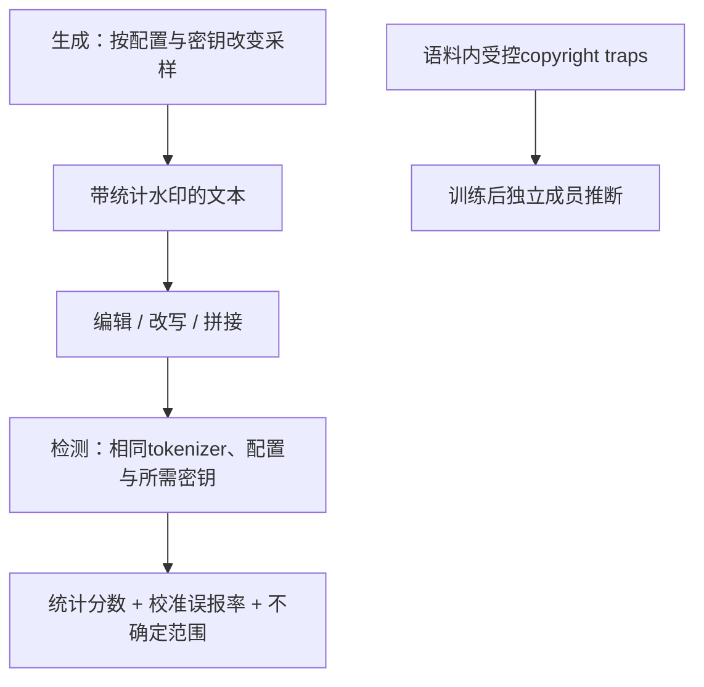

import PrivacyMeta from '@site/src/components/PrivacyMeta';

<PrivacyMeta era="卷六 · 治理与合规" technique="治理与合规" audience={['隐私工程师', '合规工程师', '安全工程师']} severity="中" maturity="研究" evidence="研究支持" />

> 一句话摘要：输出水印用采样统计信号支持生成内容识别；copyright traps 则向训练语料埋受控记号、事后检测训练使用。两者都是条件性的取证证据。**改写可能稀释信号，但不是一次改写必能抹除**；ICLR 2024 可靠性论文恰好发现，足够长的文本在强改写后仍可能被检出。它们不提供个人数据保密，也不自动证明侵权。

## 机制：我这边发生了什么

以 Kirchenbauer 等（ICML 2023）为例：我在生成每个 token 前，根据前文与配置将词表伪随机分组，给「绿表」logits 加偏置；检测方用相同 tokenizer、分组算法与所需密钥 / 配置复算绿表命中比例。绿表占比是参数 γ，不能固定称作一半。检测无需生成模型权重，并不意味着所有方案都无需检测密钥或向任何公众开放。

红线：可核查的是外部统计量；我不能凭自述认证文本来源。p 值描述指定零假设下出现如此极端统计量的概率，**不是这段文本由 AI 生成的后验概率**。



## 威胁面：两类标记分别受到什么影响

- **输出水印**：短文本、低熵输出、跨语言改写、翻译、拼接与攻击者获知检测配置均会改变可检测性。鲁棒性取决于具体方案、文本长度与攻击预算，不能从某次成功 / 失败外推所有水印。
- **训练数据陷阱**：检测的是模型对受控记号的学习信号，要求相应候选文本与模型访问；训练前去重 / 改写、记号长度和重复数影响它。**训练后改写一段输出**不等于删除已学到的陷阱信号，不能与输出水印混为一条去除攻击。

## 防护原理

水印以可检出的分布偏置补充来源记录；它既可能误报，也可能漏报。固定检测密钥与配置，按真实人类文本校准零分布，处理重复 n-gram、滑动窗口、多文本筛查的多重检验。低 p 值不是个人、账户或原始训练文档的身份证明；没有检出也不证明未使用 AI。

## 落地实现（配方）

```text
1. 固定方案、生成模型/tokenizer、密钥版本、γ/偏置/上下文窗口与检测器。
2. 建未经水印的人类文本、原始带水印、编辑、翻译/改写、拼接等独立测试集。
3. 在预设误报率下报告检出率、样本数、区间和最短长度；扫描多窗口需校正。
4. 数据陷阱另建受控虚构记号与未注入对照，不使用真实个人信息；记录训练前处理。
5. 留存原始来源与操作审计，不把水印分数单独当法律或身份结论。
```

**最小可测试断言**：同一检测器在独立人类对照上达到目标误报率，并分别报告各编辑预算、文本长度的检出率及区间。未达到既定检测力时标为不确定；有限测试不证明「不可去除」或「必可去除」。

## 真实案例 / 研究与产品现状

- **Kirchenbauer 等（ICML 2023；ICLR 2024）**：后续可靠性研究报告人类 / 模型改写后仍可检测，足够长文本能积累信号。这与原条目「一次改写抹除」的概括不同；具体长度、误报率与文本条件须回原实验核，本文不设通用阈值。
- **Copyright Traps（ICML 2024）**：在受控 1.3B 从零训练设置，长且大量重复的陷阱比短 / 少重复更可检；它提供训练使用的统计证据，不自动证明授权或侵权。
- **Google SynthID**：官方产品页说明已用于 Gemini app / web 的文本水印，另有 SynthID Detector；产品适用面不等于任何第三方都能检测所有模型。
- **Anthropic（2026-08-14）**：宣布未来 Claude 模型采用 SynthID-Text 变体；官方称标记不包含可追溯到特定个人、组织或聊天的标识。这里记录公告范围，未据此认证每个旧模型、端点或检测器均有相同能力。

## 残余风险与权衡

检测力与长度、熵、密钥管理和攻击成本相关。厂商的来源标记不等于匿名性保证；水印不会清除 PII、限制训练成员贡献或防止原文抽取。需与访问控制、来源日志与隐私评测配合。

## 与相邻技术的区别

[模型窃取](../01-foundations/model-extraction-stealing.mdx)中的模型指纹、输出文本水印、训练语料陷阱分别面向模型、生成内容、训练使用；不可互换指标。[成员推断](../01-foundations/membership-inference.mdx)是陷阱取证的方法之一，而非水印的同义词。

## 版本说明

:::note 适用版本
2026-10-29 核对三篇研究的一手出处及 Google / Anthropic 官方产品资料。机制保留，修正可靠性论文的反向概括；研究证据与厂商公告分别记录。2027-01-29 前，或采样算法、检测密钥 / 阈值、改写攻击与产品部署变化时复核。
:::

## 延伸阅读与出处

- [A Watermark for Large Language Models（ICML 2023）](https://proceedings.mlr.press/v202/kirchenbauer23a.html)
- [On the Reliability of Watermarks（ICLR 2024；作者稿 v4）](https://arxiv.org/abs/2306.04634)
- [Copyright Traps for Large Language Models（ICML 2024）](https://proceedings.mlr.press/v235/meeus24a.html)
- [Google SynthID](https://deepmind.google/models/synthid/)
- [How Claude’s text watermark works（2026-08-14）](https://www.anthropic.com/news/claude-text-watermark)
