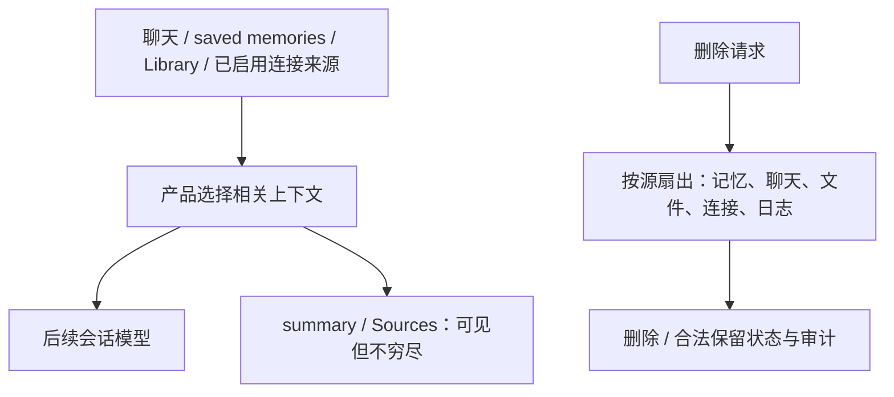

import PrivacyMeta from '@site/src/components/PrivacyMeta';

<PrivacyMeta era="卷六 · 治理与合规" technique="数据生命周期与数据治理" audience={['隐私工程师', '合规工程师', '安全工程师']} severity="中" maturity="生产" evidence="官方文档" />

> 一句话摘要：产品记忆把信息按设计带到后续会话，但可读取来源、可见摘要、关闭与删除并非一回事。当前 ChatGPT 文档包含聊天、saved memories、自定义指令、Library 和连接应用等来源，功能因账户 / 地区 / workspace 而异。把记忆作为数据生命周期的一处状态治理，不能把「不再提及」「关闭」「摘要不见了」当成所有来源都已删除。

## 机制：我这边发生了什么

我可依据产品提供的相关记忆 / 来源作答；我不能通过自述认证后端存储完整性。ChatGPT 的 saved memories 与聊天历史分开存储；改进记忆还维护较宽的摘要。官方明确：摘要和 Sources 都可能遗漏可用细节，且不会每次回答都搜索全部历史。没有单独的历史引用存储上限，也不等于每条历史都被调用。

Claude API memory tool 是另一种形态：我请求文件操作，应用处理器访问自己控制的 `/memories` 存储并把结果返给模型。client-side 表示存储与处理器由应用掌控，**不意味着读出的内容不进入模型 API 请求**。应同时核本地保留和 API 留存 / 资格。



## 威胁面：留存、读取与删除分别检查

- **读取来源变宽**：文件、邮件或连接应用可能参与个性化。断开连接阻止未来访问，不删除已在旧聊天出现的内容。
- **关闭不等于删源**：关闭 Memory 不删除旧聊天，再开启可能从保留聊天形成新记忆；「Don't mention this again」调整引用行为而不删除原来源。
- **可见性有限**：summary / Sources 是检查入口，不能当全量存储清单；后台日志或第三方存储仍需合同与运维证据。
- **安全用途有独立边界**：官方指出极少数高风险情况可使用有限安全相关上下文；个性化关闭不等于所有安全处理禁用。

## 防护原理

把产品 / API 记忆登记为独立状态：来源、读取范围、写入条件、访问身份、保留、删除传播和证据。对每个来源分别删除 / 断开，并复核关联聊天、文件与日志；不要用模型口头回答代替后端审计。客户端 memory handler 要做每用户隔离、路径规范化、授权与删除，不能只检查路径字符串前缀。

## 落地实现（配方）

```text
1. 固定账户/plan、地区、workspace 与产品版本，列出已启用来源和读/写权限。
2. 用合成 canary 测试跨会话引用，核 summary/Sources 及实际来源，避免存入第三方真实 PII。
3. 删除时覆盖记忆条目、原聊天、Library 文件与其他源；连接来源同时检查旧聊天副本。
4. 关闭引用和删除存储分别记录；声明传播窗口、合法保留与审计不可见部分。
5. API memory 按身份隔离存储；核 API 数据控制，不能把 client-side 或 ZDR 当本地文件自动删除。
```

**临时聊天须区分读与写**：当前 ChatGPT 专页允许开始前选择 Personalized / Unpersonalized；后者不用现有记忆、自定义指令与插件，两者都不创建 / 更新记忆。保存后转为普通聊天，按账户模型改进与 Memory 设置处理。临时聊天仍可能为安全目的保留至多 30 天，第三方 Actions 接收数据后适用其自身政策；不能称作端到端零保留。

**最小可测试断言**：用受控 canary，覆盖新会话、关闭、按源删除、重新开启及传播等待后的引用；既验证授权访问仍正常，又验证不应引用的路径不再复现。探针未复现是有限证据，删除清单与提供方回执必须另核；不能要求所有后台副本都在摘要中可见。

## 真实案例 / 产品边界

| 形态 | 已核边界 | 仍需逐部署核实 |
|---|---|---|
| ChatGPT 产品记忆 | 相关聊天 / 记忆 / 文件 / 连接来源，summary 与 Sources 不穷尽，读写与删除控制分开 | 账户、地区、workspace 可用性、源删除与后台日志 |
| Claude API memory tool | 应用自己实现存储操作，`/memories`可映射用户目录或数据库 | 路径穿越、跨身份访问、读入 API 的内容及模型/功能 ZDR 资格 |

**依法保留的历史例**：OpenAI 2025-10-22 的官方更新称，先前对未来新内容的无限保留义务于 **2025-09-26** 结束，部分 **2025 年 4–9 月**历史数据仍按该声明隔离保存。该声明有具体产品 / 地区排除；它不是「所有 saved memory 对象均被法院冻结」的证据，也不是本条对当前诉讼裁定的独立核验。引用案例只支持删除可能受适用法律义务影响。

## 残余风险与权衡

记忆提高连续性，也扩大个性化来源与留存面。API 本地文件、产品记忆与模型权重是不同对象；删记忆不自动移除此前训练的影响，后者另见[机器遗忘](../05-frontier-deployment/machine-unlearning.mdx)。[跨会话记忆串味](../04-rag-agents/cross-session-memory-bleed.mdx)讨论身份隔离失败；本条讨论正常授权功能的留存治理。

## 版本说明

:::note 适用版本
2026-10-29 复核当前 Memory / Temporary chat 专页、Claude memory tool 与 OpenAI 2025 保全更新。2026-11-29 前，或来源、读写 / 删除控制、账户政策、连接器及依法保留安排变化时复核；本次没有访问用户的具体账户设置或独立核查司法案卷。
:::

## 延伸阅读与出处

- [Memory in ChatGPT](https://help.openai.com/en/articles/8590148-memory-in-chatgpt)
- [Temporary chat in ChatGPT](https://help.openai.com/en/articles/8914046-temporary-chat-in-chatgpt)
- [Claude Memory tool](https://platform.claude.com/docs/en/agents-and-tools/tool-use/memory-tool)
- [OpenAI 2025 法律保全更新](https://openai.com/index/response-to-nyt-data-demands/)
